# LogoDock

由社区维护的品牌 Logo 资源库，收录公司、产品与组织的 Logo。每个收录文件保留来源、分发依据和 SHA-256 摘要，方便下载、引用和核对。

A community-maintained collection of company, product, and organization logos with traceable sources and distribution permissions.

网站可在本地运行，部署输出为 `_site/`。

## 本地开发

推荐使用 Node.js 22.22.3，与 `.node-version` 和 CI 保持一致：

```sh
npm ci --ignore-scripts
npm run hooks:install
npm run dev
```

打开终端显示的本地地址，默认为 `http://127.0.0.1:5173/`。页面由 SvelteKit/Vite 提供热更新；素材、Schema 和构建脚本变化会重新校验并更新开发服务。不会部署或修改远端。端口占用时使用 `npm run dev -- --port 5174`。

运行 `npm run build` 后，用 `npm run preview` 预览 `_site/` 静态产物。验证子路径时先运行 `BASE_PATH=/logodock npm run build`，再运行 `npm run preview -- --base /logodock/`。根域名部署使用默认空 BASE_PATH。

## 网站工程

网站使用 SvelteKit、Svelte、TypeScript、Tailwind CSS 与 Bits UI。Tailwind 工具类复用现有语义颜色，Bits UI 提供筛选选择器；全站通过 adapter-static 预渲染，不要求在线 Node 服务或数据库。

- `logos/` 与 `schema/`：原始素材、元数据及校验契约。
- `src/routes/`：首页与独立品牌路由；详情只加载当前品牌及必要父级信息。
- `src/lib/components/`：页面组件与 Bits UI 封装；`src/lib/` 保留搜索、链接和剪贴板工具。
- `scripts/`：素材准备、校验、索引、静态构建与预览工具。
- `static/`：构建前从已校验素材生成的暂存目录，不能手工维护；`_site/` 是最终部署产物。两者均由 Git 忽略。

`npm run check` 执行 ESLint、格式检查、数据、索引、Svelte/TypeScript、构建及 Node 回归检查。完整检查按需手动运行，CI 也会执行；本地提交钩子只检查暂存文件和提交信息。浏览器测试另运行 `npx playwright install chromium`、`npm run test:browser`（需要先完成构建）。

## 获取与使用

在仓库页面选择 **Code → Download ZIP**，或克隆仓库：

```sh
git clone https://github.com/didilili/logodock.git
cd logodock
```

从下方资源表选择文件，按仓库相对路径复制到自己的项目。`logos/<id>/metadata.json` 记录该公司的来源与分发依据；根目录 `index.json` 提供完整索引，文件路径位于 `brands[].assets[].path`。

第三方 Logo 的使用条件以各文件的 `rights` 记录及其引用的许可、品牌指南为准。仓库中的收录许可不替代商标使用要求，使用前请核对用途与品牌规范。

网站支持中英文品牌名、公司全称、真实别名与官网域名搜索，可按收录类型、Logo 形式和文件格式筛选。每个条目有独立的 `logos/<id>/` 页面，显示品牌名称、收录类型与素材来源；可以切换实际存在的素材、选择预览背景、下载原始文件，并复制图片地址、HTML 或 Markdown。

需要通过 URL 引用时，可以固定到已存在的完整 commit SHA：

```text
https://raw.githubusercontent.com/didilili/logodock/<full-commit-sha>/logos/<id>/<asset-file>
```

上面是 URL 结构示例：将 `<full-commit-sha>` 换成已推送的完整 commit SHA，将 `logos/<id>/<asset-file>` 换成资源表中的路径。固定版本可以避免文件随分支更新而变化；当前图片地址则跟随网站更新。

网站仅在素材与已提交快照一致、且能确认该提交属于本仓库的已发布版本时提供固定版本链接：本地构建依据官方仓库 `origin` 的远端跟踪引用，GitHub Actions 构建依据仓库和提交信息。本地未提交或未推送的版本、没有 Git 信息的源码包，以及其他仓库的构建，只提供实际本站地址。本地跟踪引用尚未包含已推送提交时，更新远端引用后再构建；本地 `127.0.0.1` 地址不能作为他人项目的公共图片源。

## 资源

<!-- logos:start -->
| 预览 | 品牌 | 文件 / 类型 | 许可 | 说明 |
| --- | --- | --- | --- | --- |
|  | 阿里巴巴集团 | [wordmark-orange-chinese.svg](logos/alibaba/wordmark-orange-chinese.svg) / wordmark | [Public domain &#40;textlogo&#41;](https://commons.wikimedia.org/wiki/File:Alibaba_zh_logo.svg) | 依据所引 Wikimedia Commons 对该具体文件的 PD-textlogo 公共领域判定收录；这是第三方对简单文字或几何图形的判断，不是品牌方授予的再分发许可，商标权及其他使用限制仍保留。保存该文件页提供的 SVG 原始字节，未清洗、改色、裁切或重绘；此 SVG 由路径等矢量图形组成，不是内嵌位图容器。 |
|  | 阿里巴巴集团 | [wordmark-orange.png](logos/alibaba/wordmark-orange.png) / wordmark | [Public domain &#40;textlogo&#41;](https://commons.wikimedia.org/w/index.php?title=File%3AAlibaba_en_logo.svg&oldid=1115285514) | 分发依据为 Wikimedia Commons 对该具体标识的简单图形/文字公共领域判定（PD-textlogo），不是品牌方的再分发授权。该判定不授予商标权，相关商标权保留；使用时不得暗示品牌方背书。 保存 Commons 文件页正式提供的 PNG 渲染下载，原样保存，未自行修改图形、颜色、比例或透明背景。此项为 Alibaba Group 的英文文字标识，字形与集团官方资源页 https://www.alibabagroup.com/en-US/resource-logos 所列 Alibaba Group logo &#40;English&#41; 中的文字一致；不是 Alibaba.com 业务标识。Commons 当前文件注明为英文纯文字版本。 |
|  | 阿里巴巴集团 | [wordmark-orange.svg](logos/alibaba/wordmark-orange.svg) / wordmark | [Public domain &#40;textlogo&#41;](https://commons.wikimedia.org/w/index.php?title=File%3AAlibaba_en_logo.svg&oldid=1115285514) | 依据所引 Wikimedia Commons 对该具体文件的 PD-textlogo 公共领域判定收录；这是第三方对简单文字或几何图形的判断，不是品牌方授予的再分发许可，商标权及其他使用限制仍保留。保存该文件页提供的 SVG 原始字节，未清洗、改色、裁切或重绘；此 SVG 由路径等矢量图形组成，不是内嵌位图容器。 |
|  | 字节跳动 | [logo-english.png](logos/bytedance/logo-english.png) / logo | [Public domain &#40;textlogo&#41;](https://commons.wikimedia.org/w/index.php?title=File%3AByteDance_logo_English.svg&oldid=1117279263) | 分发依据为 Wikimedia Commons 对该具体标识的简单图形/文字公共领域判定（PD-textlogo），不是品牌方的再分发授权。该判定不授予商标权，相关商标权保留；使用时不得暗示品牌方背书。 保存 Commons 文件页正式提供的 PNG 渲染下载，原样保存，未自行修改图形、颜色、比例或透明背景。公司身份与当前图形及英文字样已对照 https://www.bytedance.com/?locale=en 页首内嵌 Logo 核对；此项不是抖音、TikTok 或其他产品标识。 |
|  | 字节跳动 | [logo-english.svg](logos/bytedance/logo-english.svg) / logo | [Public domain &#40;textlogo&#41;](https://commons.wikimedia.org/w/index.php?title=File%3AByteDance_logo_English.svg&oldid=1117279263) | 依据所引 Wikimedia Commons 对该具体文件的 PD-textlogo 公共领域判定收录；这是第三方对简单文字或几何图形的判断，不是品牌方授予的再分发许可，商标权及其他使用限制仍保留。保存该文件页提供的 SVG 原始字节，未清洗、改色、裁切或重绘；此 SVG 由路径等矢量图形组成，不是内嵌位图容器。 |
|  | Codeberg e.V. | [icon-blue.png](logos/codeberg/icon-blue.png) / icon | [CC0-1.0](https://codeberg.org/Codeberg/Design/raw/commit/ac514aa9aaa2457d4af3c3e13df3ab136d22a49a/README.md) | 原始蓝色版本，未修改。Codeberg e.V. 是非营利组织，此处收录其组织品牌。素材版权采用 CC0；Codeberg 名称与 Logo 商标权保留。遵循官方品牌指南，不变形、不自定义染色，深色背景请选择官方白色版本。 |
|  | Codeberg e.V. | [icon-blue.svg](logos/codeberg/icon-blue.svg) / icon | [CC0-1.0](https://codeberg.org/Codeberg/Design/raw/commit/ac514aa9aaa2457d4af3c3e13df3ab136d22a49a/README.md) | 官方原始蓝色 SVG，未修改；适合浅色背景，深色背景请选择官方白色版本。Codeberg e.V. 是非营利组织，此处收录其组织品牌。Design 仓库 README 与 LICENSE 明确采用 CC0；Codeberg 名称与 Logo 商标权保留。遵循官方品牌指南，不变形、不自行染色、不拆开重排组合标识。 |
|  | Codeberg e.V. | [icon-white.png](logos/codeberg/icon-white.png) / icon | [CC0-1.0](https://codeberg.org/Codeberg/Design/raw/commit/ac514aa9aaa2457d4af3c3e13df3ab136d22a49a/README.md) | 官方原始白色版本，未修改；适合深色背景。素材版权采用 CC0；Codeberg 名称与 Logo 商标权保留。遵循官方品牌指南，不变形、不自行染色。 |
|  | Codeberg e.V. | [icon-white.svg](logos/codeberg/icon-white.svg) / icon | [CC0-1.0](https://codeberg.org/Codeberg/Design/raw/commit/ac514aa9aaa2457d4af3c3e13df3ab136d22a49a/README.md) | 官方原始白色 SVG，未修改；适合深色背景。Codeberg e.V. 是非营利组织，此处收录其组织品牌。Design 仓库 README 与 LICENSE 明确采用 CC0；Codeberg 名称与 Logo 商标权保留。遵循官方品牌指南，不变形、不自行染色、不拆开重排组合标识。 |
|  | Codeberg e.V. | [logo-vertical-blue.png](logos/codeberg/logo-vertical-blue.png) / logo | [CC0-1.0](https://codeberg.org/Codeberg/Design/raw/commit/ac514aa9aaa2457d4af3c3e13df3ab136d22a49a/README.md) | 原始蓝色版本，未修改。Codeberg e.V. 是非营利组织，此处收录其组织品牌。素材版权采用 CC0；Codeberg 名称与 Logo 商标权保留。遵循官方品牌指南，不变形、不自定义染色，深色背景请选择官方白色版本。 |
|  | Codeberg e.V. | [logo-vertical-blue.svg](logos/codeberg/logo-vertical-blue.svg) / logo | [CC0-1.0](https://codeberg.org/Codeberg/Design/raw/commit/ac514aa9aaa2457d4af3c3e13df3ab136d22a49a/README.md) | 官方原始蓝色 SVG，未修改；适合浅色背景，深色背景请选择官方白色版本。Codeberg e.V. 是非营利组织，此处收录其组织品牌。Design 仓库 README 与 LICENSE 明确采用 CC0；Codeberg 名称与 Logo 商标权保留。遵循官方品牌指南，不变形、不自行染色、不拆开重排组合标识。 |
|  | Codeberg e.V. | [logo-vertical-white.png](logos/codeberg/logo-vertical-white.png) / logo | [CC0-1.0](https://codeberg.org/Codeberg/Design/raw/commit/ac514aa9aaa2457d4af3c3e13df3ab136d22a49a/README.md) | 官方原始白色版本，未修改；适合深色背景。素材版权采用 CC0；Codeberg 名称与 Logo 商标权保留。遵循官方品牌指南，不变形、不自行染色。 |
|  | Codeberg e.V. | [logo-vertical-white.svg](logos/codeberg/logo-vertical-white.svg) / logo | [CC0-1.0](https://codeberg.org/Codeberg/Design/raw/commit/ac514aa9aaa2457d4af3c3e13df3ab136d22a49a/README.md) | 官方原始白色 SVG，未修改；适合深色背景。Codeberg e.V. 是非营利组织，此处收录其组织品牌。Design 仓库 README 与 LICENSE 明确采用 CC0；Codeberg 名称与 Logo 商标权保留。遵循官方品牌指南，不变形、不自行染色、不拆开重排组合标识。 |
|  | 滴滴 | [logo-english.png](logos/didi/logo-english.png) / logo | [Public domain &#40;textlogo&#41;](https://commons.wikimedia.org/w/index.php?title=File%3ADiDi_Logo.svg&oldid=1219426260) | 分发依据为 Wikimedia Commons 对该具体标识的简单图形/文字公共领域判定（PD-textlogo），不是品牌方的再分发授权。该判定不授予商标权，相关商标权保留；使用时不得暗示品牌方背书。 保存 Commons 文件页正式提供的 PNG 渲染下载，原样保存，未自行修改图形、颜色、比例或透明背景。公司身份与橙色图形、深灰 DiDi 字样已对照 https://www.didiglobal.com/ 实际引用的 https://website.didiglobal.com/dist/media/logo-en.cdc5b041.svg 核对。 |
|  | 滴滴 | [logo-english.svg](logos/didi/logo-english.svg) / logo | [Public domain &#40;textlogo&#41;](https://commons.wikimedia.org/w/index.php?title=File%3ADiDi_Logo.svg&oldid=1219426260) | 依据所引 Wikimedia Commons 对该具体文件的 PD-textlogo 公共领域判定收录；这是第三方对简单文字或几何图形的判断，不是品牌方授予的再分发许可，商标权及其他使用限制仍保留。保存该文件页提供的 SVG 原始字节，未清洗、改色、裁切或重绘；此 SVG 由路径等矢量图形组成，不是内嵌位图容器。 |
|  | Git | [icon-orange.svg](logos/git/icon-orange.svg) / icon | [CC-BY-3.0](https://github.com/git/git-scm.com/blob/f8a81a6dffa8f80450f8688769f9a2a57de1f545/content/community/logos.html) | Git 是版本控制软件产品；此处收录其官方产品标识原件，未修改。官方 Logo 下载页明确采用 CC BY 3.0，可在保留署名和许可链接的条件下再分发。Git 名称和 Logo 的商标权由 Software Freedom Conservancy 代表 Git 项目持有；版权许可不替代商标政策，使用时须遵循 https://git-scm.com/about/trademark ，不得暗示官方背书，商品销售等用途须另行取得许可。 |
|  | Git | [logo-color.svg](logos/git/logo-color.svg) / logo | [CC-BY-3.0](https://github.com/git/git-scm.com/blob/f8a81a6dffa8f80450f8688769f9a2a57de1f545/content/community/logos.html) | Git 是版本控制软件产品；此处收录其官方产品标识原件，未修改。官方 Logo 下载页明确采用 CC BY 3.0，可在保留署名和许可链接的条件下再分发。Git 名称和 Logo 的商标权由 Software Freedom Conservancy 代表 Git 项目持有；版权许可不替代商标政策，使用时须遵循 https://git-scm.com/about/trademark ，不得暗示官方背书，商品销售等用途须另行取得许可。 |
|  | Git | [logo-white.svg](logos/git/logo-white.svg) / logo | [CC-BY-3.0](https://github.com/git/git-scm.com/blob/f8a81a6dffa8f80450f8688769f9a2a57de1f545/content/community/logos.html) | Git 是版本控制软件产品；此处收录其官方产品标识原件，未修改。官方 Logo 下载页明确采用 CC BY 3.0，可在保留署名和许可链接的条件下再分发。Git 名称和 Logo 的商标权由 Software Freedom Conservancy 代表 Git 项目持有；版权许可不替代商标政策，使用时须遵循 https://git-scm.com/about/trademark ，不得暗示官方背书，商品销售等用途须另行取得许可。 |
|  | GitLab | [icon-legacy.png](logos/gitlab/icon-legacy.png) / icon | [CC-BY-NC-SA-4.0](https://gitlab.com/gitlab-com/gitlab-artwork/-/raw/9b07772f44a9fa51f395a95928a6e41c61a5b1cb/README.md) | 历史标识：来自 GitLab 官方 Artwork 仓库的旧版图标，未修改，不代表当前官网标识。仅限非商业用途，需署名并保留许可链接；改编须按相同方式共享。商标权不随素材许可授予。此许可仅对应本文件，不能推及当前新版 Logo。 当前商标使用要求另见 https://handbook.gitlab.com/handbook/marketing/brand-experience/trademark-guidelines/ ；旧版 Artwork 的版权许可不自动覆盖 press-kit 新版，当前新版须另行核对来源及分发依据。 |
|  | 荣耀 | [wordmark-black-2020.svg](logos/honor/wordmark-black-2020.svg) / wordmark | [Public domain &#40;textlogo&#41;](https://commons.wikimedia.org/w/index.php?title=File%3AHonor_Logo_%282020%29.svg&oldid=1107928605) | 依据 Wikimedia Commons 对该文件的 PD-textlogo（简单图形或文字未达到版权独创性门槛）公共领域判定收录；这是 Commons 的第三方判定，不是品牌方对本仓库的再分发授权。商标权仍归相关权利人，使用不得暗示官方背书。保存 Commons 提供的原始 SVG，未修改。公司身份和现用黑色字形对照 https://www.honor.com/global/brand/ 及其页头官方文件 https://www-file.honor.com/content/dam/honor/common/logo/honor-logo-black.svg 。现用公司名称见 https://www.honor.com/cn/news/honor-name-change/ ；荣耀已为独立公司，此记录不设华为 parentId。 官方品牌标识指导页 https://www.honor.com/cn/brand-guideline/basics/logo/ 提供 PNG/AI Toolkit，并注明标志须经合同或协议授权后使用；商标说明见 https://www.honor.com/cn/company-trademark-policy/ 。这些入口用于核对品牌规范，不作为本仓库镜像分发的授权依据，本文件仍仅按所引 Commons 特定文件的公共领域判定记录。 |
|  | 华为 | [wordmark-dark-2018.png](logos/huawei/wordmark-dark-2018.png) / wordmark | [Public domain &#40;textlogo&#41;](https://commons.wikimedia.org/w/index.php?title=File%3AHuawei_wordmark_2019.svg&oldid=1123513783) | 依据 Wikimedia Commons 对该文件的 PD-textlogo（简单图形或文字未达到版权独创性门槛）公共领域判定收录；这是 Commons 的第三方判定，不是品牌方对本仓库的再分发授权。商标权仍归相关权利人，使用不得暗示官方背书。保存文件页正式提供的 1280px PNG（Commons 渲染）下载，未在本地转换、改色或裁切；原始 SVG：https://upload.wikimedia.org/wikipedia/commons/d/db/Huawei&#95;wordmark&#95;2019.svg 。仅收录 HUAWEI 文字标识，不含花瓣图案；Commons 文件说明及分类标记其为 2018 年起使用的文字式样。公司身份和现用字形对照 https://www.huawei.com/en/corporate-information ，官网页头仍使用该字形。 |
|  | 科大讯飞 | [logo-black-bilingual.png](logos/iflytek/logo-black-bilingual.png) / logo | [Public domain &#40;textlogo&#41;](https://commons.wikimedia.org/w/index.php?title=File:IFlytek_logo.png&oldid=1015993493) | 权利依据为所引 Commons 具体文件页对科大讯飞 X 图形、中文名和 iFLYTEK 英文名组合作品的 PD-textlogo 公共领域判断；本原件与该作品核对了三个部分的图形及字形，属于同一组合标识的单色版，分辨率和边缘像素不同，不声称文件字节相同，也不将该判断推广到其他版式或产品标识。该判断不是科大讯飞授予的开放版权许可或再分发授权，不同法域原创性门槛可能不同。官方及商标权利保留，不得暗示官方背书或违反适用的品牌使用限制。 源文件为官网当前中文首页 index JavaScript，webpack module 146 内含原生 PNG data URI；仅作 Base64 解码取得原始 PNG 字节，未重新编码图像，不是渲染、重绘或从网页截图生成。首页滚动后的头部使用此黑色标识。 质量核验记录： - 272 × 83 像素，透明背景；适合小尺寸浅色背景使用，放大显示会降低清晰度。 - 官方首页脚本 module 146 内嵌原生 PNG，仅作 Base64 解码，未裁切、重绘、转换或放大。 |
|  | 科大讯飞 | [logo-blue-bilingual.png](logos/iflytek/logo-blue-bilingual.png) / logo | [Public domain &#40;textlogo&#41;](https://commons.wikimedia.org/w/index.php?title=File:IFlytek_logo.png&oldid=1015993493) | 该文件页使用 PD-textlogo，依据是 Wikimedia Commons 对简单文字或几何图形未达到版权原创性门槛的公共领域判定，不是品牌方授予 Logo 的开放版权许可或再分发授权；不同法域的原创性判断可能不同。商标权及其他使用限制仍然保留，不得暗示官方背书。公司身份见 https://www.iflytek.com/en/about-us/about.html ，中文官网为 https://www.iflytek.com/cn/ 。本文件为科大讯飞公司 X 图形、中文名及 iFLYTEK 英文名的组合标识；已与现用英文官网 /en/Public/Uploads/uploadfile/images/20230812/comlogo1.svg 的图形与英文字形核对，不是星火等产品标识。 |
|  | 科大讯飞 | [logo-white-bilingual.png](logos/iflytek/logo-white-bilingual.png) / logo | [Public domain &#40;textlogo&#41;](https://commons.wikimedia.org/w/index.php?title=File:IFlytek_logo.png&oldid=1015993493) | 权利依据为所引 Commons 具体文件页对科大讯飞 X 图形、中文名和 iFLYTEK 英文名组合作品的 PD-textlogo 公共领域判断；本原件与该作品核对了三个部分的图形及字形，属于同一组合标识的单色版，分辨率和边缘像素不同，不声称文件字节相同，也不将该判断推广到其他版式或产品标识。该判断不是科大讯飞授予的开放版权许可或再分发授权，不同法域原创性门槛可能不同。官方及商标权利保留，不得暗示官方背书或违反适用的品牌使用限制。 官网中文首页头部未滚动状态使用此白色标识。 质量核验记录： - 302 × 92 像素，透明背景；适合小尺寸深色背景使用，放大显示会降低清晰度。 - 官方原生 PNG，保留源文件字节，未裁切、重绘、转换或放大。 |
| 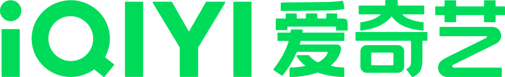 | 爱奇艺 | [wordmark-green.png](logos/iqiyi/wordmark-green.png) / wordmark | [Public domain &#40;textlogo&#41;](https://commons.wikimedia.org/w/index.php?title=File%3AIQIYI_logo_%282022%29.svg&oldid=1277926211) | 分发依据为 Wikimedia Commons 对该具体标识的简单图形/文字公共领域判定（PD-textlogo），不是品牌方的再分发授权。该判定不授予商标权，相关商标权保留；使用时不得暗示品牌方背书。保存 Commons 文件页正式提供的 PNG 渲染下载，原样保存，未自行修改图形、颜色、比例或透明背景。公司身份由 https://ir.iqiyi.com/ 核对；2022 年起的绿色中英文文字标识及 &#35;00DC5A 线上色已对照官方标志使用规范 https://www.iqiyi.com/common/biaozhiguifan.html 核对，Commons 文件来源亦注明该官方页面。 |
|  | 爱奇艺 | [wordmark-green.svg](logos/iqiyi/wordmark-green.svg) / wordmark | [Public domain &#40;textlogo&#41;](https://commons.wikimedia.org/w/index.php?title=File%3AIQIYI_logo_%282022%29.svg&oldid=1277926211) | 依据所引 Wikimedia Commons 对该具体文件的 PD-textlogo 公共领域判定收录；这是第三方对简单文字或几何图形的判断，不是品牌方授予的再分发许可，商标权及其他使用限制仍保留。保存该文件页提供的 SVG 原始字节，未清洗、改色、裁切或重绘；此 SVG 由路径等矢量图形组成，不是内嵌位图容器。 |
| 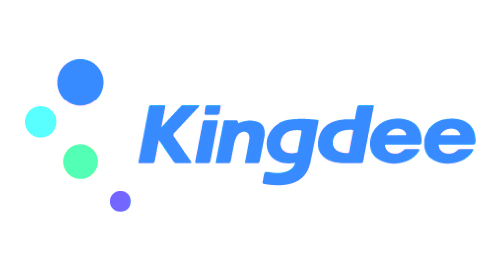 | 金蝶 | [logo-color-english.jpg](logos/kingdee/logo-color-english.jpg) / logo | [CC-BY-SA-4.0](https://commons.wikimedia.org/w/index.php?title=File:Kingdee_logo_wiki.jpg&oldid=1271741533) | 按 CC BY-SA 4.0 保留作者署名、文件来源与许可链接，注明未修改；若改编需按相同或兼容许可分享。此逐文件版权许可不转让商标权，也不代表公司背书。Commons 文件描述为 Kingdee Cloud ERP Logo；公司官网 https://www.kingdee.com/newlist/42875 明确这套四色圆点加 Kingdee 字形是2017年发布的集团品牌标识，而非单个软件产品标识。核对日 https://www.kingdee.com/global/ 仍使用同形公司标识 https://global.kingdee.com/wp-content/uploads/2025/07/logo-scaled.png ，其 alt 为 Kingdee International Software Group；公司身份见 https://www.kingdee.com/global/company-information/ 。许可依据为 Commons 上传者对该具体文件的 CC BY-SA 4.0 声明，未推断为全品牌开放授权。 文件特征复核：此 JPG 原生尺寸为2528×1371，采用 CMYK / Coated FOGRA39 &#40;ISO 12647-2:2004&#41; 色彩配置，无透明通道且有明显白底留白。它是按来源保留的原件，不是透明 PNG 或 sRGB 网页优化输出；适合网页的透明版本需另取可靠来源并核对分发条件。 |
| 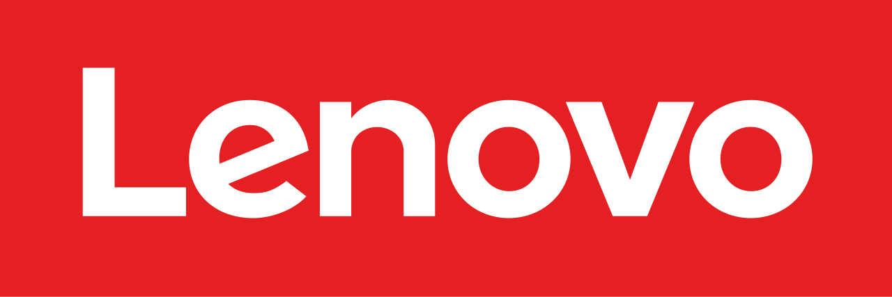 | 联想 | [logo-red-2015.png](logos/lenovo/logo-red-2015.png) / logo | [Public domain &#40;textlogo&#41;](https://commons.wikimedia.org/w/index.php?title=File%3ALenovo_%282015%29.svg&oldid=1251613811) | 依据 Wikimedia Commons 对该文件的 PD-textlogo（简单图形或文字未达到版权独创性门槛）公共领域判定收录；这是 Commons 的第三方判定，不是品牌方对本仓库的再分发授权。商标权仍归相关权利人，使用不得暗示官方背书。保存文件页正式提供的 1280px PNG（Commons 渲染）下载，未在本地转换、改色或裁切；原始 SVG：https://upload.wikimedia.org/wikipedia/commons/c/c9/Lenovo&#95;%282015%29.svg 。2015 年启用的横向红底白字式样；现行官网品牌指南 https://brandworld.lenovo.com/visual-identity/logo/ 仍将 signature red Lenovo logo 列为首选标识，并提供相同字形和红色矩形结构。 配色复核：本 Commons PNG 红底主色为 &#35;E42022；当前官方 https://brandworld.lenovo.com/visual-identity/color/ 的 Logo color / Signature Red 为 RGB&#40;225,37,27&#41;（&#35;E1251B）。字形及矩形结构相符不等于配色完全一致，本文件不标为当前官方标准红色原件，保留下载原色，后续另核对官方标准色文件及分发依据。 |
| 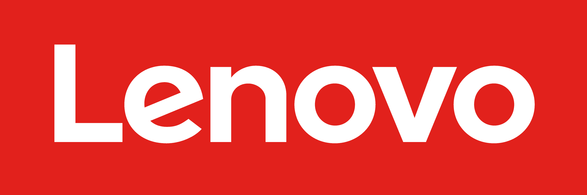 | 联想 | [logo-red-brandworld.png](logos/lenovo/logo-red-brandworld.png) / logo | [Public domain &#40;textlogo; third-party assessment&#41;](https://commons.wikimedia.org/w/index.php?title=File%3ALenovo_%282015%29.svg&oldid=1251613811) | 版权收录依据是 Commons 对相同简单 Lenovo 字样与纯色矩形标识的 PD-textlogo 第三方判断，不是联想对本图库的授权。经图形复核，本文件没有新增口号、插画或复杂组合；原色及像素/路径均保留。官方来源只证明文件及现行使用，不证明允许图库镜像或再分发。官方 https://www.lenovo.com/us/en/legal/copytrade/ 说明其他公司使用 Lenovo Logo 需取得书面许可或品牌授权；本条不授予商标使用权，也不构成对该限制的豁免，不得暗示官方背书。品牌资源禁止用于训练 AI 模型，见 https://brandworld.lenovo.com/visual-identity/logo/ 。 质量核验记录： - 2560×854 官方页面原始 PNG，完整红色矩形；文件本身没有透明背景。 - 原始不透明主色为 &#35;E2211C，未附 ICC，与当前指南 &#35;E1251B 有差异；没有在本地改色。 |
|  | 联想 | [logo-red-official.svg](logos/lenovo/logo-red-official.svg) / logo | [Public domain &#40;textlogo; third-party assessment&#41;](https://commons.wikimedia.org/w/index.php?title=File%3ALenovo_%282015%29.svg&oldid=1251613811) | 版权收录依据是 Commons 对相同简单 Lenovo 字样与纯色矩形标识的 PD-textlogo 第三方判断，不是联想对本图库的授权。经图形复核，本文件没有新增口号、插画或复杂组合；原色及像素/路径均保留。官方来源只证明文件及现行使用，不证明允许图库镜像或再分发。官方 https://www.lenovo.com/us/en/legal/copytrade/ 说明其他公司使用 Lenovo Logo 需取得书面许可或品牌授权；本条不授予商标使用权，也不构成对该限制的豁免，不得暗示官方背书。品牌资源禁止用于训练 AI 模型，见 https://brandworld.lenovo.com/visual-identity/logo/ 。 质量核验记录： - 原始路径使用 &#35;E1251B，与当前官方 Signature Red 一致。 - 官方官网页头原件为 123.999×40 视口，保留其约 3.1:1 原始比例；未调整为品牌指南的 3:1。 |
| 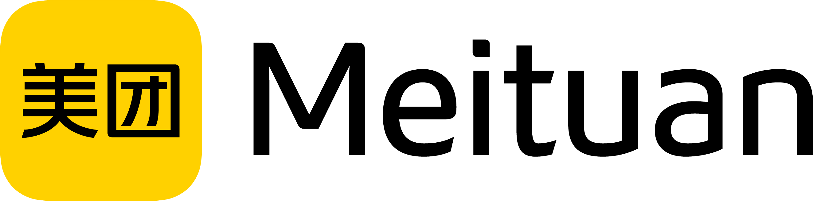 | 美团 | [logo-bilingual-commons.png](logos/meituan/logo-bilingual-commons.png) / logo | [Public domain &#40;textlogo&#41;](https://commons.wikimedia.org/w/index.php?title=File:Meituan_English_Logo.png&oldid=1252441203) | Commons 文件页许可区对该具体文件标注 PD-textlogo；结构化数据另列 CC BY-SA 4.0，故同时保留上传者、来源及该协议链接。此文件不是官方 SVG 或官方原件。2647 × 658 像素，透明外沿；图标内为中文字“美团”，外侧为英文 Meituan，因此语言记为 bilingual。当前官方英文关于页 https://www.meituan.com/en-US/about-us 页首仍使用这一构图与字形；Commons 版本的文字是黑色，官网当前页首是深色文字，原文件保持原色。商标权及其他使用限制仍然保留，不得暗示官方背书。 |
| 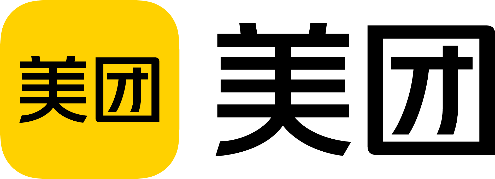 | 美团 | [logo-chinese-official.png](logos/meituan/logo-chinese-official.png) / logo | [Public domain &#40;textlogo&#41;](https://commons.wikimedia.org/wiki/File:Meituan_Logo.png) | 原始文件为官方媒体包“美团/美团横式色彩标识.png”，1896 × 687 像素、带透明通道；从官方 ZIP 逐字节提取，未放大、裁切、改色或重绘。已与原库 Commons 195 × 71 版本核对，为同一黄色圆角方形加黑色“美团”的中文组合设计。分发依据是 Commons 对该相同设计的 PD-textlogo 判定，不是新的官方再分发授权。官方媒体页限制图像“仅供个人或编辑使用”；此处没有将该声明当作开放素材库许可。商标权及其他使用限制仍然保留，不得暗示官方背书。 |
|  | 美团 | [logo-chinese.png](logos/meituan/logo-chinese.png) / logo | [Public domain &#40;textlogo&#41;](https://commons.wikimedia.org/w/index.php?title=File%3AMeituan_Logo.png&oldid=999835944) | 分发依据为 Wikimedia Commons 对该具体标识的简单图形/文字公共领域判定（PD-textlogo），不是品牌方的再分发授权。该判定不授予商标权，相关商标权保留；使用时不得暗示品牌方背书。 公司身份与黄色方形图形、黑色中文字样已对照 https://www.meituan.com/ 当前页首组合标识核对；Commons 文件来源注明美团官网。此 PNG 是 Commons 提供的原始文件，未裁切、改色或重绘。 文件特征复核：本 PNG 原生尺寸仅195×71，保留来源字节，不能视作高清或矢量版本；较大尺寸及 SVG 标识尚待另行核对来源。 |
|  | MiniMax | [logo-black-horizontal.png](logos/minimax/logo-black-horizontal.png) / logo | [Public domain &#40;textlogo&#41;](https://commons.wikimedia.org/w/index.php?title=File:MiniMax.png&oldid=1051737129) | 权利依据为所引 Commons 具体文件页对相同简单波形和 MINIMAX 字形作品的 PD-textlogo 公共领域判断；本文件为官方 ZIP 内原生 PNG，已与该 Commons 竖版作品核对图形及字形，版式、色彩和像素分辨率不同，不声称两个文件字节相同，也不将该判断泛化到其他 MiniMax 图形。该判断不是 MiniMax 的开放许可或再分发授权，不同法域原创性门槛可能不同。官方 https://www.minimax.io/brand-vi 的使用条款保留权利，要求遵守比例、颜色、间距和组合规范，禁止歪曲、拆分、重设计及转授权；其有限、非独占、不可转让的使用许可不等于 Logo 仓库再分发授权，未涵盖用途须另行申请批准。商标及其他使用限制仍然保留，不得暗示官方背书。 ZIP 成员：MiniMax&#95;Logo&#95;Asset/png/Horizontal/Black&#95;Black.png。 质量核验记录： - 3600 × 1320 像素，透明背景；官方 ZIP 原生 PNG，保留原画布与留白，未裁切、重绘、转换或放大。 - ZIP 内文件路径：MiniMax&#95;Logo&#95;Asset/png/Horizontal/Black&#95;Black.png |
| 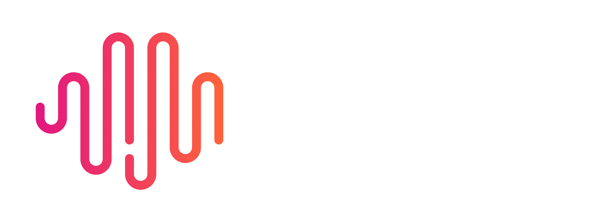 | MiniMax | [logo-gradient-horizontal-white.png](logos/minimax/logo-gradient-horizontal-white.png) / logo | [Public domain &#40;textlogo&#41;](https://commons.wikimedia.org/w/index.php?title=File:MiniMax.png&oldid=1051737129) | 权利依据为所引 Commons 具体文件页对相同简单波形和 MINIMAX 字形作品的 PD-textlogo 公共领域判断；本文件为官方 ZIP 内原生 PNG，已与该 Commons 竖版作品核对图形及字形，版式、色彩和像素分辨率不同，不声称两个文件字节相同，也不将该判断泛化到其他 MiniMax 图形。该判断不是 MiniMax 的开放许可或再分发授权，不同法域原创性门槛可能不同。官方 https://www.minimax.io/brand-vi 的使用条款保留权利，要求遵守比例、颜色、间距和组合规范，禁止歪曲、拆分、重设计及转授权；其有限、非独占、不可转让的使用许可不等于 Logo 仓库再分发授权，未涵盖用途须另行申请批准。商标及其他使用限制仍然保留，不得暗示官方背书。 ZIP 成员：MiniMax&#95;Logo&#95;Asset/png/Horizontal/BrandColor&#95;White.png。 质量核验记录： - 3600 × 1320 像素，透明背景；官方 ZIP 原生 PNG，保留原画布与留白，未裁切、重绘、转换或放大。 - ZIP 内文件路径：MiniMax&#95;Logo&#95;Asset/png/Horizontal/BrandColor&#95;White.png |
|  | MiniMax | [logo-gradient-horizontal.png](logos/minimax/logo-gradient-horizontal.png) / logo | [Public domain &#40;textlogo&#41;](https://commons.wikimedia.org/w/index.php?title=File:MiniMax.png&oldid=1051737129) | 权利依据为所引 Commons 具体文件页对相同简单波形和 MINIMAX 字形作品的 PD-textlogo 公共领域判断；本文件为官方 ZIP 内原生 PNG，已与该 Commons 竖版作品核对图形及字形，版式、色彩和像素分辨率不同，不声称两个文件字节相同，也不将该判断泛化到其他 MiniMax 图形。该判断不是 MiniMax 的开放许可或再分发授权，不同法域原创性门槛可能不同。官方 https://www.minimax.io/brand-vi 的使用条款保留权利，要求遵守比例、颜色、间距和组合规范，禁止歪曲、拆分、重设计及转授权；其有限、非独占、不可转让的使用许可不等于 Logo 仓库再分发授权，未涵盖用途须另行申请批准。商标及其他使用限制仍然保留，不得暗示官方背书。 ZIP 成员：MiniMax&#95;Logo&#95;Asset/png/Horizontal/BrandColor&#95;Black.png。 质量核验记录： - 3600 × 1320 像素，透明背景；官方 ZIP 原生 PNG，保留原画布与留白，未裁切、重绘、转换或放大。 - ZIP 内文件路径：MiniMax&#95;Logo&#95;Asset/png/Horizontal/BrandColor&#95;Black.png |
| 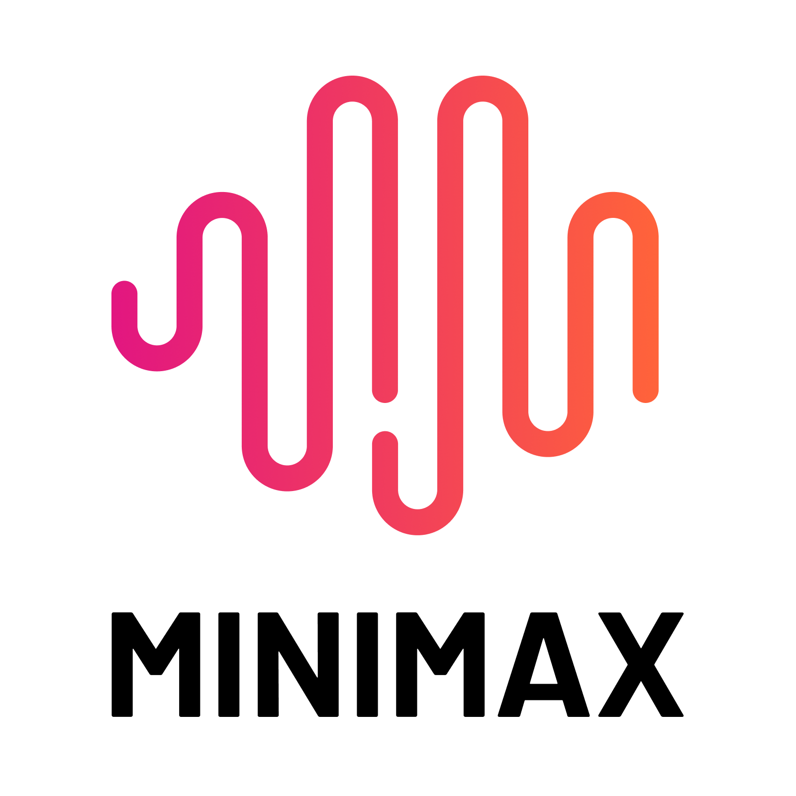 | MiniMax | [logo-gradient-vertical-official.png](logos/minimax/logo-gradient-vertical-official.png) / logo | [Public domain &#40;textlogo&#41;](https://commons.wikimedia.org/w/index.php?title=File:MiniMax.png&oldid=1051737129) | 权利依据为所引 Commons 具体文件页对相同简单波形和 MINIMAX 字形作品的 PD-textlogo 公共领域判断；本文件为官方 ZIP 内原生 PNG，已与该 Commons 竖版作品核对图形及字形，版式、色彩和像素分辨率不同，不声称两个文件字节相同，也不将该判断泛化到其他 MiniMax 图形。该判断不是 MiniMax 的开放许可或再分发授权，不同法域原创性门槛可能不同。官方 https://www.minimax.io/brand-vi 的使用条款保留权利，要求遵守比例、颜色、间距和组合规范，禁止歪曲、拆分、重设计及转授权；其有限、非独占、不可转让的使用许可不等于 Logo 仓库再分发授权，未涵盖用途须另行申请批准。商标及其他使用限制仍然保留，不得暗示官方背书。 ZIP 成员：MiniMax&#95;Logo&#95;Asset/png/Vertical/BrandColor&#95;Black.png。 质量核验记录： - 1600 × 1600 像素，透明背景；官方 ZIP 原生 PNG，保留原画布与留白，未裁切、重绘、转换或放大。 - ZIP 内文件路径：MiniMax&#95;Logo&#95;Asset/png/Vertical/BrandColor&#95;Black.png |
| 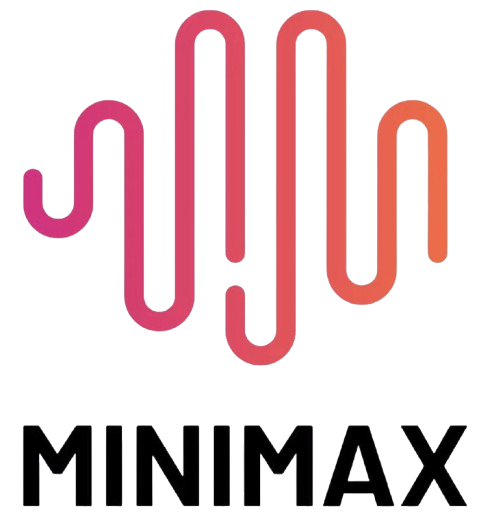 | MiniMax | [logo-gradient-vertical.png](logos/minimax/logo-gradient-vertical.png) / logo | [Public domain &#40;textlogo&#41;](https://commons.wikimedia.org/w/index.php?title=File:MiniMax.png&oldid=1051737129) | 该文件页使用 PD-textlogo，依据是 Wikimedia Commons 对简单文字或几何图形未达到版权原创性门槛的公共领域判定，不是品牌方授予 Logo 的开放版权许可或再分发授权；不同法域的原创性判断可能不同。商标权及其他使用限制仍然保留，不得暗示官方背书。公司归属由 https://www.minimax.io/about 核对。当前 https://www.minimax.io/brand-vi 的 Logo System/Our Logo 展示相同波形与 MINIMAX 字形；本文件是该公司标识的竖排布局，非海螺等产品图标。官方品牌指南另规定比例、颜色、间距与组合使用，不得歪曲、拆分、转授权或造成误导，未覆盖的使用情境应申请批准；本记录依据 Commons 对这一具体文件的公共领域判定，不将官方下载入口或其有限、不可转让的使用许可解释为再分发授权。 |
|  | OPPO | [wordmark-green-2019.png](logos/oppo/wordmark-green-2019.png) / wordmark | [Public domain &#40;textlogo&#41;](https://commons.wikimedia.org/w/index.php?title=File%3AOPPO_LOGO_2019.svg&oldid=1291432638) | 依据 Wikimedia Commons 对该文件的 PD-textlogo（简单图形或文字未达到版权独创性门槛）公共领域判定收录；这是 Commons 的第三方判定，不是品牌方对本仓库的再分发授权。商标权仍归相关权利人，使用不得暗示官方背书。保存文件页正式提供的 1280px PNG（Commons 渲染）下载，未在本地转换、改色或裁切；原始 SVG：https://upload.wikimedia.org/wikipedia/commons/0/0a/OPPO&#95;LOGO&#95;2019.svg 。公司身份见 https://privacy.oppo.com/cn/policy ，字形对照 https://www.oppo.com/en/about/ 。绿色字标仍见 OPPO 2025 年官方合规声明 https://www.oppo.com/content/dam/oppo/uk/static/certification/OPPO%20Enco%20Buds3%20Pro%28ETEK1%29&#95;SoC.pdf ，网站也使用单色变体；此处保留来源绿色，未改为黑色。 |
|  | OPPO | [wordmark-green-2019.svg](logos/oppo/wordmark-green-2019.svg) / wordmark | [Public domain &#40;textlogo&#41;](https://commons.wikimedia.org/w/index.php?title=File%3AOPPO_LOGO_2019.svg&oldid=1291432638) | 依据所引 Wikimedia Commons 对该具体文件的 PD-textlogo 公共领域判定收录；这是第三方对简单文字或几何图形的判断，不是品牌方授予的再分发许可，商标权及其他使用限制仍保留。保存该文件页提供的 SVG 原始字节，未清洗、改色、裁切或重绘；此 SVG 由路径等矢量图形组成，不是内嵌位图容器。 |
|  | 商汤科技 | [logo-color.png](logos/sensetime/logo-color.png) / logo | [CC-BY-SA-4.0](https://commons.wikimedia.org/w/index.php?title=File:SenseTime_logo.png&oldid=1255679577) | 按 CC BY-SA 4.0 保留作者署名、文件来源与许可链接，注明未修改；若改编需按相同或兼容许可分享。此逐文件版权许可不转让商标权，也不代表公司背书。公司归属由 https://www.sensetime.com/cn/about 核对；本 Commons PNG 与核对日官网 https://www.sensetime.com/assets/logo-frame10.png 字节级相同，属于当前商汤公司组合标识。许可依据为该 Commons 文件页的逐文件 CC BY-SA 4.0 标注，非官网一般版权声明或代码许可。 |
|  | 腾讯 | [wordmark-black-official.png](logos/tencent/wordmark-black-official.png) / wordmark | [Public domain &#40;textlogo; third-party assessment&#41;](https://commons.wikimedia.org/w/index.php?title=File%3ATencent_logo_2017.svg&oldid=1213564805) | 版权收录依据为 Wikimedia Commons 对相同 Tencent + 腾讯中英文简单字标作品的 PD-textlogo 第三方公共领域判定；已比对斜体英文字形、箭头状 t、中文字形及横向构图，不扩展至其他组合、口号、企鹅图形或产品标识。该 Commons 判定不是本 PNG 的下载来源，也不是腾讯对本图库的开放许可或再分发授权；不同法域的原创性门槛可能不同。官方媒体页 https://www.tencent.com/zh-cn/newsroom/media-resources/ 明确素材仅供媒体报道使用，未将此条款解释为图库镜像授权。官方 https://www.tencent.com/zh-cn/legal-statement/ 保留版权，并说明超越合理使用范畴且未经书面许可的使用可能被追责；其商标声明说明未经许可使用相关注册商标或混淆性近似商标可能侵权。本项不授予商标权或对这些限制的豁免，不得暗示官方背书。文件直接下载原样保存，未裁切、放大、改色、重画或转换格式。 质量核验记录： - 2953 × 889 像素官方透明 PNG 原件；实际字形包围框约 2764 × 370，保留较多上下透明留白，未裁切。 - 官方媒体页直接提供的黑色版本，非由其他图片在本地改色生成。 |
|  | 腾讯 | [wordmark-blue-official.png](logos/tencent/wordmark-blue-official.png) / wordmark | [Public domain &#40;textlogo; third-party assessment&#41;](https://commons.wikimedia.org/w/index.php?title=File%3ATencent_logo_2017.svg&oldid=1213564805) | 版权收录依据为 Wikimedia Commons 对相同 Tencent + 腾讯中英文简单字标作品的 PD-textlogo 第三方公共领域判定；已比对斜体英文字形、箭头状 t、中文字形及横向构图，不扩展至其他组合、口号、企鹅图形或产品标识。该 Commons 判定不是本 PNG 的下载来源，也不是腾讯对本图库的开放许可或再分发授权；不同法域的原创性门槛可能不同。官方媒体页 https://www.tencent.com/zh-cn/newsroom/media-resources/ 明确素材仅供媒体报道使用，未将此条款解释为图库镜像授权。官方 https://www.tencent.com/zh-cn/legal-statement/ 保留版权，并说明超越合理使用范畴且未经书面许可的使用可能被追责；其商标声明说明未经许可使用相关注册商标或混淆性近似商标可能侵权。本项不授予商标权或对这些限制的豁免，不得暗示官方背书。文件直接下载原样保存，未裁切、放大、改色、重画或转换格式。 质量核验记录： - 2953 × 889 像素官方透明 PNG 原件；实际字形包围框约 2763 × 370，保留较多上下透明留白，未裁切。 - 原始不透明主色为 &#35;0052D9；保留官方原色。 |
| 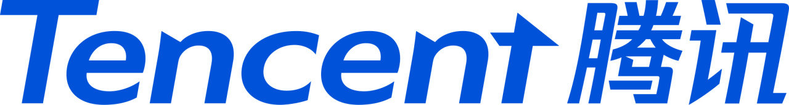 | 腾讯 | [wordmark-blue.png](logos/tencent/wordmark-blue.png) / wordmark | [Public domain &#40;textlogo&#41;](https://commons.wikimedia.org/w/index.php?title=File%3ATencent_logo_2017.svg&oldid=1213564805) | 分发依据为 Wikimedia Commons 对该具体标识的简单图形/文字公共领域判定（PD-textlogo），不是品牌方的再分发授权。该判定不授予商标权，相关商标权保留；使用时不得暗示品牌方背书。 保存 Commons 文件页正式提供的 PNG 渲染下载，原样保存，未自行修改图形、颜色、比例或透明背景。当前中英文蓝色文字样式与 https://www.tencent.com/zh-cn/newsroom/media-resources/ 的腾讯标识核对一致。腾讯官方媒体库注明其素材仅供媒体报道使用；本项未把该媒体库条款写成通用授权，而是采用 Commons 对此具体文件的 PD-textlogo 判定。 |
|  | 腾讯 | [wordmark-white-official.png](logos/tencent/wordmark-white-official.png) / wordmark | [Public domain &#40;textlogo; third-party assessment&#41;](https://commons.wikimedia.org/w/index.php?title=File%3ATencent_logo_2017.svg&oldid=1213564805) | 版权收录依据为 Wikimedia Commons 对相同 Tencent + 腾讯中英文简单字标作品的 PD-textlogo 第三方公共领域判定；已比对斜体英文字形、箭头状 t、中文字形及横向构图，不扩展至其他组合、口号、企鹅图形或产品标识。该 Commons 判定不是本 PNG 的下载来源，也不是腾讯对本图库的开放许可或再分发授权；不同法域的原创性门槛可能不同。官方媒体页 https://www.tencent.com/zh-cn/newsroom/media-resources/ 明确素材仅供媒体报道使用，未将此条款解释为图库镜像授权。官方 https://www.tencent.com/zh-cn/legal-statement/ 保留版权，并说明超越合理使用范畴且未经书面许可的使用可能被追责；其商标声明说明未经许可使用相关注册商标或混淆性近似商标可能侵权。本项不授予商标权或对这些限制的豁免，不得暗示官方背书。文件直接下载原样保存，未裁切、放大、改色、重画或转换格式。 质量核验记录： - 2953 × 889 像素官方透明 PNG 原件；实际字形包围框约 2764 × 371，保留较多上下透明留白，未裁切。 - 官方媒体页直接提供的白色版本，非由其他图片在本地改色生成。 |
|  | 携程集团 | [wordmark-color.png](logos/trip-com/wordmark-color.png) / wordmark | [Public domain &#40;textlogo&#41;](https://commons.wikimedia.org/w/index.php?title=File%3ATrip.com_Group_logo.svg&oldid=1245285677) | 分发依据为 Wikimedia Commons 对该具体标识的简单图形/文字公共领域判定（PD-textlogo），不是品牌方的再分发授权。该判定不授予商标权，相关商标权保留；使用时不得暗示品牌方背书。 保存 Commons 文件页正式提供的 PNG 渲染下载，原样保存，未自行修改图形、颜色、比例或透明背景。此项标识含 Group，为携程集团公司标识，非 Trip.com 预订产品标识。公司身份与集团字样已对照 https://group.trip.com/ 和 https://group.trip.com/about/story 核对；集团官网当前页首使用同字形的反白版本。 |
|  | 携程集团 | [wordmark-color.svg](logos/trip-com/wordmark-color.svg) / wordmark | [Public domain &#40;textlogo&#41;](https://commons.wikimedia.org/w/index.php?title=File%3ATrip.com_Group_logo.svg&oldid=1245285677) | 依据所引 Wikimedia Commons 对该具体文件的 PD-textlogo 公共领域判定收录；这是第三方对简单文字或几何图形的判断，不是品牌方授予的再分发许可，商标权及其他使用限制仍保留。保存该文件页提供的 SVG 原始字节，未清洗、改色、裁切或重绘；此 SVG 由路径等矢量图形组成，不是内嵌位图容器。 |
|  | vivo | [wordmark-blue-2019.png](logos/vivo/wordmark-blue-2019.png) / wordmark | [Public domain &#40;textlogo&#41;](https://commons.wikimedia.org/w/index.php?title=File%3AVivo_%28China%29_logo.svg&oldid=1276362702) | 依据 Wikimedia Commons 对该文件的 PD-textlogo（简单图形或文字未达到版权独创性门槛）公共领域判定收录；这是 Commons 的第三方判定，不是品牌方对本仓库的再分发授权。商标权仍归相关权利人，使用不得暗示官方背书。保存文件页正式提供的 1280px PNG（Commons 渲染）下载，未在本地转换、改色或裁切；原始 SVG：https://upload.wikimedia.org/wikipedia/commons/0/04/Vivo&#95;%28China%29&#95;logo.svg 。中国科技公司 vivo，非巴西同名电信运营商。公司身份和现用字形对照 https://www.vivo.com/en/about-vivo/culture ；法定中文名称见 https://mobile.vivo.com/ 。2019 年视觉识别及品牌色发布说明见 https://www.vivo.com/sg/about-vivo/news/Vivo-V15Pro-Unveils-Tech 。 |
|  | vivo | [wordmark-blue-2019.svg](logos/vivo/wordmark-blue-2019.svg) / wordmark | [Public domain &#40;textlogo&#41;](https://commons.wikimedia.org/w/index.php?title=File%3AVivo_%28China%29_logo.svg&oldid=1276362702) | 依据所引 Wikimedia Commons 对该具体文件的 PD-textlogo 公共领域判定收录；这是第三方对简单文字或几何图形的判断，不是品牌方授予的再分发许可，商标权及其他使用限制仍保留。保存该文件页提供的 SVG 原始字节，未清洗、改色、裁切或重绘；此 SVG 由路径等矢量图形组成，不是内嵌位图容器。 |
| 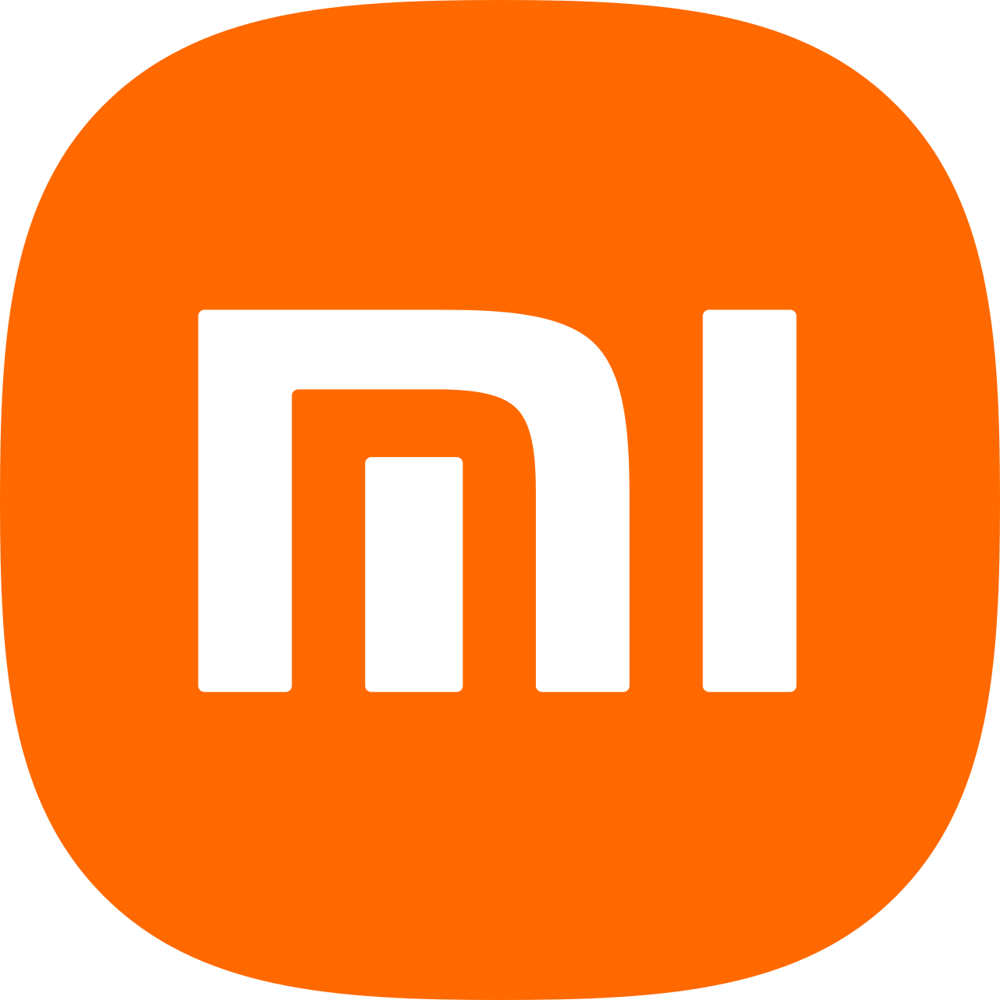 | 小米 | [icon-orange-2021.png](logos/xiaomi/icon-orange-2021.png) / icon | [Public domain &#40;textlogo&#41;](https://commons.wikimedia.org/w/index.php?title=File%3AXiaomi_logo_%282021-%29.svg&oldid=1257483450) | 依据 Wikimedia Commons 对该文件的 PD-textlogo（简单图形或文字未达到版权独创性门槛）公共领域判定收录；这是 Commons 的第三方判定，不是品牌方对本仓库的再分发授权。商标权仍归相关权利人，使用不得暗示官方背书。保存文件页正式提供的 1280px PNG（Commons 渲染）下载，未在本地转换、改色或裁切；原始 SVG：https://upload.wikimedia.org/wikipedia/commons/a/ae/Xiaomi&#95;logo&#95;%282021-%29.svg 。公司身份及现用标识对照 https://www.mi.com/global/about/ ；2021 年新标识见小米集团官方半年报 https://ir.mi.com/system/files-encrypted/nasdaq&#95;kms/assets/2021/12/22/4-01-53/2021092800380.pdf 。 |
|  | 小米 | [logo-horizontal-official.svg](logos/xiaomi/logo-horizontal-official.svg) / logo | [Public domain &#40;textlogo; third-party assessment&#41;](https://commons.wikimedia.org/wiki/File:Xiaomi_logo_horizontal_%282021-%29.svg) | 原文件来源为 Xiaomi 官方 CDN，原样保存，未清洗、改色或组合重绘。所引 Commons 文件页直接列出该官方原文件地址并对同一横版组合标识作 PD-textlogo 判断；依据是第三方公共领域判定，不是小米品牌方授予的再分发许可。商标权及其他使用限制仍保留，不得暗示官方背书。官方文件与 Commons 版本的图形元素逐项一致，仅根元素名义尺寸不同。 |
|  | 用友 | [wordmark-red-transparent.png](logos/yonyou/wordmark-red-transparent.png) / wordmark | [Public domain &#40;textlogo&#41;](https://commons.wikimedia.org/w/index.php?title=File:Yonyou_logo.jpg&oldid=1279365656) | 版权依据是 Commons 对同一简单英文 yonyou 字标作品的 PD-textlogo 判定；已逐一核对相同字形结构，不将该判定扩展至中文组合、云图形或产品标识。这不是品牌方的开放许可或官方再分发授权，官方站点仅证明文件来源与现行使用；不同法域的原创性判断可能不同。商标权及其他使用限制仍然保留，不得暗示官方背书。来源文件未裁切、改色、放大、重绘或清理 SVG。 质量核验记录： - 686 × 139 像素透明 PNG；保留官方文件字节。 |
| 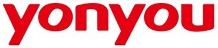 | 用友 | [wordmark-red.jpg](logos/yonyou/wordmark-red.jpg) / wordmark | [Public domain &#40;textlogo&#41;](https://commons.wikimedia.org/w/index.php?title=File:Yonyou_logo.jpg&oldid=1279365656) | 该文件页使用 PD-textlogo，依据是 Wikimedia Commons 对简单文字或几何图形未达到版权原创性门槛的公共领域判定，不是品牌方授予 Logo 的开放版权许可或再分发授权；不同法域的原创性判断可能不同。商标权及其他使用限制仍然保留，不得暗示官方背书。公司身份由 https://www.yonyou.com/about/company.html 及官网信息核对；当前全球官网 https://www.yonyou.com/global/ 使用 /global/static/logo.png 的同形红色 yonyou 英文字标。本文件仅收录公司英文版本，不是 YonBIP、YonSuite 等产品标识；中文官网另使用红色中文名与灰色英文名组合。 文件特征复核：此 JPG 原生尺寸为366×81，无透明通道，带白色背景；保留来源原件，不通过放大或改后缀充当高清透明图片。更高分辨率、透明及矢量版本尚待补齐。 |
|  | 用友 | [wordmark-white-transparent.png](logos/yonyou/wordmark-white-transparent.png) / wordmark | [Public domain &#40;textlogo&#41;](https://commons.wikimedia.org/w/index.php?title=File:Yonyou_logo.jpg&oldid=1279365656) | 版权依据是 Commons 对同一简单英文 yonyou 字标作品的 PD-textlogo 判定；已逐一核对相同字形结构，不将该判定扩展至中文组合、云图形或产品标识。这不是品牌方的开放许可或官方再分发授权，官方站点仅证明文件来源与现行使用；不同法域的原创性判断可能不同。商标权及其他使用限制仍然保留，不得暗示官方背书。来源文件未裁切、改色、放大、重绘或清理 SVG。 质量核验记录： - 1348 × 423 像素透明 PNG；原画布含透明留白，保留来源原件。 |
|  | 用友 | [wordmark-white.svg](logos/yonyou/wordmark-white.svg) / wordmark | [Public domain &#40;textlogo&#41;](https://commons.wikimedia.org/w/index.php?title=File:Yonyou_logo.jpg&oldid=1279365656) | 版权依据是 Commons 对同一简单英文 yonyou 字标作品的 PD-textlogo 判定；已逐一核对相同字形结构，不将该判定扩展至中文组合、云图形或产品标识。这不是品牌方的开放许可或官方再分发授权，官方站点仅证明文件来源与现行使用；不同法域的原创性判断可能不同。商标权及其他使用限制仍然保留，不得暗示官方背书。来源文件未裁切、改色、放大、重绘或清理 SVG。 质量核验记录： - 原生路径 SVG，viewBox 0 0 125 25；透明背景，适合深色底。 |
|  | 智谱 | [icon-monochrome-commons.png](logos/zhipu/icon-monochrome-commons.png) / icon | [Public domain &#40;textlogo&#41;](https://commons.wikimedia.org/w/index.php?title=File:Z.ai_%28company_logo%29.svg&oldid=1192313548) | 该文件页使用 PD-textlogo，依据是 Wikimedia Commons 对简单文字或几何图形未达到版权原创性门槛的公共领域判定，不是品牌方授予 Logo 的开放版权许可或再分发授权；不同法域的原创性判断可能不同。商标权及其他使用限制仍然保留，不得暗示官方背书。公司官网 https://www.zhipuai.cn/zh/about 明确“智谱（Z.AI）”。Commons 文件页注明此方形图标的来源是 https://chat.z.ai/ ；当前公司官网 /logo.svg 与 /logo-en.svg 是 Z 字形分别与“智谱”“Z.AI”组成的横版标识，与本文件构图不同。本记录准确标为 Z.ai 方形图标，不将其冒充公司官网提供的横版标识或官方原件，也不把 GLM、智谱清言等模型或产品作为公司别名。Commons 原 SVG 含本仓库静态子集未接受的 style 元素和属性，因此选用同一文件页正式提供的960px PNG渲染文件原样保存，未自行改图、清洗 SVG 或裁切；下载和许可来源均对应这一 Commons SVG 文件页。 |
|  | 智谱 | [logo-black-chinese.svg](logos/zhipu/logo-black-chinese.svg) / logo | [Public domain &#40;textlogo&#41;](https://commons.wikimedia.org/w/index.php?title=File:Z.ai_%28formerly_Zhipu_AI%29%282025_logo%29.jpg&oldid=1266754117) | 原件直接取自智谱公司官网，中文关于页当前使用同名 SVG。分发依据是 Wikimedia Commons 对同一“Z + 智谱”中文组合设计的 PD-textlogo 公共领域判定（所列 JPG 文件页），不是官网授予的开放许可，也不引用 chat.z.ai 方形图标的判定。已逐项比对 Z 图形、中文字形及横向比例；官网 SVG 是同一设计的官方黑色/白色版本，未自行裁切、改色、清洗或重绘。Commons 仅提供判定依据，不是本 SVG 的下载来源。不同法域对原创性门槛的判断可能不同；商标权保留，不得暗示官方背书。 |
|  | 智谱 | [logo-white-chinese.svg](logos/zhipu/logo-white-chinese.svg) / logo | [Public domain &#40;textlogo&#41;](https://commons.wikimedia.org/w/index.php?title=File:Z.ai_%28formerly_Zhipu_AI%29%282025_logo%29.jpg&oldid=1266754117) | 原件直接取自智谱公司官网，中文关于页当前使用同名 SVG。分发依据是 Wikimedia Commons 对同一“Z + 智谱”中文组合设计的 PD-textlogo 公共领域判定（所列 JPG 文件页），不是官网授予的开放许可，也不引用 chat.z.ai 方形图标的判定。已逐项比对 Z 图形、中文字形及横向比例；官网 SVG 是同一设计的官方黑色/白色版本，未自行裁切、改色、清洗或重绘。Commons 仅提供判定依据，不是本 SVG 的下载来源。不同法域对原创性门槛的判断可能不同；商标权保留，不得暗示官方背书。 |
|  | 中兴通讯 | [wordmark-blue-header-official.png](logos/zte/wordmark-blue-header-official.png) / wordmark | [Public domain &#40;textlogo; third-party assessment&#41;](https://commons.wikimedia.org/w/index.php?title=File%3AZTE-logo.svg&oldid=1281655836) | 版权收录依据是 Commons 对相同圆角 ZTE 三字母简单字标的 PD-textlogo / PD-shape 第三方判断，不是中兴通讯对本图库的许可。本文件仅含相同字标，没有加入中文、口号或其他图案；未将此依据外推到不同组合标识。官方图库的下载入口及官网展示只证明来源和现行使用，不等于图库再分发授权。官方 https://www.zte.com.cn/global/article/acknowledge.html 仅允许个人非商业目的拷贝、传播网站内容并保留版权声明，且声明商标、标识使用须经明确许可；本条不授予商标使用权或品牌授权，也不构成对这些限制的豁免，不得暗示官方背书。 质量核验记录： - 原始不透明色为 &#35;008ED3，与官方 VI 数字媒体标准蓝一致。 - 仅 92×44 原始像素，适合小尺寸展示；不是高清文件，未放大或重采样。 |
| 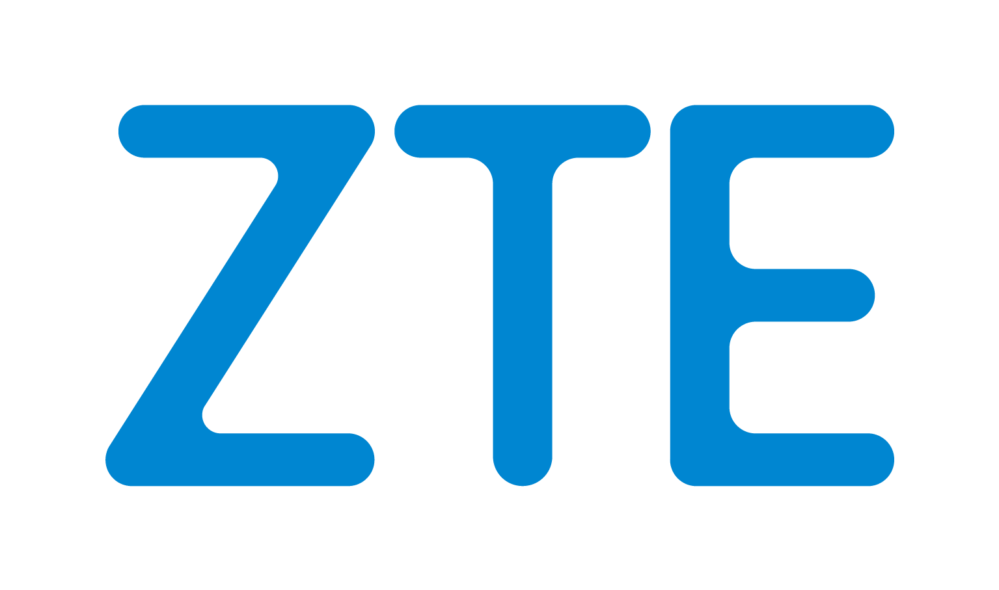 | 中兴通讯 | [wordmark-blue-official.png](logos/zte/wordmark-blue-official.png) / wordmark | [Public domain &#40;textlogo; third-party assessment&#41;](https://commons.wikimedia.org/w/index.php?title=File%3AZTE-logo.svg&oldid=1281655836) | 版权收录依据是 Commons 对相同圆角 ZTE 三字母简单字标的 PD-textlogo / PD-shape 第三方判断，不是中兴通讯对本图库的许可。本文件仅含相同字标，没有加入中文、口号或其他图案；未将此依据外推到不同组合标识。官方图库的下载入口及官网展示只证明来源和现行使用，不等于图库再分发授权。官方 https://www.zte.com.cn/global/article/acknowledge.html 仅允许个人非商业目的拷贝、传播网站内容并保留版权声明，且声明商标、标识使用须经明确许可；本条不授予商标使用权或品牌授权，也不构成对这些限制的豁免，不得暗示官方背书。 质量核验记录： - 官方英文素材包成员 zte&#95;logo&#95;en/ZTE LOGO.png；1535×907，含原始透明留白，未裁切。 - 包内 PNG 原色为 &#35;0086D1，未附 ICC，与官方 VI 数字色 &#35;008ED3 有差异；不是标准蓝色完全一致版，未改色。 - 素材包内文件日期为 2015 年，但截至 2026-11-07 仍由现行官方企业图库直接提供。 |
| 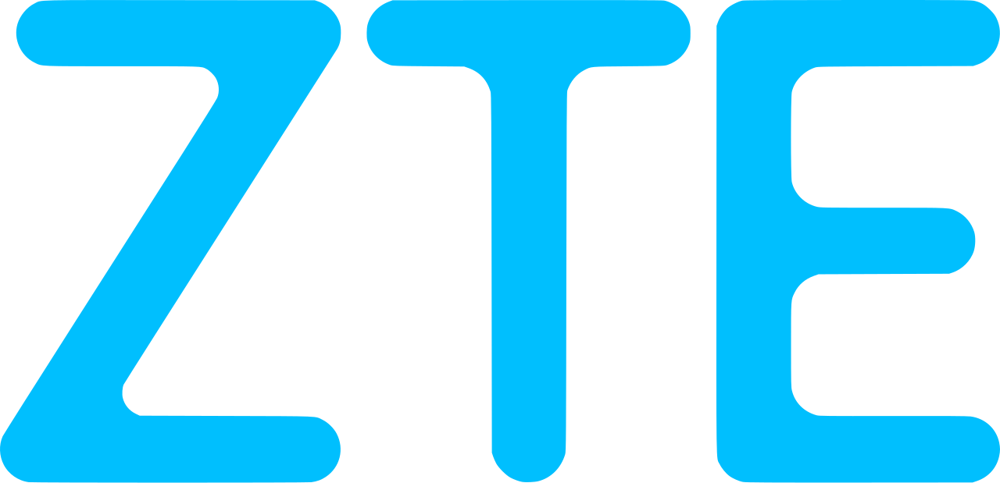 | 中兴通讯 | [wordmark-cyan-2015.png](logos/zte/wordmark-cyan-2015.png) / wordmark | [Public domain &#40;textlogo&#41;](https://commons.wikimedia.org/w/index.php?title=File%3AZTE-logo.svg&oldid=1281655836) | 依据 Wikimedia Commons 对该文件的 PD-textlogo（简单图形或文字未达到版权独创性门槛）公共领域判定收录；这是 Commons 的第三方判定，不是品牌方对本仓库的再分发授权。商标权仍归相关权利人，使用不得暗示官方背书。保存文件页正式提供的 1280px PNG（Commons 渲染）下载，未在本地转换、改色或裁切；原始 SVG：https://upload.wikimedia.org/wikipedia/commons/2/20/ZTE-logo.svg 。圆角 ZTE 字形与现行官网 https://www.zte.com.cn/global/ 页头一致；官方视觉识别手册说明浅蓝色及圆润字形，见 https://www.zte.com.cn/content/dam/zte-site/mediapics/file/ZTE&#95;VI%E8%A7%86%E8%A7%89%E8%AF%86%E5%88%AB%E6%8C%87%E5%AF%BC%E6%89%8B%E5%86%8C&#95;%E8%8B%B1%E6%96%87.pdf 。 配色复核：本文件原始 PNG 的不透明主色为 RGB&#40;0,191,254&#41;（&#35;00BFFE）；所引官方 VI 手册第 6 页规定数字媒体 ZTE Blue 为 RGB&#40;0,142,211&#41;（&#35;008ED3），当前官网页头 https://www.zte.com.cn/content/dam/zte-site/res-www-zte-com-cn/navigator/global/main/img/logo-en.png 也采用后者。因此本文件不是当前官网标准蓝色原件，保留 Commons 下载字节，不在本地改色。圆角字标由中兴于 2014 年 12 月 30 日发布，见官方 https://www.zte.com.cn/content/dam/zte-site/res-www-zte-com-cn/mediares/magazine/publication/tech&#95;en/pdf/201501.pdf 第 4 页；原文件名中的2015不作为准确首发日期。 质量核验记录： - 该标识造型于 2014 年发布；文件名保留原有 2015 标记。 |
| 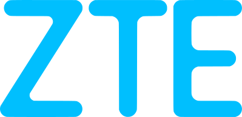 | 中兴通讯 | [wordmark-cyan-commons.svg](logos/zte/wordmark-cyan-commons.svg) / wordmark | [Public domain &#40;textlogo&#41;](https://commons.wikimedia.org/w/index.php?title=File%3AZTE-logo.svg&oldid=1281655836) | 依据所引 Commons 对 ZTE-logo.svg 这一具体文件的 PD-textlogo 公共领域判定收录，不是中兴品牌方授予的再分发许可。原样保存该 SVG 文件，未清洗、改色或裁切。此文件为路径矢量，配色属于 Commons 青色版本，与官方 VI 标准蓝 &#35;008ED3 不同；不将其标为标准蓝原件。商标权及其他使用限制仍保留。 |
|  | 中兴通讯 | [wordmark-white-official.png](logos/zte/wordmark-white-official.png) / wordmark | [Public domain &#40;textlogo; third-party assessment&#41;](https://commons.wikimedia.org/w/index.php?title=File%3AZTE-logo.svg&oldid=1281655836) | 版权收录依据是 Commons 对相同圆角 ZTE 三字母简单字标的 PD-textlogo / PD-shape 第三方判断，不是中兴通讯对本图库的许可。本文件仅含相同字标，没有加入中文、口号或其他图案；未将此依据外推到不同组合标识。官方图库的下载入口及官网展示只证明来源和现行使用，不等于图库再分发授权。官方 https://www.zte.com.cn/global/article/acknowledge.html 仅允许个人非商业目的拷贝、传播网站内容并保留版权声明，且声明商标、标识使用须经明确许可；本条不授予商标使用权或品牌授权，也不构成对这些限制的豁免，不得暗示官方背书。 质量核验记录： - 官方英文素材包成员 zte&#95;logo&#95;en/ZTE LOGO反白.png；1535×907，含原始透明留白，未裁切。 - 官方原生反白文件，适合深色背景；未由蓝色图片在本地生成。 |
<!-- logos:end -->

目录以公司标识为主，也保留明确区分身份的组织与开发者产品。部分文字标识依据 Wikimedia Commons 逐文件公共领域判定收录，部分文件遵循相应 Creative Commons 许可；来源提供的 PNG 渲染版会在元数据中注明。GitLab 条目是历史图标，采用非商业许可；Codeberg 是非营利组织品牌；Git 是版本控制产品。具体用途条件见表格及各条目元数据。

## 目录与索引

```text
logos/
  <id>/
    metadata.json
    <asset-file>
index.json
```

`metadata.json` 和原始资源文件是维护来源。数据契约为 [schema/metadata.schema.json](schema/metadata.schema.json)，当前采用严格的 `schemaVersion: 3`，包含双语品牌名称、带来源和主体角色的法人名称、别名、官网、默认素材、形态、语言、方向、配色、来源类型、版本状态和背景适用信息；没有版本号的旧元数据需先迁移。

`index.json` 由脚本生成，顶层也标明 `schemaVersion: 3`，包含资源路径、可读取的 PNG/JPEG 原生尺寸、来源、文件摘要和权利信息；不要手工修改。网页、索引和 README 资源表使用同一批原始记录。

[首批候选清单](content/source-candidates.json)用于跟踪中文用户常用的国内外互联网与 AI 公司。候选不是已收录、已审核或可下载素材，不进入网页目录和可下载数量。

## 贡献与检查

欢迎通过 Issue 提交收录建议、报告错误或提出权利请求；提交资源前请阅读 [贡献指南](CONTRIBUTING.md)。新资源需要说明所属公司、可靠来源，以及允许在本仓库分发的依据。

网站与维护脚本推荐使用 **Node.js 22.22.3**（见 `.node-version`）。在仓库根目录运行：

```sh
npm ci --ignore-scripts
npm run hooks:install
# 修改资源或元数据后，更新索引与资源表
npm run build:index
npm run check
```

`validate` 可单独检查资源与元数据，`build:index` 更新索引与上方资源表，`check` 执行完整的本地检查。直接下载使用 Logo 不需要运行这些脚本。校验器检查许可声明字段是否完整，不代替实际权利核实；SVG 检查采用保守的静态子集规则，不会修改或清洗文件。

`npm run lint`、`npm run format:check` 只检查；需要主动修复时使用 `npm run lint:fix`、`npm run format`。格式化限于配置允许的源码、脚本、测试、文档与配置文件，不处理 `logos/`、`index.json` 或 README 生成资源表；README 整体跳过自动格式化。提交格式和钩子行为见[贡献指南](CONTRIBUTING.md)。

## 展示网页

网站首页是可搜索、筛选的资源目录，卡片提供独立详情页入口、原图下载与图片地址复制。详情页区分公司、产品和组织，展示实际变体、当前/历史状态、来源与使用限制。预览背景只改变容器，不改写素材。复制失败时会保留并选中文本供手动复制。静态 HTML 已包含目录和默认素材，关闭 JavaScript 仍可浏览与下载。下载优先使用已收录文件；只有当前图稿缺少 PNG 时，下载菜单才提供由 SVG 等比生成的长边 1024px 透明 PNG。SVG 源码和浏览器支持的原始 PNG 图片复制集中在复制菜单中。

```sh
npm run build:site
npm run preview
```

`src/` 为网页源码，`_site/` 是完整静态构建结果。生产托管上传 `_site/` 即可；根域名构建使用默认配置，子路径部署须在构建时设置 `BASE_PATH`。GitHub Pages 工作流会读取 Pages 配置的 base path；本地开发命令不会部署。

## 许可

本仓库原创脚本和文档采用 [MIT License](LICENSE)。第三方 Logo 各自适用元数据记录的许可或品牌指南，详见 [NOTICE.md](NOTICE.md)。MIT 不授予第三方 Logo 的版权或商标使用权。
