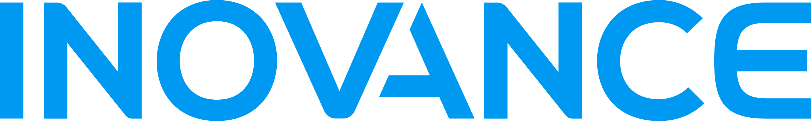
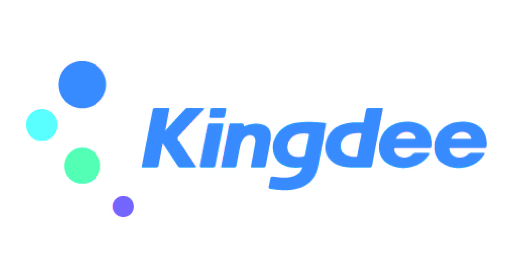
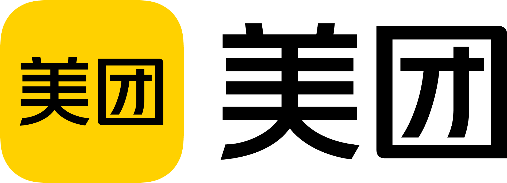
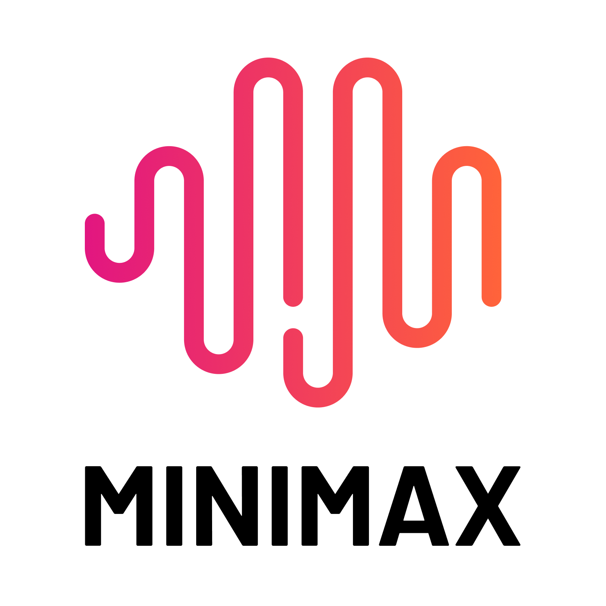
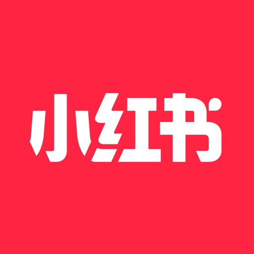
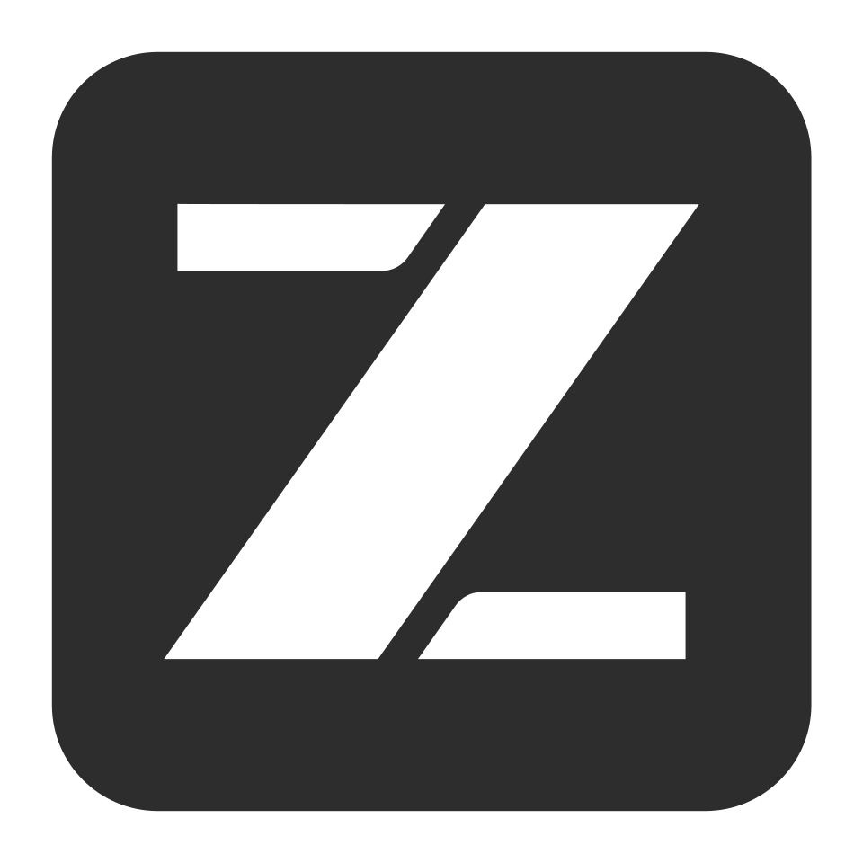

# Logo 资源清单

此文件由 `npm run build:index` 生成，请修改 `logos/<id>/metadata.json` 和原始素材后重新生成。

当前收录 31 个品牌、57 个文件。使用条件以逐文件记录及其来源为准，收录不代表品牌方授权或背书；详见 [第三方资源说明](../NOTICE.md)。

返回 [项目说明](../README.md) · [贡献指南](../CONTRIBUTING.md) · [完整 JSON 索引](../index.json)

| 预览 | 品牌 | 文件 / 类型 | 许可 | 说明 |
| --- | --- | --- | --- | --- |
|  | 阿里巴巴集团 | [wordmark-orange-chinese.svg](../logos/alibaba/wordmark-orange-chinese.svg) / wordmark | [Public domain &#40;textlogo&#41;](https://commons.wikimedia.org/wiki/File:Alibaba_zh_logo.svg) | 依据所引 Wikimedia Commons 对该具体文件的 PD-textlogo 公共领域判定收录；这是第三方对简单文字或几何图形的判断，不是品牌方授予的再分发许可，商标权及其他使用限制仍保留。保存该文件页提供的 SVG 原始字节，未清洗、改色、裁切或重绘；此 SVG 由路径等矢量图形组成，不是内嵌位图容器。 原始核对记录 纯中文“阿里巴巴”字标，未含阿里图形。 |
|  | 阿里巴巴集团 | [wordmark-orange.svg](../logos/alibaba/wordmark-orange.svg) / wordmark | [Public domain &#40;textlogo&#41;](https://commons.wikimedia.org/w/index.php?title=File%3AAlibaba_en_logo.svg&oldid=1115285514) | 依据所引 Wikimedia Commons 对该具体文件的 PD-textlogo 公共领域判定收录；这是第三方对简单文字或几何图形的判断，不是品牌方授予的再分发许可，商标权及其他使用限制仍保留。保存该文件页提供的 SVG 原始字节，未清洗、改色、裁切或重绘；此 SVG 由路径等矢量图形组成，不是内嵌位图容器。 原始核对记录 纯英文字标，未含阿里图形；不是完整的集团组合标识。 |
|  | 字节跳动 | [icon-white-official.svg](../logos/bytedance/icon-white-official.svg) / icon | [Public domain &#40;textlogo; third-party assessment&#41;](https://commons.wikimedia.org/w/index.php?title=File%3AByteDance_logo_English.svg&oldid=1117279263) | 文件是本次官网下载 HTML 中第 3 个 img data:image/svg+xml 的 Base64 原始字节（从 0 编号为 2）；仅解码内嵌传输，不修改路径、颜色、画布或比例。已对照官网中英组合标与既有 Commons 英文组合标，核对四根斜端柱的高低次序、朝向和相对位置，属于相同几何图形的官方白色版本。版权依据限于 Commons 对该简单四柱图形的第三方公共领域判断，不是字节跳动对图库的再分发授权；保留商标限制，不得暗示官方背书。与彩色英文组合标用途不同，供深色背景纯图形场景取用。 原始核对记录 100 × 88 viewBox，纯路径矢量，无内嵌位图。 官方白色图形，须在深色背景使用；没有从组合标中裁切。 |
|  | 字节跳动 | [logo-english.svg](../logos/bytedance/logo-english.svg) / logo | [Public domain &#40;textlogo&#41;](https://commons.wikimedia.org/w/index.php?title=File%3AByteDance_logo_English.svg&oldid=1117279263) | 依据所引 Wikimedia Commons 对该具体文件的 PD-textlogo 公共领域判定收录；这是第三方对简单文字或几何图形的判断，不是品牌方授予的再分发许可，商标权及其他使用限制仍保留。保存该文件页提供的 SVG 原始字节，未清洗、改色、裁切或重绘；此 SVG 由路径等矢量图形组成，不是内嵌位图容器。 |
|  | Codeberg e.V. | [icon-blue.svg](../logos/codeberg/icon-blue.svg) / icon | [CC0-1.0](https://codeberg.org/Codeberg/Design/raw/commit/ac514aa9aaa2457d4af3c3e13df3ab136d22a49a/README.md) | 官方原始蓝色 SVG，未修改；适合浅色背景，深色背景请选择官方白色版本。Codeberg e.V. 是非营利组织，此处收录其组织品牌。Design 仓库 README 与 LICENSE 明确采用 CC0；Codeberg 名称与 Logo 商标权保留。遵循官方品牌指南，不变形、不自行染色、不拆开重排组合标识。 |
|  | Codeberg e.V. | [icon-white.svg](../logos/codeberg/icon-white.svg) / icon | [CC0-1.0](https://codeberg.org/Codeberg/Design/raw/commit/ac514aa9aaa2457d4af3c3e13df3ab136d22a49a/README.md) | 官方原始白色 SVG，未修改；适合深色背景。Codeberg e.V. 是非营利组织，此处收录其组织品牌。Design 仓库 README 与 LICENSE 明确采用 CC0；Codeberg 名称与 Logo 商标权保留。遵循官方品牌指南，不变形、不自行染色、不拆开重排组合标识。 |
|  | Codeberg e.V. | [logo-vertical-blue.svg](../logos/codeberg/logo-vertical-blue.svg) / logo | [CC0-1.0](https://codeberg.org/Codeberg/Design/raw/commit/ac514aa9aaa2457d4af3c3e13df3ab136d22a49a/README.md) | 官方原始蓝色 SVG，未修改；适合浅色背景，深色背景请选择官方白色版本。Codeberg e.V. 是非营利组织，此处收录其组织品牌。Design 仓库 README 与 LICENSE 明确采用 CC0；Codeberg 名称与 Logo 商标权保留。遵循官方品牌指南，不变形、不自行染色、不拆开重排组合标识。 |
|  | Codeberg e.V. | [logo-vertical-white.svg](../logos/codeberg/logo-vertical-white.svg) / logo | [CC0-1.0](https://codeberg.org/Codeberg/Design/raw/commit/ac514aa9aaa2457d4af3c3e13df3ab136d22a49a/README.md) | 官方原始白色 SVG，未修改；适合深色背景。Codeberg e.V. 是非营利组织，此处收录其组织品牌。Design 仓库 README 与 LICENSE 明确采用 CC0；Codeberg 名称与 Logo 商标权保留。遵循官方品牌指南，不变形、不自行染色、不拆开重排组合标识。 |
|  | 滴滴 | [icon-gray-official.svg](../logos/didi/icon-gray-official.svg) / icon | [Public domain &#40;textlogo; third-party assessment&#41;](https://commons.wikimedia.org/w/index.php?title=File:DiDi_Logo.svg&oldid=1219426260) | 官网当前 main.9a074ac6.js 直接引用此页脚纯图形 SVG；文件原样保存。已对照同站 logo-en.cdc5b041.svg、logo-zh.5837eebe.svg 及既有 Commons 英文组合，核对 D 形开口、横向顶边与右侧高低断点；这是官方独立灰色图形，不是从组合标裁切或改色。分发依据为 Commons 对包含该相同几何 D 的 DiDi 组合标的第三方 PD-textlogo 判断，不是官方开放授权；不扩展到其他滴滴产品图标。商标及其他使用限制保留，不得暗示官方背书。 原始核对记录 41.15 × 41.15 viewBox，纯路径矢量，无内嵌位图。 原件为 &#35;ADADAD 灰色，保留原始底部留白；不是橙色品牌版本。 |
|  | 滴滴 | [logo-english.svg](../logos/didi/logo-english.svg) / logo | [Public domain &#40;textlogo&#41;](https://commons.wikimedia.org/w/index.php?title=File%3ADiDi_Logo.svg&oldid=1219426260) | 依据所引 Wikimedia Commons 对该具体文件的 PD-textlogo 公共领域判定收录；这是第三方对简单文字或几何图形的判断，不是品牌方授予的再分发许可，商标权及其他使用限制仍保留。保存该文件页提供的 SVG 原始字节，未清洗、改色、裁切或重绘；此 SVG 由路径等矢量图形组成，不是内嵌位图容器。 |
|  | Git | [icon-orange.svg](../logos/git/icon-orange.svg) / icon | [CC-BY-3.0](https://github.com/git/git-scm.com/blob/f8a81a6dffa8f80450f8688769f9a2a57de1f545/content/community/logos.html) | Git 是版本控制软件产品；此处收录其官方产品标识原件，未修改。官方 Logo 下载页明确采用 CC BY 3.0，可在保留署名和许可链接的条件下再分发。Git 名称和 Logo 的商标权由 Software Freedom Conservancy 代表 Git 项目持有；版权许可不替代商标政策，使用时须遵循 https://git-scm.com/about/trademark ，不得暗示官方背书，商品销售等用途须另行取得许可。 |
|  | Git | [logo-color.svg](../logos/git/logo-color.svg) / logo | [CC-BY-3.0](https://github.com/git/git-scm.com/blob/f8a81a6dffa8f80450f8688769f9a2a57de1f545/content/community/logos.html) | Git 是版本控制软件产品；此处收录其官方产品标识原件，未修改。官方 Logo 下载页明确采用 CC BY 3.0，可在保留署名和许可链接的条件下再分发。Git 名称和 Logo 的商标权由 Software Freedom Conservancy 代表 Git 项目持有；版权许可不替代商标政策，使用时须遵循 https://git-scm.com/about/trademark ，不得暗示官方背书，商品销售等用途须另行取得许可。 |
|  | Git | [logo-white.svg](../logos/git/logo-white.svg) / logo | [CC-BY-3.0](https://github.com/git/git-scm.com/blob/f8a81a6dffa8f80450f8688769f9a2a57de1f545/content/community/logos.html) | Git 是版本控制软件产品；此处收录其官方产品标识原件，未修改。官方 Logo 下载页明确采用 CC BY 3.0，可在保留署名和许可链接的条件下再分发。Git 名称和 Logo 的商标权由 Software Freedom Conservancy 代表 Git 项目持有；版权许可不替代商标政策，使用时须遵循 https://git-scm.com/about/trademark ，不得暗示官方背书，商品销售等用途须另行取得许可。 |
|  | GitLab | [icon-legacy.png](../logos/gitlab/icon-legacy.png) / icon | [CC-BY-NC-SA-4.0](https://gitlab.com/gitlab-com/gitlab-artwork/-/raw/9b07772f44a9fa51f395a95928a6e41c61a5b1cb/README.md) | 历史标识：来自 GitLab 官方 Artwork 仓库的旧版图标，未修改，不代表当前官网标识。仅限非商业用途，需署名并保留许可链接；改编须按相同方式共享。商标权不随素材许可授予。此许可仅对应本文件，不能推及当前新版 Logo。 当前商标使用要求另见 https://handbook.gitlab.com/handbook/marketing/brand-experience/trademark-guidelines/ ；旧版 Artwork 的版权许可不自动覆盖 press-kit 新版，当前新版须另行核对来源及分发依据。 |
|  | 荣耀 | [wordmark-black-2020.svg](../logos/honor/wordmark-black-2020.svg) / wordmark | [Public domain &#40;textlogo&#41;](https://commons.wikimedia.org/w/index.php?title=File%3AHonor_Logo_%282020%29.svg&oldid=1107928605) | 依据 Wikimedia Commons 对该文件的 PD-textlogo（简单图形或文字未达到版权独创性门槛）公共领域判定收录；这是 Commons 的第三方判定，不是品牌方对本仓库的再分发授权。商标权仍归相关权利人，使用不得暗示官方背书。保存 Commons 提供的原始 SVG，未修改。公司身份和现用黑色字形对照 https://www.honor.com/global/brand/ 及其页头官方文件 https://www-file.honor.com/content/dam/honor/common/logo/honor-logo-black.svg 。现用公司名称见 https://www.honor.com/cn/news/honor-name-change/ ；荣耀已为独立公司，此记录不设华为 parentId。 官方品牌标识指导页 https://www.honor.com/cn/brand-guideline/basics/logo/ 提供 PNG/AI Toolkit，并注明标志须经合同或协议授权后使用；商标说明见 https://www.honor.com/cn/company-trademark-policy/ 。这些入口用于核对品牌规范，不作为本仓库镜像分发的授权依据，本文件仍仅按所引 Commons 特定文件的公共领域判定记录。 |
|  | 华为 | [wordmark-dark-2018.png](../logos/huawei/wordmark-dark-2018.png) / wordmark | [Public domain &#40;textlogo&#41;](https://commons.wikimedia.org/w/index.php?title=File%3AHuawei_wordmark_2019.svg&oldid=1123513783) | 依据 Wikimedia Commons 对该文件的 PD-textlogo（简单图形或文字未达到版权独创性门槛）公共领域判定收录；这是 Commons 的第三方判定，不是品牌方对本仓库的再分发授权。商标权仍归相关权利人，使用不得暗示官方背书。保存文件页正式提供的 1280px PNG（Commons 渲染）下载，未在本地转换、改色或裁切；原始 SVG：https://upload.wikimedia.org/wikipedia/commons/d/db/Huawei&#95;wordmark&#95;2019.svg 。仅收录 HUAWEI 文字标识，不含花瓣图案；Commons 文件说明及分类标记其为 2018 年起使用的文字式样。公司身份和现用字形对照 https://www.huawei.com/en/corporate-information ，官网页头仍使用该字形。 原始核对记录 仅含 HUAWEI 字标，未含花瓣图形。 2026-11-09 SVG 优先复核 同页原始 SVG 含 DOCTYPE，按仓库静态 SVG 验收规则采用来源提供的 PNG 渲染文件。 |
|  | 科大讯飞 | [logo-black-bilingual.png](../logos/iflytek/logo-black-bilingual.png) / logo | [Public domain &#40;textlogo&#41;](https://commons.wikimedia.org/w/index.php?title=File:IFlytek_logo.png&oldid=1015993493) | 权利依据为所引 Commons 具体文件页对科大讯飞 X 图形、中文名和 iFLYTEK 英文名组合作品的 PD-textlogo 公共领域判断；本原件与该作品核对了三个部分的图形及字形，属于同一组合标识的单色版，分辨率和边缘像素不同，不声称文件字节相同，也不将该判断推广到其他版式或产品标识。该判断不是科大讯飞授予的开放版权许可或再分发授权，不同法域原创性门槛可能不同。官方及商标权利保留，不得暗示官方背书或违反适用的品牌使用限制。 源文件为官网当前中文首页 index JavaScript，webpack module 146 内含原生 PNG data URI；仅作 Base64 解码取得原始 PNG 字节，未重新编码图像，不是渲染、重绘或从网页截图生成。首页滚动后的头部使用此黑色标识。 质量核验记录： - 272 × 83 像素，透明背景；适合小尺寸浅色背景使用，放大显示会降低清晰度。 - 官方首页脚本 module 146 内嵌原生 PNG，仅作 Base64 解码，未裁切、重绘、转换或放大。 原始核对记录 272 × 83 像素，透明背景；适合浅色背景，放大易模糊。 |
|  | 科大讯飞 | [logo-blue-bilingual.png](../logos/iflytek/logo-blue-bilingual.png) / logo | [Public domain &#40;textlogo&#41;](https://commons.wikimedia.org/w/index.php?title=File:IFlytek_logo.png&oldid=1015993493) | 该文件页使用 PD-textlogo，依据是 Wikimedia Commons 对简单文字或几何图形未达到版权原创性门槛的公共领域判定，不是品牌方授予 Logo 的开放版权许可或再分发授权；不同法域的原创性判断可能不同。商标权及其他使用限制仍然保留，不得暗示官方背书。公司身份见 https://www.iflytek.com/en/about-us/about.html ，中文官网为 https://www.iflytek.com/cn/ 。本文件为科大讯飞公司 X 图形、中文名及 iFLYTEK 英文名的组合标识；已与现用英文官网 /en/Public/Uploads/uploadfile/images/20230812/comlogo1.svg 的图形与英文字形核对，不是星火等产品标识。 原始核对记录 550 × 166 像素，放大使用会降低清晰度。 |
|  | 科大讯飞 | [logo-english-official.svg](../logos/iflytek/logo-english-official.svg) / logo | [Public domain &#40;textlogo; third-party assessment&#41;](https://commons.wikimedia.org/wiki/File:IFlytek_logo.png) | 本文件为当前英文官网桌面和手机页头直接引用的 SVG，纯路径，无内嵌位图。已与已有 Commons 公司中英组合标逐图核对 X 形弧线、三条斜线以及 iFLYTEK 字形，并对照本次官网下载的纯图 favicon；不包含星火等产品图标。分发依据是 Commons 对相同 X 图形及 iFLYTEK 文字标识的第三方 PD-textlogo 判断，不是科大讯飞对本库授予的再分发许可；仅以此判断收录相同作品的官方英文排列原件，保留商标及其他使用限制，不得暗示官方背书。与中英文 PNG 语言、布局及配色不同，英文矢量版本适合英文页面和大幅输出。 原始核对记录 168 × 33 viewBox，原生路径矢量，无内嵌位图。 保留官网原始深蓝绿色；未将已有 PNG 放大、描摹或改色。 |
|  | 科大讯飞 | [logo-white-bilingual.png](../logos/iflytek/logo-white-bilingual.png) / logo | [Public domain &#40;textlogo&#41;](https://commons.wikimedia.org/w/index.php?title=File:IFlytek_logo.png&oldid=1015993493) | 权利依据为所引 Commons 具体文件页对科大讯飞 X 图形、中文名和 iFLYTEK 英文名组合作品的 PD-textlogo 公共领域判断；本原件与该作品核对了三个部分的图形及字形，属于同一组合标识的单色版，分辨率和边缘像素不同，不声称文件字节相同，也不将该判断推广到其他版式或产品标识。该判断不是科大讯飞授予的开放版权许可或再分发授权，不同法域原创性门槛可能不同。官方及商标权利保留，不得暗示官方背书或违反适用的品牌使用限制。 官网中文首页头部未滚动状态使用此白色标识。 质量核验记录： - 302 × 92 像素，透明背景；适合小尺寸深色背景使用，放大显示会降低清晰度。 - 官方原生 PNG，保留源文件字节，未裁切、重绘、转换或放大。 原始核对记录 302 × 92 像素，透明背景；适合深色背景，放大易模糊。 |
|  | 汇川技术 | [wordmark-blue-official.png](../logos/inovance/wordmark-blue-official.png) / wordmark | [Public domain &#40;textlogo; third-party assessment&#41;](https://commons.wikimedia.org/w/index.php?title=File:Shenzhen_Inovance_Technology.svg&oldid=1117280283) | 原件由当前官方全球网站页头图片地址去除服务器端图像质量/格式处理参数后，取得同路径提供的原始 PNG；下载原字节未裁切、放大、改色或转换。版权收录依据为 Commons 对 INOVANCE 简单文字图形作品的 PD-textlogo 第三方判断，不是汇川对本库的再分发授权；已在一致预览条件核对 I/N/O/V/A/N/C/E 字形、A 的断开三角与整体比例。Commons 文件的蓝色与官方当前图像不同，因此不把 Commons SVG 作为另一配色入库，也不宣称字节相同。该判断不推广到汇川其他图形、中文字体或产品标识。不同法域的原创性门槛可能不同，商标权及其他使用限制仍保留，不得暗示官方背书。 原始核对记录 2858 × 431 像素，透明背景，紧凑横版画布；边缘清晰，适合浅色背景。 |
|  | 爱奇艺 | [wordmark-green.svg](../logos/iqiyi/wordmark-green.svg) / wordmark | [Public domain &#40;textlogo&#41;](https://commons.wikimedia.org/w/index.php?title=File%3AIQIYI_logo_%282022%29.svg&oldid=1277926211) | 依据所引 Wikimedia Commons 对该具体文件的 PD-textlogo 公共领域判定收录；这是第三方对简单文字或几何图形的判断，不是品牌方授予的再分发许可，商标权及其他使用限制仍保留。保存该文件页提供的 SVG 原始字节，未清洗、改色、裁切或重绘；此 SVG 由路径等矢量图形组成，不是内嵌位图容器。 |
|  | 金蝶 | [logo-color-english.jpg](../logos/kingdee/logo-color-english.jpg) / logo | [CC-BY-SA-4.0](https://commons.wikimedia.org/w/index.php?title=File:Kingdee_logo_wiki.jpg&oldid=1271741533) | 按 CC BY-SA 4.0 保留作者署名、文件来源与许可链接，注明未修改；若改编需按相同或兼容许可分享。此逐文件版权许可不转让商标权，也不代表公司背书。Commons 文件描述为 Kingdee Cloud ERP Logo；公司官网 https://www.kingdee.com/newlist/42875 明确这套四色圆点加 Kingdee 字形是2017年发布的集团品牌标识，而非单个软件产品标识。核对日 https://www.kingdee.com/global/ 仍使用同形公司标识 https://global.kingdee.com/wp-content/uploads/2025/07/logo-scaled.png ，其 alt 为 Kingdee International Software Group；公司身份见 https://www.kingdee.com/global/company-information/ 。许可依据为 Commons 上传者对该具体文件的 CC BY-SA 4.0 声明，未推断为全品牌开放授权。 文件特征复核：此 JPG 原生尺寸为2528×1371，采用 CMYK / Coated FOGRA39 &#40;ISO 12647-2:2004&#41; 色彩配置，无透明通道且有明显白底留白。它是按来源保留的原件，不是透明 PNG 或 sRGB 网页优化输出；适合网页的透明版本需另取可靠来源并核对分发条件。 原始核对记录 CMYK JPEG，白色不透明背景；显示效果受色彩管理影响。 原画布含较多留白。 |
|  | 快手 | [icon-orange-official.png](../logos/kuaishou/icon-orange-official.png) / icon | [Public domain &#40;textlogo; third-party assessment&#41;](https://commons.wikimedia.org/w/index.php?title=File:Kuaishou_logo.png&oldid=686719154) | 已逐图对照 Commons 英文组合原件与快手官方“纯图形无文字”：摄影机双圆、圆角矩形机身、左侧三角镜头的造型、比例与橙色一致。本文件直接来自官方素材页而非由 Commons 组合裁切。版权依据为 Commons 对相同简单摄影机图形的第三方 PD-textlogo 判断，不是快手对图库的再分发授权。官方素材页许可限定宣传推广快手产品、要求署名及保持完整性；未把该条款解释为独立图库镜像授权。该第三方版权判断不授予商标权，使用时仍须遵守商标及其他限制，不得暗示官方背书。 原始核对记录 1024 × 1024 像素，透明背景；有效图形范围约 680 × 781 像素。 直接保存官方原始文件，未裁切、放大、改色或重绘。 |
|  | 快手 | [logo-english-official.jpg](../logos/kuaishou/logo-english-official.jpg) / logo | [Public domain &#40;textlogo; third-party assessment&#41;](https://commons.wikimedia.org/w/index.php?title=File:Kuaishou_logo.png&oldid=686719154) | 直接下载快手官方素材页e-logo-1-min.jpeg原样保存；实际查看原件，并在相同横版条件下对照Commons File:Kuaishou&#95;logo.png的摄影机双圆、圆角机身、三角镜头、KUAISHOU字形、间距、橙/灰构图，核对同款。Commons正文对具体作品的PD-textlogo评估为第三方版权分发依据，不是快手对图库的再分发授权；官方素材页宣传推广用途、署名、完整性要求不解释为图库镜像许可。商标权及其他限制保留，不得暗示背书；不同法域原创性门槛可能不同。本轮优先保存官方原件，来源回溯brandlogos.net的Commons透明PNG仅留作核对证据，不将其称作官方原件或增添同用途公开文件。 原始核对记录 13725 × 9097 像素官方原始 JPEG，白底，保留大量原始留白；有效图稿约 8559 × 1596 像素。 保留来源原始字节，未裁切、改色、放大或重新压缩。JPEG有压缩，透明独立图形另由官方PNG提供。 |
|  | 联想 | [logo-red-official.svg](../logos/lenovo/logo-red-official.svg) / logo | [Public domain &#40;textlogo; third-party assessment&#41;](https://commons.wikimedia.org/w/index.php?title=File%3ALenovo_%282015%29.svg&oldid=1251613811) | 版权收录依据是 Commons 对相同简单 Lenovo 字样与纯色矩形标识的 PD-textlogo 第三方判断，不是联想对本图库的授权。经图形复核，本文件没有新增口号、插画或复杂组合；原色及像素/路径均保留。官方来源只证明文件及现行使用，不证明允许图库镜像或再分发。官方 https://www.lenovo.com/us/en/legal/copytrade/ 说明其他公司使用 Lenovo Logo 需取得书面许可或品牌授权；本条不授予商标使用权，也不构成对该限制的豁免，不得暗示官方背书。品牌资源禁止用于训练 AI 模型，见 https://brandworld.lenovo.com/visual-identity/logo/ 。 质量核验记录： - 原始路径使用 &#35;E1251B，与当前官方 Signature Red 一致。 - 官方官网页头原件为 123.999×40 视口，保留其约 3.1:1 原始比例；未调整为品牌指南的 3:1。 原始核对记录 标准红 &#35;E1251B。 长宽比约 3.1:1，与品牌指南的 3:1 不同。 |
|  | 美团 | [logo-bilingual-commons.png](../logos/meituan/logo-bilingual-commons.png) / logo | [Public domain &#40;textlogo&#41;](https://commons.wikimedia.org/w/index.php?title=File:Meituan_English_Logo.png&oldid=1252441203) | Commons 文件页许可区对该具体文件标注 PD-textlogo；结构化数据另列 CC BY-SA 4.0，故同时保留上传者、来源及该协议链接。此文件不是官方 SVG 或官方原件。2647 × 658 像素，透明外沿；图标内为中文字“美团”，外侧为英文 Meituan，因此语言记为 bilingual。当前官方英文关于页 https://www.meituan.com/en-US/about-us 页首仍使用这一构图与字形；Commons 版本的文字是黑色，官网当前页首是深色文字，原文件保持原色。商标权及其他使用限制仍然保留，不得暗示官方背书。 |
|  | 美团 | [logo-chinese-official.png](../logos/meituan/logo-chinese-official.png) / logo | [Public domain &#40;textlogo&#41;](https://commons.wikimedia.org/wiki/File:Meituan_Logo.png) | 原始文件为官方媒体包“美团/美团横式色彩标识.png”，1896 × 687 像素、带透明通道；从官方 ZIP 逐字节提取，未放大、裁切、改色或重绘。已与原库 Commons 195 × 71 版本核对，为同一黄色圆角方形加黑色“美团”的中文组合设计。分发依据是 Commons 对该相同设计的 PD-textlogo 判定，不是新的官方再分发授权。官方媒体页限制图像“仅供个人或编辑使用”；此处没有将该声明当作开放素材库许可。商标权及其他使用限制仍然保留，不得暗示官方背书。 原始核对记录 1896 × 687 像素，透明背景，来自官方媒体素材包。 主黄为 &#35;FFD100。 |
|  | MiniMax | [logo-black-horizontal.png](../logos/minimax/logo-black-horizontal.png) / logo | [Public domain &#40;textlogo&#41;](https://commons.wikimedia.org/w/index.php?title=File:MiniMax.png&oldid=1051737129) | 权利依据为所引 Commons 具体文件页对相同简单波形和 MINIMAX 字形作品的 PD-textlogo 公共领域判断；本文件为官方 ZIP 内原生 PNG，已与该 Commons 竖版作品核对图形及字形，版式、色彩和像素分辨率不同，不声称两个文件字节相同，也不将该判断泛化到其他 MiniMax 图形。该判断不是 MiniMax 的开放许可或再分发授权，不同法域原创性门槛可能不同。官方 https://www.minimax.io/brand-vi 的使用条款保留权利，要求遵守比例、颜色、间距和组合规范，禁止歪曲、拆分、重设计及转授权；其有限、非独占、不可转让的使用许可不等于 Logo 仓库再分发授权，未涵盖用途须另行申请批准。商标及其他使用限制仍然保留，不得暗示官方背书。 ZIP 成员：MiniMax&#95;Logo&#95;Asset/png/Horizontal/Black&#95;Black.png。 质量核验记录： - 3600 × 1320 像素，透明背景；官方 ZIP 原生 PNG，保留原画布与留白，未裁切、重绘、转换或放大。 - ZIP 内文件路径：MiniMax&#95;Logo&#95;Asset/png/Horizontal/Black&#95;Black.png 原始核对记录 3600 × 1320 像素，透明背景，画布含留白。 |
|  | MiniMax | [logo-gradient-horizontal-white.png](../logos/minimax/logo-gradient-horizontal-white.png) / logo | [Public domain &#40;textlogo&#41;](https://commons.wikimedia.org/w/index.php?title=File:MiniMax.png&oldid=1051737129) | 权利依据为所引 Commons 具体文件页对相同简单波形和 MINIMAX 字形作品的 PD-textlogo 公共领域判断；本文件为官方 ZIP 内原生 PNG，已与该 Commons 竖版作品核对图形及字形，版式、色彩和像素分辨率不同，不声称两个文件字节相同，也不将该判断泛化到其他 MiniMax 图形。该判断不是 MiniMax 的开放许可或再分发授权，不同法域原创性门槛可能不同。官方 https://www.minimax.io/brand-vi 的使用条款保留权利，要求遵守比例、颜色、间距和组合规范，禁止歪曲、拆分、重设计及转授权；其有限、非独占、不可转让的使用许可不等于 Logo 仓库再分发授权，未涵盖用途须另行申请批准。商标及其他使用限制仍然保留，不得暗示官方背书。 ZIP 成员：MiniMax&#95;Logo&#95;Asset/png/Horizontal/BrandColor&#95;White.png。 质量核验记录： - 3600 × 1320 像素，透明背景；官方 ZIP 原生 PNG，保留原画布与留白，未裁切、重绘、转换或放大。 - ZIP 内文件路径：MiniMax&#95;Logo&#95;Asset/png/Horizontal/BrandColor&#95;White.png 原始核对记录 3600 × 1320 像素，透明背景，画布含留白。 |
|  | MiniMax | [logo-gradient-horizontal.png](../logos/minimax/logo-gradient-horizontal.png) / logo | [Public domain &#40;textlogo&#41;](https://commons.wikimedia.org/w/index.php?title=File:MiniMax.png&oldid=1051737129) | 权利依据为所引 Commons 具体文件页对相同简单波形和 MINIMAX 字形作品的 PD-textlogo 公共领域判断；本文件为官方 ZIP 内原生 PNG，已与该 Commons 竖版作品核对图形及字形，版式、色彩和像素分辨率不同，不声称两个文件字节相同，也不将该判断泛化到其他 MiniMax 图形。该判断不是 MiniMax 的开放许可或再分发授权，不同法域原创性门槛可能不同。官方 https://www.minimax.io/brand-vi 的使用条款保留权利，要求遵守比例、颜色、间距和组合规范，禁止歪曲、拆分、重设计及转授权；其有限、非独占、不可转让的使用许可不等于 Logo 仓库再分发授权，未涵盖用途须另行申请批准。商标及其他使用限制仍然保留，不得暗示官方背书。 ZIP 成员：MiniMax&#95;Logo&#95;Asset/png/Horizontal/BrandColor&#95;Black.png。 质量核验记录： - 3600 × 1320 像素，透明背景；官方 ZIP 原生 PNG，保留原画布与留白，未裁切、重绘、转换或放大。 - ZIP 内文件路径：MiniMax&#95;Logo&#95;Asset/png/Horizontal/BrandColor&#95;Black.png 原始核对记录 3600 × 1320 像素，透明背景，画布含留白。 |
|  | MiniMax | [logo-gradient-vertical-official.png](../logos/minimax/logo-gradient-vertical-official.png) / logo | [Public domain &#40;textlogo&#41;](https://commons.wikimedia.org/w/index.php?title=File:MiniMax.png&oldid=1051737129) | 权利依据为所引 Commons 具体文件页对相同简单波形和 MINIMAX 字形作品的 PD-textlogo 公共领域判断；本文件为官方 ZIP 内原生 PNG，已与该 Commons 竖版作品核对图形及字形，版式、色彩和像素分辨率不同，不声称两个文件字节相同，也不将该判断泛化到其他 MiniMax 图形。该判断不是 MiniMax 的开放许可或再分发授权，不同法域原创性门槛可能不同。官方 https://www.minimax.io/brand-vi 的使用条款保留权利，要求遵守比例、颜色、间距和组合规范，禁止歪曲、拆分、重设计及转授权；其有限、非独占、不可转让的使用许可不等于 Logo 仓库再分发授权，未涵盖用途须另行申请批准。商标及其他使用限制仍然保留，不得暗示官方背书。 ZIP 成员：MiniMax&#95;Logo&#95;Asset/png/Vertical/BrandColor&#95;Black.png。 质量核验记录： - 1600 × 1600 像素，透明背景；官方 ZIP 原生 PNG，保留原画布与留白，未裁切、重绘、转换或放大。 - ZIP 内文件路径：MiniMax&#95;Logo&#95;Asset/png/Vertical/BrandColor&#95;Black.png 原始核对记录 1600 × 1600 像素，透明背景，画布含留白。 |
|  | 蔚来 | [icon-white-official.svg](../logos/nio/icon-white-official.svg) / icon | [Public domain &#40;textlogo; third-party assessment&#41;](https://commons.wikimedia.org/w/index.php?title=File:NIO_logo_emblem.svg&oldid=1124487383) | NIO 当前国际官网页头直接引用的白色独立图形。已与 Commons 纯图形及官网官方品牌说明核对上部天空拱形、下部向上指向轮廓、中央分隔和整体比例；第三方版权判断仅用于相同图形，未外推到 NIO 子品牌。白色版本适合深色背景，作为官方来源默认文件。 该依据是 Commons 对具体图稿的第三方公共领域判断，不是品牌方授予本图库的许可。商标权和其他使用限制仍归权利人，不得暗示官方背书。 原始核对记录 路径矢量，无内嵌位图；保留来源的画布和路径，未改色、裁切或重新描摹。 |
|  | OPPO | [wordmark-green-2019.svg](../logos/oppo/wordmark-green-2019.svg) / wordmark | [Public domain &#40;textlogo&#41;](https://commons.wikimedia.org/w/index.php?title=File%3AOPPO_LOGO_2019.svg&oldid=1291432638) | 依据所引 Wikimedia Commons 对该具体文件的 PD-textlogo 公共领域判定收录；这是第三方对简单文字或几何图形的判断，不是品牌方授予的再分发许可，商标权及其他使用限制仍保留。保存该文件页提供的 SVG 原始字节，未清洗、改色、裁切或重绘；此 SVG 由路径等矢量图形组成，不是内嵌位图容器。 |
|  | 商汤科技 | [logo-color.png](../logos/sensetime/logo-color.png) / logo | [CC-BY-SA-4.0](https://commons.wikimedia.org/w/index.php?title=File:SenseTime_logo.png&oldid=1255679577) | 按 CC BY-SA 4.0 保留作者署名、文件来源与许可链接，注明未修改；若改编需按相同或兼容许可分享。此逐文件版权许可不转让商标权，也不代表公司背书。公司归属由 https://www.sensetime.com/cn/about 核对；本 Commons PNG 与核对日官网 https://www.sensetime.com/assets/logo-frame10.png 字节级相同，属于当前商汤公司组合标识。许可依据为该 Commons 文件页的逐文件 CC BY-SA 4.0 标注，非官网一般版权声明或代码许可。 |
|  | 虾皮 | [logo-horizontal-official.svg](../logos/shopee/logo-horizontal-official.svg) / logo | [Public domain &#40;textlogo; third-party assessment&#41;](https://commons.wikimedia.org/w/index.php?title=File:Shopee.svg&oldid=1284381307) | 文件直接来自 Shopee 官方招聘站页脚，未改色、裁切、重绘或重新序列化。实际查看官方页面及文件，并在相同横版条件下对照 Commons File:Shopee.svg：购物袋轮廓、提手、S 字形、英文 Shopee 字形、比例与 &#35;EE4D2D 主色一致。版权分发依据为 Commons 对相同简单标识作品的 PD-textlogo 第三方公共领域评估，不是 Shopee 对本图库的授权；不扩展至 Careers 组合、活动图、吉祥物或其他作品。商标权保留，不得暗示背书；不同法域的原创性门槛可能不同。Commons 横版与本官方 SVG 用途重叠，正式库只保留官方原件。Commons 竖版 SVG 的 enable-background 不符静态子集，不改写原件；Sea 官方媒体库另有竖版 PNG，但有效图稿仅188×268，本轮按用户高清要求只留草稿。本轮未取得可正式收录的无字独立图形文件。 原始核对记录 原生路径矢量，透明背景；保留官网原始 SVG 字节与 &#35;EE4D2D 橙色。 |
|  | 腾讯 | [wordmark-black-official.png](../logos/tencent/wordmark-black-official.png) / wordmark | [Public domain &#40;textlogo; third-party assessment&#41;](https://commons.wikimedia.org/w/index.php?title=File%3ATencent_logo_2017.svg&oldid=1213564805) | 版权收录依据为 Wikimedia Commons 对相同 Tencent + 腾讯中英文简单字标作品的 PD-textlogo 第三方公共领域判定；已比对斜体英文字形、箭头状 t、中文字形及横向构图，不扩展至其他组合、口号、企鹅图形或产品标识。该 Commons 判定不是本 PNG 的下载来源，也不是腾讯对本图库的开放许可或再分发授权；不同法域的原创性门槛可能不同。官方媒体页 https://www.tencent.com/zh-cn/newsroom/media-resources/ 明确素材仅供媒体报道使用，未将此条款解释为图库镜像授权。官方 https://www.tencent.com/zh-cn/legal-statement/ 保留版权，并说明超越合理使用范畴且未经书面许可的使用可能被追责；其商标声明说明未经许可使用相关注册商标或混淆性近似商标可能侵权。本项不授予商标权或对这些限制的豁免，不得暗示官方背书。文件直接下载原样保存，未裁切、放大、改色、重画或转换格式。 质量核验记录： - 2953 × 889 像素官方透明 PNG 原件；实际字形包围框约 2764 × 370，保留较多上下透明留白，未裁切。 - 官方媒体页直接提供的黑色版本，非由其他图片在本地改色生成。 原始核对记录 2953 × 889 像素，透明背景，保留原始上下留白。 |
|  | 腾讯 | [wordmark-blue-official.png](../logos/tencent/wordmark-blue-official.png) / wordmark | [Public domain &#40;textlogo; third-party assessment&#41;](https://commons.wikimedia.org/w/index.php?title=File%3ATencent_logo_2017.svg&oldid=1213564805) | 版权收录依据为 Wikimedia Commons 对相同 Tencent + 腾讯中英文简单字标作品的 PD-textlogo 第三方公共领域判定；已比对斜体英文字形、箭头状 t、中文字形及横向构图，不扩展至其他组合、口号、企鹅图形或产品标识。该 Commons 判定不是本 PNG 的下载来源，也不是腾讯对本图库的开放许可或再分发授权；不同法域的原创性门槛可能不同。官方媒体页 https://www.tencent.com/zh-cn/newsroom/media-resources/ 明确素材仅供媒体报道使用，未将此条款解释为图库镜像授权。官方 https://www.tencent.com/zh-cn/legal-statement/ 保留版权，并说明超越合理使用范畴且未经书面许可的使用可能被追责；其商标声明说明未经许可使用相关注册商标或混淆性近似商标可能侵权。本项不授予商标权或对这些限制的豁免，不得暗示官方背书。文件直接下载原样保存，未裁切、放大、改色、重画或转换格式。 质量核验记录： - 2953 × 889 像素官方透明 PNG 原件；实际字形包围框约 2763 × 370，保留较多上下透明留白，未裁切。 - 原始不透明主色为 &#35;0052D9；保留官方原色。 原始核对记录 2953 × 889 像素，透明背景，保留原始上下留白。 有效字形范围约为 2763 × 370 像素。 蓝色为 &#35;0052D9。 |
|  | 腾讯 | [wordmark-white-official.png](../logos/tencent/wordmark-white-official.png) / wordmark | [Public domain &#40;textlogo; third-party assessment&#41;](https://commons.wikimedia.org/w/index.php?title=File%3ATencent_logo_2017.svg&oldid=1213564805) | 版权收录依据为 Wikimedia Commons 对相同 Tencent + 腾讯中英文简单字标作品的 PD-textlogo 第三方公共领域判定；已比对斜体英文字形、箭头状 t、中文字形及横向构图，不扩展至其他组合、口号、企鹅图形或产品标识。该 Commons 判定不是本 PNG 的下载来源，也不是腾讯对本图库的开放许可或再分发授权；不同法域的原创性门槛可能不同。官方媒体页 https://www.tencent.com/zh-cn/newsroom/media-resources/ 明确素材仅供媒体报道使用，未将此条款解释为图库镜像授权。官方 https://www.tencent.com/zh-cn/legal-statement/ 保留版权，并说明超越合理使用范畴且未经书面许可的使用可能被追责；其商标声明说明未经许可使用相关注册商标或混淆性近似商标可能侵权。本项不授予商标权或对这些限制的豁免，不得暗示官方背书。文件直接下载原样保存，未裁切、放大、改色、重画或转换格式。 质量核验记录： - 2953 × 889 像素官方透明 PNG 原件；实际字形包围框约 2764 × 371，保留较多上下透明留白，未裁切。 - 官方媒体页直接提供的白色版本，非由其他图片在本地改色生成。 原始核对记录 2953 × 889 像素，透明背景，保留原始上下留白。 |
|  | 腾讯音乐娱乐集团 | [wordmark-tme-blue-official.png](../logos/tencent-music/wordmark-tme-blue-official.png) / wordmark | [Public domain &#40;textlogo; third-party assessment&#41;](https://commons.wikimedia.org/w/index.php?title=File:%E9%A8%B0%E8%A8%8A%E9%9F%B3%E6%A8%82%E5%A8%9B%E6%A8%82%E9%9B%86%E5%9C%98logo.jpg&oldid=1254296409) | 直接保存当前官网页头引用的透明蓝色 PNG，未裁切、改色、放大或重新描摹。已实际查看并对照 Commons 具体图片中的 TME 部分，核对三个字母的斜切笔画、中心 M、右侧三条 E 横线及相互比例；Commons 为白色，官网提供蓝色原件，保留官网原色。版权判断仅用于相同 TME 简单字母图形，不外推到 Commons 图片背景、不同中文字形或当前官网完整中英文字标。该判断来自第三方，不是品牌方对本图库的许可；商标权及其他使用限制仍保留，不得暗示品牌背书。 原始核对记录 564 × 204 像素，透明背景；图案本身是 TME 三个字母，不属于无文字图形。 |
|  | 传音控股 | [wordmark-black-official.svg](../logos/transsion/wordmark-black-official.svg) / wordmark | [Public domain &#40;textlogo; third-party assessment&#41;](https://commons.wikimedia.org/w/index.php?title=File:Transsion_Logo.svg&oldid=1224445862) | 官方原始 SVG，2026-11-09 核对来源页确认当前用于页脚。实际看图已核对 T 上横与竖笔分离、ranssion 字形、比例和黑色；与 Commons 文件去除文件首尾空白后逐字节一致，未引入其他图形。仅保留官方原件，不另收同稿 Commons 副本。 该依据是 Commons 对具体图稿的第三方公共领域判断，不是品牌方授予本图库的许可。商标权和其他使用限制仍归权利人，不得暗示官方背书。 原始核对记录 路径矢量，无内嵌位图；保留来源的画布和路径，未改色、裁切或重新描摹。 |
|  | 携程集团 | [wordmark-color.svg](../logos/trip-com/wordmark-color.svg) / wordmark | [Public domain &#40;textlogo&#41;](https://commons.wikimedia.org/w/index.php?title=File%3ATrip.com_Group_logo.svg&oldid=1245285677) | 依据所引 Wikimedia Commons 对该具体文件的 PD-textlogo 公共领域判定收录；这是第三方对简单文字或几何图形的判断，不是品牌方授予的再分发许可，商标权及其他使用限制仍保留。保存该文件页提供的 SVG 原始字节，未清洗、改色、裁切或重绘；此 SVG 由路径等矢量图形组成，不是内嵌位图容器。 |
|  | vivo | [wordmark-blue-2019.svg](../logos/vivo/wordmark-blue-2019.svg) / wordmark | [Public domain &#40;textlogo&#41;](https://commons.wikimedia.org/w/index.php?title=File%3AVivo_%28China%29_logo.svg&oldid=1276362702) | 依据所引 Wikimedia Commons 对该具体文件的 PD-textlogo 公共领域判定收录；这是第三方对简单文字或几何图形的判断，不是品牌方授予的再分发许可，商标权及其他使用限制仍保留。保存该文件页提供的 SVG 原始字节，未清洗、改色、裁切或重绘；此 SVG 由路径等矢量图形组成，不是内嵌位图容器。 |
|  | 小红书 | [wordmark-square-appstore.jpg](../logos/xiaohongshu/wordmark-square-appstore.jpg) / wordmark | [Public domain &#40;textlogo; third-party assessment&#41;](https://commons.wikimedia.org/w/index.php?title=File:XiaohongshuLOGO.png&oldid=1059366505) | 实际查看官方应用商店本轮提供的512px文件、Commons原生256px图和小红书现用官网。三字的独特笔画、右上圆点及横排构图一致；App Store方形底与Commons圆角底不同，未改写或裁切任何原件。分发依据只针对相同简单文字与几何背景作品的 Commons PD-textlogo 第三方公共领域判断，不是小红书或 Apple 的图库授权；不包括口号、其他插画、薯队长形象或无字图标。Commons文件页正文为PD-textlogo，结构化数据仍残留旧CC BY-SA 4.0标签，本项明确依据正文对应的固定修订判断，不把结构化元数据当新授权。商标权保留，不得暗示官方背书；不同法域的原创性门槛可能不同。此项为公司通用品牌在应用上的字标版本，不将其表述为无字公司徽标。 原始核对记录 512 × 512 像素，来自官方应用商店直接提供的 artworkUrl512；保留原始 JPG 字节，不透明红底。 这是小红书应用使用的方形品牌字标，不是独立无字图形；没有将 256px Commons 文件放大。 商店提供的栅格展示图，不是原生矢量或设计源文件；按原生像素使用。 |
|  | 小米 | [icon-orange-2021.png](../logos/xiaomi/icon-orange-2021.png) / icon | [Public domain &#40;textlogo&#41;](https://commons.wikimedia.org/w/index.php?title=File%3AXiaomi_logo_%282021-%29.svg&oldid=1257483450) | 依据 Wikimedia Commons 对该文件的 PD-textlogo（简单图形或文字未达到版权独创性门槛）公共领域判定收录；这是 Commons 的第三方判定，不是品牌方对本仓库的再分发授权。商标权仍归相关权利人，使用不得暗示官方背书。保存文件页正式提供的 1280px PNG（Commons 渲染）下载，未在本地转换、改色或裁切；原始 SVG：https://upload.wikimedia.org/wikipedia/commons/a/ae/Xiaomi&#95;logo&#95;%282021-%29.svg 。公司身份及现用标识对照 https://www.mi.com/global/about/ ；2021 年新标识见小米集团官方半年报 https://ir.mi.com/system/files-encrypted/nasdaq&#95;kms/assets/2021/12/22/4-01-53/2021092800380.pdf 。 2026-11-09 SVG 优先复核 同页图形原始 SVG 含 DOCTYPE，按仓库静态 SVG 验收规则采用来源提供的 PNG 渲染文件。 |
|  | 小米 | [logo-horizontal-official.svg](../logos/xiaomi/logo-horizontal-official.svg) / logo | [Public domain &#40;textlogo; third-party assessment&#41;](https://commons.wikimedia.org/wiki/File:Xiaomi_logo_horizontal_%282021-%29.svg) | 原文件来源为 Xiaomi 官方 CDN，原样保存，未清洗、改色或组合重绘。所引 Commons 文件页直接列出该官方原文件地址并对同一横版组合标识作 PD-textlogo 判断；依据是第三方公共领域判定，不是小米品牌方授予的再分发许可。商标权及其他使用限制仍保留，不得暗示官方背书。官方文件与 Commons 版本的图形元素逐项一致，仅根元素名义尺寸不同。 |
|  | 小鹏 | [icon-black-official.svg](../logos/xpeng/icon-black-official.svg) / icon | [Public domain &#40;textlogo; third-party assessment&#41;](https://commons.wikimedia.org/w/index.php?title=File:XPeng_logo.svg&oldid=1115665137) | 官网当前页头直接引用的独立 X 形图形 SVG。已逐图比较 Commons 组合标识中的相同 X 形图形，包括两侧翼形轮廓、中央分隔与细缝；版权判断仅用于该相同图形，不外推到其他小鹏标识。官方黑白两版分别适合浅色与深色背景。 该依据是 Commons 对具体图稿的第三方公共领域判断，不是品牌方授予本图库的许可。商标权和其他使用限制仍归权利人，不得暗示官方背书。 原始核对记录 路径矢量，无内嵌位图；保留来源的画布和路径，未改色、裁切或重新描摹。 |
|  | 小鹏 | [icon-white-official.svg](../logos/xpeng/icon-white-official.svg) / icon | [Public domain &#40;textlogo; third-party assessment&#41;](https://commons.wikimedia.org/w/index.php?title=File:XPeng_logo.svg&oldid=1115665137) | 官网当前页头直接引用的独立 X 形图形 SVG。已逐图比较 Commons 组合标识中的相同 X 形图形，包括两侧翼形轮廓、中央分隔与细缝；版权判断仅用于该相同图形，不外推到其他小鹏标识。官方黑白两版分别适合浅色与深色背景。 该依据是 Commons 对具体图稿的第三方公共领域判断，不是品牌方授予本图库的许可。商标权和其他使用限制仍归权利人，不得暗示官方背书。 原始核对记录 路径矢量，无内嵌位图；保留来源的画布和路径，未改色、裁切或重新描摹。 |
|  | 小鹏 | [logo-black-commons.svg](../logos/xpeng/logo-black-commons.svg) / logo | [Public domain &#40;textlogo&#41;](https://commons.wikimedia.org/w/index.php?title=File:XPeng_logo.svg&oldid=1115665137) | Commons 文件页将作者记为 XPeng Motor，注明原始来源为官方投资者站 https://ir.xiaopeng.com/sites/g/files/knoqqb75791/themes/site/nir&#95;pid7769/dist/images/logo.svg 。本轮该官方直链返回 403，因此下载地址如实登记为 Commons，不冒称本轮直接取得的官方文件。已查看 X 形图形与 XPENG 字样、横向比例和背景，保留来源原始 SVG。 该依据是 Commons 对具体图稿的第三方公共领域判断，不是品牌方授予本图库的许可。商标权和其他使用限制仍归权利人，不得暗示官方背书。 原始核对记录 路径矢量，无内嵌位图；保留来源的画布和路径，未改色、裁切或重新描摹。 |
|  | 用友 | [wordmark-red-transparent.png](../logos/yonyou/wordmark-red-transparent.png) / wordmark | [Public domain &#40;textlogo&#41;](https://commons.wikimedia.org/w/index.php?title=File:Yonyou_logo.jpg&oldid=1279365656) | 版权依据是 Commons 对同一简单英文 yonyou 字标作品的 PD-textlogo 判定；已逐一核对相同字形结构，不将该判定扩展至中文组合、云图形或产品标识。这不是品牌方的开放许可或官方再分发授权，官方站点仅证明文件来源与现行使用；不同法域的原创性判断可能不同。商标权及其他使用限制仍然保留，不得暗示官方背书。来源文件未裁切、改色、放大、重绘或清理 SVG。 质量核验记录： - 686 × 139 像素透明 PNG；保留官方文件字节。 原始核对记录 686 × 139 像素，透明背景，原始红色为 &#35;E60013。 |
|  | 用友 | [wordmark-white.svg](../logos/yonyou/wordmark-white.svg) / wordmark | [Public domain &#40;textlogo&#41;](https://commons.wikimedia.org/w/index.php?title=File:Yonyou_logo.jpg&oldid=1279365656) | 版权依据是 Commons 对同一简单英文 yonyou 字标作品的 PD-textlogo 判定；已逐一核对相同字形结构，不将该判定扩展至中文组合、云图形或产品标识。这不是品牌方的开放许可或官方再分发授权，官方站点仅证明文件来源与现行使用；不同法域的原创性判断可能不同。商标权及其他使用限制仍然保留，不得暗示官方背书。来源文件未裁切、改色、放大、重绘或清理 SVG。 质量核验记录： - 原生路径 SVG，viewBox 0 0 125 25；透明背景，适合深色底。 原始核对记录 原生路径 SVG，白色为 &#35;FFFFFF，透明背景，适合深色背景。 原始视口为 125 × 25。 |
|  | 智谱 | [icon-monochrome-commons.png](../logos/zhipu/icon-monochrome-commons.png) / icon | [Public domain &#40;textlogo&#41;](https://commons.wikimedia.org/w/index.php?title=File:Z.ai_%28company_logo%29.svg&oldid=1192313548) | 该文件页使用 PD-textlogo，依据是 Wikimedia Commons 对简单文字或几何图形未达到版权原创性门槛的公共领域判定，不是品牌方授予 Logo 的开放版权许可或再分发授权；不同法域的原创性判断可能不同。商标权及其他使用限制仍然保留，不得暗示官方背书。公司官网 https://www.zhipuai.cn/zh/about 明确“智谱（Z.AI）”。Commons 文件页注明此方形图标的来源是 https://chat.z.ai/ ；当前公司官网 /logo.svg 与 /logo-en.svg 是 Z 字形分别与“智谱”“Z.AI”组成的横版标识，与本文件构图不同。本记录准确标为 Z.ai 方形图标，不将其冒充公司官网提供的横版标识或官方原件，也不把 GLM、智谱清言等模型或产品作为公司别名。Commons 原 SVG 含本仓库静态子集未接受的 style 元素和属性，因此选用同一文件页正式提供的960px PNG渲染文件原样保存，未自行改图、清洗 SVG 或裁切；下载和许可来源均对应这一 Commons SVG 文件页。 原始核对记录 来自 chat.z.ai 的方形图标，不能等同于智谱公司的横版组合标识。 2026-11-09 SVG 优先复核 同页方形图标 SVG 的绘制样式仍超出仓库静态验收范围，采用来源提供的 PNG 渲染文件。 |
|  | 智谱 | [logo-black-chinese.svg](../logos/zhipu/logo-black-chinese.svg) / logo | [Public domain &#40;textlogo&#41;](https://commons.wikimedia.org/w/index.php?title=File:Z.ai_%28formerly_Zhipu_AI%29%282025_logo%29.jpg&oldid=1266754117) | 原件直接取自智谱公司官网，中文关于页当前使用同名 SVG。分发依据是 Wikimedia Commons 对同一“Z + 智谱”中文组合设计的 PD-textlogo 公共领域判定（所列 JPG 文件页），不是官网授予的开放许可，也不引用 chat.z.ai 方形图标的判定。已逐项比对 Z 图形、中文字形及横向比例；官网 SVG 是同一设计的官方黑色/白色版本，未自行裁切、改色、清洗或重绘。Commons 仅提供判定依据，不是本 SVG 的下载来源。不同法域对原创性门槛的判断可能不同；商标权保留，不得暗示官方背书。 |
|  | 智谱 | [logo-white-chinese.svg](../logos/zhipu/logo-white-chinese.svg) / logo | [Public domain &#40;textlogo&#41;](https://commons.wikimedia.org/w/index.php?title=File:Z.ai_%28formerly_Zhipu_AI%29%282025_logo%29.jpg&oldid=1266754117) | 原件直接取自智谱公司官网，中文关于页当前使用同名 SVG。分发依据是 Wikimedia Commons 对同一“Z + 智谱”中文组合设计的 PD-textlogo 公共领域判定（所列 JPG 文件页），不是官网授予的开放许可，也不引用 chat.z.ai 方形图标的判定。已逐项比对 Z 图形、中文字形及横向比例；官网 SVG 是同一设计的官方黑色/白色版本，未自行裁切、改色、清洗或重绘。Commons 仅提供判定依据，不是本 SVG 的下载来源。不同法域对原创性门槛的判断可能不同；商标权保留，不得暗示官方背书。 |
|  | 中兴通讯 | [wordmark-blue-header-official.png](../logos/zte/wordmark-blue-header-official.png) / wordmark | [Public domain &#40;textlogo; third-party assessment&#41;](https://commons.wikimedia.org/w/index.php?title=File%3AZTE-logo.svg&oldid=1281655836) | 版权收录依据是 Commons 对相同圆角 ZTE 三字母简单字标的 PD-textlogo / PD-shape 第三方判断，不是中兴通讯对本图库的许可。本文件仅含相同字标，没有加入中文、口号或其他图案；未将此依据外推到不同组合标识。官方图库的下载入口及官网展示只证明来源和现行使用，不等于图库再分发授权。官方 https://www.zte.com.cn/global/article/acknowledge.html 仅允许个人非商业目的拷贝、传播网站内容并保留版权声明，且声明商标、标识使用须经明确许可；本条不授予商标使用权或品牌授权，也不构成对这些限制的豁免，不得暗示官方背书。 质量核验记录： - 原始不透明色为 &#35;008ED3，与官方 VI 数字媒体标准蓝一致。 - 仅 92×44 原始像素，适合小尺寸展示；不是高清文件，未放大或重采样。 原始核对记录 标准蓝 &#35;008ED3。 仅 92 × 44 像素，适合小尺寸展示，放大易模糊。 |
|  | 中兴通讯 | [wordmark-blue-official.png](../logos/zte/wordmark-blue-official.png) / wordmark | [Public domain &#40;textlogo; third-party assessment&#41;](https://commons.wikimedia.org/w/index.php?title=File%3AZTE-logo.svg&oldid=1281655836) | 版权收录依据是 Commons 对相同圆角 ZTE 三字母简单字标的 PD-textlogo / PD-shape 第三方判断，不是中兴通讯对本图库的许可。本文件仅含相同字标，没有加入中文、口号或其他图案；未将此依据外推到不同组合标识。官方图库的下载入口及官网展示只证明来源和现行使用，不等于图库再分发授权。官方 https://www.zte.com.cn/global/article/acknowledge.html 仅允许个人非商业目的拷贝、传播网站内容并保留版权声明，且声明商标、标识使用须经明确许可；本条不授予商标使用权或品牌授权，也不构成对这些限制的豁免，不得暗示官方背书。 质量核验记录： - 官方英文素材包成员 zte&#95;logo&#95;en/ZTE LOGO.png；1535×907，含原始透明留白，未裁切。 - 包内 PNG 原色为 &#35;0086D1，未附 ICC，与官方 VI 数字色 &#35;008ED3 有差异；不是标准蓝色完全一致版，未改色。 - 素材包内文件日期为 2015 年，但截至 2026-11-07 仍由现行官方企业图库直接提供。 原始核对记录 1535 × 907 像素，透明背景，画布含留白。 |
|  | 中兴通讯 | [wordmark-white-official.png](../logos/zte/wordmark-white-official.png) / wordmark | [Public domain &#40;textlogo; third-party assessment&#41;](https://commons.wikimedia.org/w/index.php?title=File%3AZTE-logo.svg&oldid=1281655836) | 版权收录依据是 Commons 对相同圆角 ZTE 三字母简单字标的 PD-textlogo / PD-shape 第三方判断，不是中兴通讯对本图库的许可。本文件仅含相同字标，没有加入中文、口号或其他图案；未将此依据外推到不同组合标识。官方图库的下载入口及官网展示只证明来源和现行使用，不等于图库再分发授权。官方 https://www.zte.com.cn/global/article/acknowledge.html 仅允许个人非商业目的拷贝、传播网站内容并保留版权声明，且声明商标、标识使用须经明确许可；本条不授予商标使用权或品牌授权，也不构成对这些限制的豁免，不得暗示官方背书。 质量核验记录： - 官方英文素材包成员 zte&#95;logo&#95;en/ZTE LOGO反白.png；1535×907，含原始透明留白，未裁切。 - 官方原生反白文件，适合深色背景；未由蓝色图片在本地生成。 原始核对记录 1535 × 907 像素，透明背景，画布含留白。 白色版本，适合深色背景。 |
