# Logo 资源清单

此文件由 `npm run build:index` 生成，请修改 `logo/<id>/metadata.json` 和原始素材后重新生成。

当前收录 236 个品牌、615 个文件。使用条件以逐文件记录及其来源为准，收录不代表品牌方授权或背书；详见 [第三方资源说明](../NOTICE.md)。

返回 [项目说明](../README.md) · [贡献指南](../CONTRIBUTING.md) · [完整 JSON 索引](../index.json)

| 预览 | 品牌 | 文件 / 类型 | 许可 | 说明 |
| --- | --- | --- | --- | --- |
| 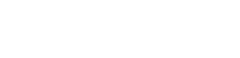 | 零一万物 | [logo.png](../logo/01-ai/logo.png) / wordmark | [许可未核实](https://www.lingyiwanwu.com/) |  |
| 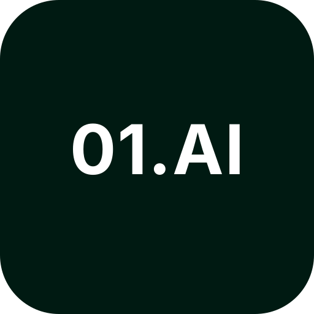 | 零一万物 | [symbol.svg](../logo/01-ai/symbol.svg) / wordmark | [许可未核实](https://www.lingyiwanwu.com/) |  |
|  | 九云数智 | [icon-blue-official.png](../logo/9yundata/icon-blue-official.png) / icon | [许可未核实](https://www.9yundata.com/about-us.html) |  |
| 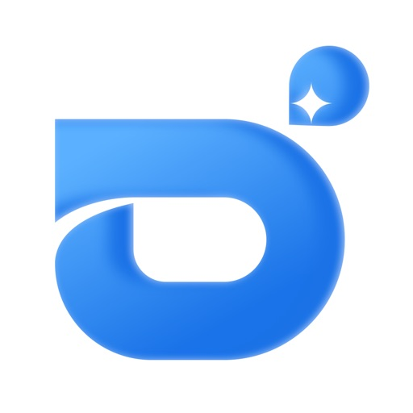 | 智元机器人 | [icon-appstore.jpg](../logo/agibot/icon-appstore.jpg) / icon | [许可未核实](https://apps.apple.com/cn/app/agibot-go/id6745000316?uo=4) |  |
|  | 智元机器人 | [logo-bilingual-small-official.png](../logo/agibot/logo-bilingual-small-official.png) / logo | [许可未核实](https://www.agibot.com.cn/) |  |
|  | 智元机器人 | [logo-english-gray-small-official.png](../logo/agibot/logo-english-gray-small-official.png) / logo | [许可未核实](https://www.agibot.com/) |  |
|  | 智元机器人 | [logo-english-white-small-official.png](../logo/agibot/logo-english-white-small-official.png) / logo | [许可未核实](https://www.agibot.com/) |  |
|  | 爱回收 | [icon-yellow.png](../logo/aihuishou/icon-yellow.png) / icon | [许可未核实](https://www.atrenew.com/en-us/) |  |
|  | 爱回收 | [logo-brand.png](../logo/aihuishou/logo-brand.png) / logo | [许可未核实](https://www.atrenew.com/en-us/) |  |
| 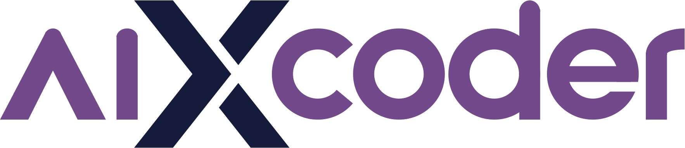 | 硅心科技 | [wordmark.png](../logo/aixcoder/wordmark.png) / wordmark | [许可未核实](https://www.aixcoder.com/zh/about) |  |
|  | 构序智能 | [icon.svg](../logo/aixcut/icon.svg) / icon | [许可未核实](https://aixcut.cn/) |  |
|  | 构序智能 | [logo-white.svg](../logo/aixcut/logo-white.svg) / logo | [许可未核实](https://aixcut.cn/) |  |
|  | 阿里巴巴集团 | [logo-chinese-horizontal-official.png](../logo/alibaba/logo-chinese-horizontal-official.png) / logo | [许可未核实](https://www.alibabagroup.com/en-US/resource-logos) | 官方媒体库限获认可媒体作编辑用途，使用时标注来源；其他用途需阿里巴巴集团书面许可。可等比缩放，须保持图稿原样。 |
| 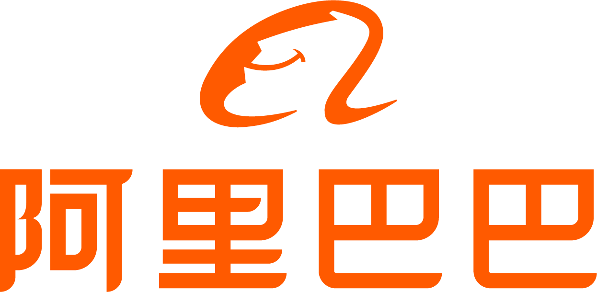 | 阿里巴巴集团 | [logo-chinese-vertical-official.png](../logo/alibaba/logo-chinese-vertical-official.png) / logo | [许可未核实](https://www.alibabagroup.com/en-US/resource-logos) | 官方媒体库限获认可媒体作编辑用途，使用时标注来源；其他用途需阿里巴巴集团书面许可。可等比缩放，须保持图稿原样。 |
|  | 阿里巴巴集团 | [logo-english-horizontal-official.png](../logo/alibaba/logo-english-horizontal-official.png) / logo | [许可未核实](https://www.alibabagroup.com/en-US/resource-logos) | 官方媒体库限获认可媒体作编辑用途，使用时标注来源；其他用途需阿里巴巴集团书面许可。可等比缩放，须保持图稿原样。 |
| 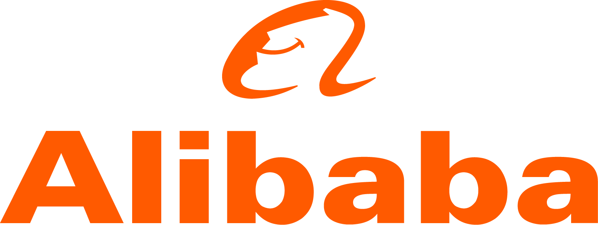 | 阿里巴巴集团 | [logo-english-vertical-official.png](../logo/alibaba/logo-english-vertical-official.png) / logo | [许可未核实](https://www.alibabagroup.com/en-US/resource-logos) | 官方媒体库限获认可媒体作编辑用途，使用时标注来源；其他用途需阿里巴巴集团书面许可。可等比缩放，须保持图稿原样。 |
|  | 阿里巴巴集团 | [wordmark-orange-chinese.svg](../logo/alibaba/wordmark-orange-chinese.svg) / wordmark | [Public domain &#40;textlogo&#41;](https://commons.wikimedia.org/wiki/File:Alibaba_zh_logo.svg) | 版权依据采用所引 Wikimedia Commons 具体文件页的 PD-textlogo 第三方公共领域判定，图库分发依据限于该判定。商标权及其他使用限制保留，使用不得暗示官方背书。不同法域的原创性门槛可能不同。判定范围为相应语言的阿里巴巴字标。 |
|  | 阿里巴巴集团 | [wordmark-orange.svg](../logo/alibaba/wordmark-orange.svg) / wordmark | [Public domain &#40;textlogo&#41;](https://commons.wikimedia.org/w/index.php?title=File%3AAlibaba_en_logo.svg&oldid=1115285514) | 版权依据采用所引 Wikimedia Commons 具体文件页的 PD-textlogo 第三方公共领域判定，图库分发依据限于该判定。商标权及其他使用限制保留，使用不得暗示官方背书。不同法域的原创性门槛可能不同。判定范围为相应语言的阿里巴巴字标。 |
| 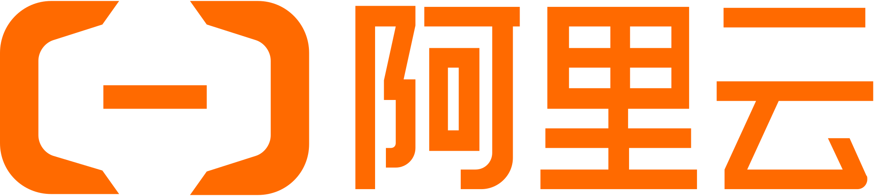 | 阿里云 | [logo-chinese-horizontal.svg](../logo/alibaba-cloud/logo-chinese-horizontal.svg) / logo | [许可未核实](https://www.aliyun.com/) |  |
|  | 阿里云 | [logo-en.png](../logo/alibaba-cloud/logo-en.png) / logo | [许可未核实](https://www.aliyun.com/about/branddesign/guidelines) |  |
|  | 阿里云 | [symbol-orange.svg](../logo/alibaba-cloud/symbol-orange.svg) / icon | [许可未核实](https://talent.alibaba.com/?lang=zh) |  |
|  | 阿里国际 | [wordmark-bilingual.svg](../logo/alibaba-international/wordmark-bilingual.svg) / wordmark | [许可未核实](https://talent.alibaba.com/?lang=zh) |  |
|  | 阿里国际 | [wordmark-careers-white.png](../logo/alibaba-international/wordmark-careers-white.png) / wordmark | [许可未核实](https://aidc-jobs.alibaba.com/zh/) |  |
|  | 高德 | [icon-appstore.jpg](../logo/amap/icon-appstore.jpg) / icon | [许可未核实](https://apps.apple.com/cn/app/%E9%AB%98%E5%BE%B7%E5%9C%B0%E5%9B%BE-%E9%AB%98%E5%BE%B7%E6%89%93%E8%BD%A6-%E5%AF%BC%E8%88%AA%E5%85%AC%E4%BA%A4%E5%9C%B0%E9%93%81%E5%87%BA%E8%A1%8C/id461703208?uo=4) |  |
|  | 高德 | [logo-map-horizontal.png](../logo/amap/logo-map-horizontal.png) / logo | [许可未核实](https://www.amap.com/) |  |
|  | 蚂蚁国际 | [logo-brand.svg](../logo/ant-international/logo-brand.svg) / logo | [许可未核实](https://www.ant-intl.com/cn/) |  |
|  | 蚂蚁国际 | [logo-white.svg](../logo/ant-international/logo-white.svg) / logo | [许可未核实](https://www.ant-intl.com/cn/) |  |
|  | 蚂蚁国际 | [symbol-brand.svg](../logo/ant-international/symbol-brand.svg) / icon | [许可未核实](https://www.ant-intl.com/cn/) |  |
| 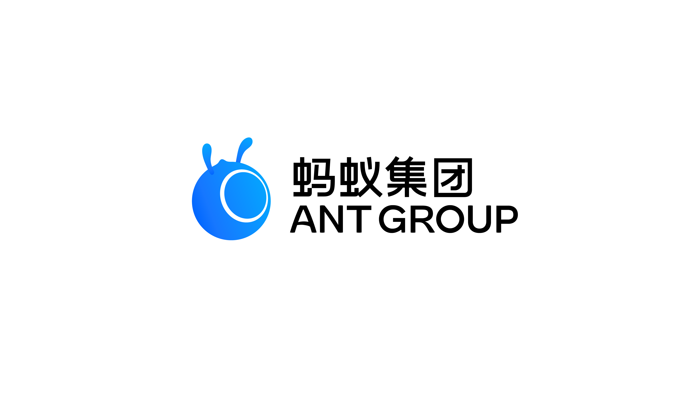 | 蚂蚁集团 | [logo-bilingual-color-official.png](../logo/antgroup/logo-bilingual-color-official.png) / logo | [许可未核实](https://www.antgroup.com/news-media/media-library) |  |
|  | 蚂蚁集团 | [logo-bilingual-white-official.png](../logo/antgroup/logo-bilingual-white-official.png) / logo | [许可未核实](https://www.antgroup.com/news-media/media-library) |  |
| 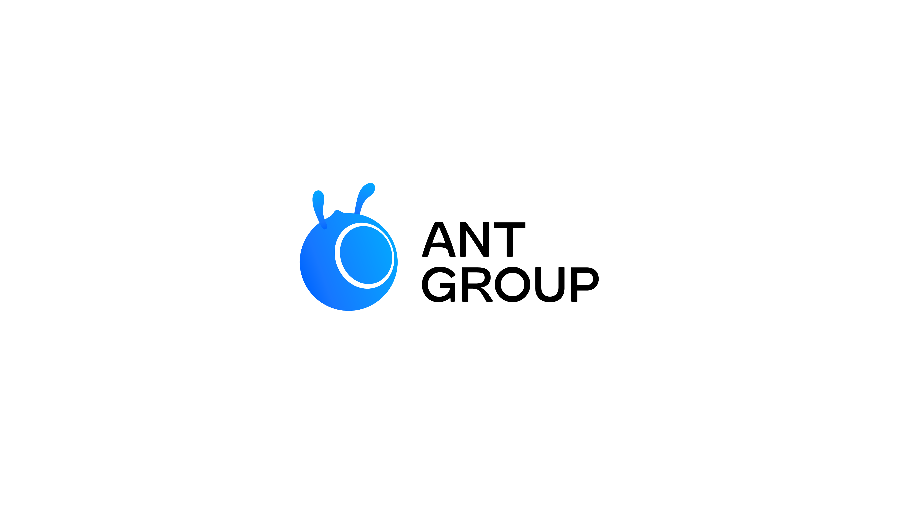 | 蚂蚁集团 | [logo-english-color-official.png](../logo/antgroup/logo-english-color-official.png) / logo | [许可未核实](https://www.antgroup.com/news-media/media-library) |  |
|  | 蚂蚁集团 | [logo-english-white-official.png](../logo/antgroup/logo-english-white-official.png) / logo | [许可未核实](https://www.antgroup.com/news-media/media-library) |  |
|  | 亚信科技 | [icon-color-extracted.svg](../logo/asiainfo/icon-color-extracted.svg) / icon | [许可未核实](https://www.asiainfo.com/zh_cn/index.html) | 许可及署名条件待核实。 |
|  | 亚信科技 | [icon-white-extracted.svg](../logo/asiainfo/icon-white-extracted.svg) / icon | [许可未核实](https://www.asiainfo.com/zh_cn/index.html) | 许可及署名条件待核实。 |
|  | 亚信科技 | [logo-bilingual-color-official.svg](../logo/asiainfo/logo-bilingual-color-official.svg) / logo | [许可未核实](https://www.asiainfo.com/zh_cn/index.html) |  |
|  | 亚信科技 | [logo-bilingual-white-official.svg](../logo/asiainfo/logo-bilingual-white-official.svg) / logo | [许可未核实](https://www.asiainfo.com/zh_cn/index.html) |  |
|  | 亚信安全 | [logo-chinese-official.png](../logo/asiainfo-security/logo-chinese-official.png) / logo | [许可未核实](https://www.asiainfo-sec.com/) |  |
|  | 亚信安全 | [logo-white.png](../logo/asiainfo-security/logo-white.png) / wordmark | [许可未核实](https://www.asiainfo-sec.com/) |  |
|  | 汽车之家 | [wordmark-blue.png](../logo/autohome/wordmark-blue.png) / wordmark | [许可未核实](https://www.autohome.com.cn/) |  |
| 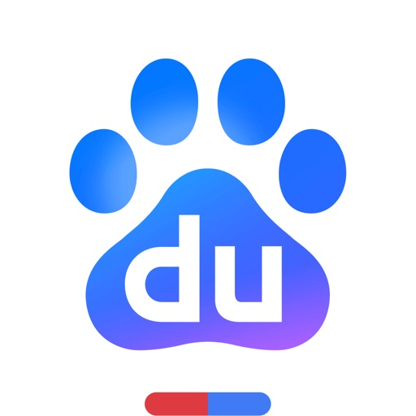 | 百度 | [icon-appstore.jpg](../logo/baidu/icon-appstore.jpg) / icon | [许可未核实](https://apps.apple.com/cn/app/%E7%99%BE%E5%BA%A6-ai%E6%99%BA%E8%83%BD%E6%90%9C%E7%B4%A2/id382201985?uo=4) |  |
| 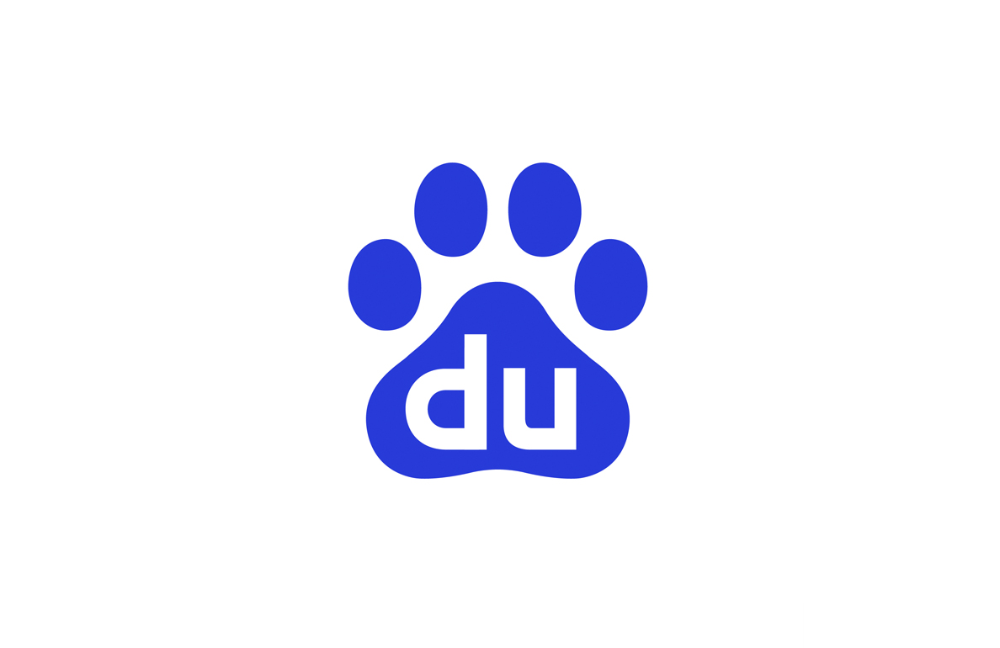 | 百度 | [icon-blue-brand-library.jpg](../logo/baidu/icon-blue-brand-library.jpg) / icon | [许可未核实](https://home.baidu.com/media_resource/show_detail/res_id/5/tab_id/1) | 熊掌内含 du 字母。官方将此图限定为设计应用参考，单独作为标志使用限使用面积高度≤13mm。 |
| 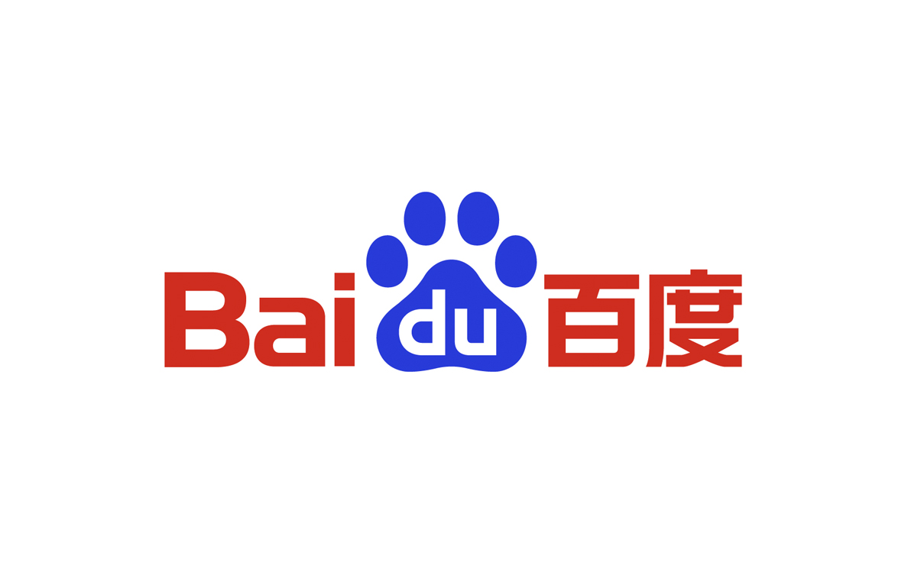 | 百度 | [logo-bilingual-brand-library.jpg](../logo/baidu/logo-bilingual-brand-library.jpg) / logo | [许可未核实](https://home.baidu.com/media_resource/show_detail/res_id/2/tab_id/1) | 官方标准色规范注明 du 字母采用白色填充，须整体使用并保持比例与配色，适用背景见对应规范。 |
|  | 百度 | [logo-bilingual-small-official.png](../logo/baidu/logo-bilingual-small-official.png) / logo | [许可未核实](https://home.baidu.com/) | 品牌规范要求整体使用并保持比例与配色。 |
|  | 白龙马云行科技 | [logo-white.png](../logo/bailongma-yunxing/logo-white.png) / logo | [许可未核实](https://www.bailongma.com/about) |  |
|  | 白龙马云行科技 | [symbol.png](../logo/bailongma-yunxing/symbol.png) / icon | [许可未核实](https://www.bailongma.com/about) |  |
|  | 拓竹 | [logo-black-horizontal.svg](../logo/bambu-lab/logo-black-horizontal.svg) / logo | [许可未核实](https://us.store.bambulab.com/) |  |
|  | 拓竹 | [symbol-green.svg](../logo/bambu-lab/symbol-green.svg) / icon | [许可未核实](https://github.com/bambulab/BambuStudio) |  |
|  | 拓竹 | [symbol-square.svg](../logo/bambu-lab/symbol-square.svg) / icon | [许可未核实](https://github.com/bambulab/BambuStudio) |  |
|  | 中国银行 | [logo-bilingual.png](../logo/bank-of-china/logo-bilingual.png) / logo | [许可未核实](https://www.boc.cn/custserv/cs1/200812/t20081209_135606.html) | 官网版权声明要求商业用途先取得中国银行书面许可，并注明来源和版权。 |
|  | 宁波银行 | [logo-bilingual.png](../logo/bank-of-ningbo/logo-bilingual.png) / logo | [许可未核实](https://www.nbcb.com.cn/) |  |
|  | 上海银行 | [logo-bilingual-slogan-official.png](../logo/bank-of-shanghai/logo-bilingual-slogan-official.png) / logo | [许可未核实](https://www.bosc.cn/zh/) |  |
|  | 上海银行 | [logo-bilingual.png](../logo/bank-of-shanghai/logo-bilingual.png) / logo | [许可未核实](https://www.bosc.cn/en/) |  |
|  | 比孚信息科技 | [logo-bilingual.svg](../logo/bifu/logo-bilingual.svg) / logo | [许可未核实](https://bizfocus.cn/) |  |
|  | BIGO | [wordmark-blue-official.png](../logo/bigo/wordmark-blue-official.png) / wordmark | [许可未核实](https://www.bigo.sg/about) |  |
|  | BIGO | [wordmark-white-official.png](../logo/bigo/wordmark-white-official.png) / wordmark | [许可未核实](https://www.bigo.sg/mobile/about) |  |
|  | 哔哩哔哩 | [wordmark-blue-international-official.svg](../logo/bilibili/wordmark-blue-international-official.svg) / wordmark | [许可未核实](https://www.bilibili.tv/) |  |
|  | 哔哩哔哩 | [wordmark-ir-blue-official.svg](../logo/bilibili/wordmark-ir-blue-official.svg) / wordmark | [许可未核实](https://ir.bilibili.com/en/) |  |
|  | 哔哩哔哩 | [wordmark-ir-white-official.svg](../logo/bilibili/wordmark-ir-white-official.svg) / wordmark | [许可未核实](https://ir.bilibili.com/en/) |  |
|  | 哔哩哔哩 | [wordmark-recruitment-white-official.png](../logo/bilibili/wordmark-recruitment-white-official.png) / wordmark | [许可未核实](https://jobs.bilibili.com/) |  |
|  | 哔哩哔哩 | [wordmark-white-small-official.png](../logo/bilibili/wordmark-white-small-official.png) / wordmark | [许可未核实](https://www.bilibili.com/) |  |
|  | 壁仞科技 | [logo-bilingual-color-horizontal.svg](../logo/biren/logo-bilingual-color-horizontal.svg) / logo | [许可未核实](https://www.birentech.com/) |  |
|  | 壁仞科技 | [logo-bilingual-white-horizontal.svg](../logo/biren/logo-bilingual-white-horizontal.svg) / logo | [许可未核实](https://www.birentech.com/) |  |
|  | 壁仞科技 | [symbol-original.svg](../logo/biren/symbol-original.svg) / icon | [许可未核实](https://www.birentech.com/) |  |
|  | 壁仞科技 | [symbol-square.svg](../logo/biren/symbol-square.svg) / icon | [许可未核实](https://www.birentech.com/) |  |
| 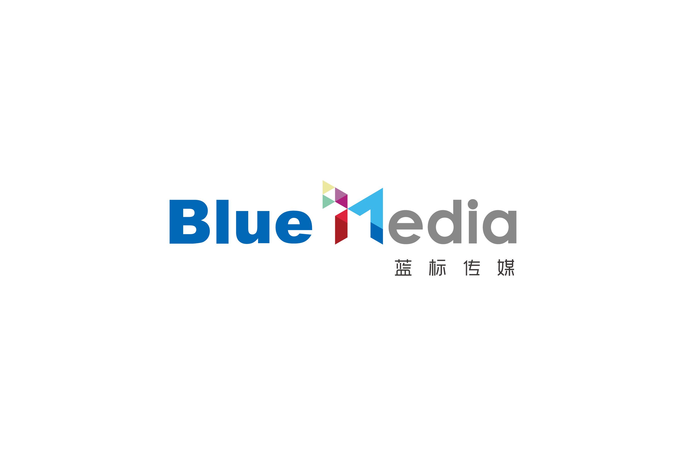 | 蓝标传媒 | [logo-color.png](../logo/bluemedia/logo-color.png) / logo | [许可未核实](https://bluemediagroup.cn/) |  |
|  | 蓝标传媒 | [logo.svg](../logo/bluemedia/logo.svg) / logo | [许可未核实](https://bluemediagroup.cn/) |  |
|  | 柏楚电子 | [logo-blue.svg](../logo/bochu/logo-blue.svg) / logo | [许可未核实](https://www.bochu.com/) |  |
|  | 柏楚电子 | [logo-vertical.png](../logo/bochu/logo-vertical.png) / logo | [许可未核实](https://www.bochu.com/) |  |
|  | 柏楚电子 | [logo-white.svg](../logo/bochu/logo-white.svg) / logo | [许可未核实](https://www.bochu.com/) |  |
|  | 柏楚电子 | [symbol-blue.svg](../logo/bochu/symbol-blue.svg) / icon | [许可未核实](https://www.bochu.com/) |  |
|  | 波克 | [logo-square.png](../logo/boke/logo-square.png) / wordmark | [许可未核实](https://www.boke.com/) |  |
|  | 波克 | [wordmark-red.png](../logo/boke/wordmark-red.png) / wordmark | [许可未核实](https://www.boke.com/) |  |
|  | 不鸣科技 | [logo-brand.png](../logo/boomingtech/logo-brand.png) / logo | [许可未核实](https://www.boomingtech.com/) |  |
|  | 不鸣科技 | [logo-white.png](../logo/boomingtech/logo-white.png) / logo | [许可未核实](https://www.boomingtech.com/) |  |
|  | 佰聆数据 | [logo-zh.png](../logo/brilliant-data/logo-zh.png) / logo | [许可未核实](https://www.brilliant-solution.com/) |  |
|  | 比亚迪 | [logo-group.png](../logo/byd/logo-group.png) / wordmark | [许可未核实](https://www.bydglobal.com/cn) |  |
|  | 字节跳动 | [icon-color-extracted.svg](../logo/bytedance/icon-color-extracted.svg) / icon | [Public domain &#40;textlogo&#41;](https://commons.wikimedia.org/w/index.php?title=File%3AByteDance_logo_English.svg&oldid=1117279263) | 版权依据采用所引 Wikimedia Commons 具体文件页的 PD-textlogo 第三方公共领域判定，图库分发依据限于该判定。商标权及其他使用限制保留，使用不得暗示官方背书。不同法域的原创性门槛可能不同。判定范围为字节跳动四柱图形及对应英文组合。 |
|  | 字节跳动 | [icon-white-official.svg](../logo/bytedance/icon-white-official.svg) / icon | [Public domain &#40;textlogo; third-party assessment&#41;](https://commons.wikimedia.org/w/index.php?title=File%3AByteDance_logo_English.svg&oldid=1117279263) | 版权依据采用所引 Wikimedia Commons 具体文件页的 PD-textlogo 第三方公共领域判定，图库分发依据限于该判定。商标权及其他使用限制保留，使用不得暗示官方背书。不同法域的原创性门槛可能不同。判定范围限于相同四柱简单几何图形。 |
|  | 字节跳动 | [icon-white-square-extracted.svg](../logo/bytedance/icon-white-square-extracted.svg) / icon | [Public domain &#40;textlogo; third-party assessment&#41;](https://commons.wikimedia.org/w/index.php?title=File%3AByteDance_logo_English.svg&oldid=1117279263) | 版权依据采用所引 Wikimedia Commons 具体文件页的 PD-textlogo 第三方公共领域判定，图库分发依据限于该判定。商标权及其他使用限制保留，使用不得暗示官方背书。不同法域的原创性门槛可能不同。判定范围限于相同四柱简单几何图形。 |
|  | 字节跳动 | [logo-bilingual-color-official.svg](../logo/bytedance/logo-bilingual-color-official.svg) / logo | [许可未核实](https://www.bytedance.com/?locale=zh) |  |
|  | 字节跳动 | [logo-bilingual-white-official.svg](../logo/bytedance/logo-bilingual-white-official.svg) / logo | [许可未核实](https://www.bytedance.com/?locale=zh) |  |
|  | 字节跳动 | [logo-english-white-official.svg](../logo/bytedance/logo-english-white-official.svg) / logo | [许可未核实](https://www.bytedance.com/?locale=en) |  |
|  | 字节跳动 | [logo-english.svg](../logo/bytedance/logo-english.svg) / logo | [Public domain &#40;textlogo&#41;](https://commons.wikimedia.org/w/index.php?title=File%3AByteDance_logo_English.svg&oldid=1117279263) | 版权依据采用所引 Wikimedia Commons 具体文件页的 PD-textlogo 第三方公共领域判定，图库分发依据限于该判定。商标权及其他使用限制保留，使用不得暗示官方背书。不同法域的原创性门槛可能不同。判定范围为字节跳动四柱图形及对应英文组合。 |
|  | 客诺信息技术 | [logo-color.webp](../logo/callnovo/logo-color.webp) / logo | [许可未核实](https://callnovo.com/) |  |
|  | 客诺信息技术 | [logo-white.svg](../logo/callnovo/logo-white.svg) / logo | [许可未核实](https://www.callnovocx.com/request-a-quote) |  |
|  | 客诺信息技术 | [symbol-white.svg](../logo/callnovo/symbol-white.svg) / icon | [许可未核实](https://www.callnovocx.com/request-a-quote) |  |
| 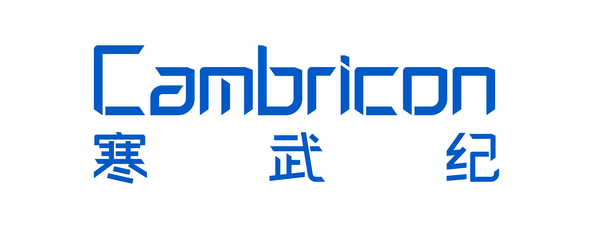 | 寒武纪 | [logo-bilingual-brand-library.png](../logo/cambricon/logo-bilingual-brand-library.png) / wordmark | [许可未核实](https://www.cambricon.com/) | 官网法律声明要求商标使用事先取得书面许可。品牌书要求保留标识比例与配色并遵守安全空间。 |
|  | 寒武纪 | [logo-bilingual-white.png](../logo/cambricon/logo-bilingual-white.png) / wordmark | [许可未核实](https://www.cambricon.com/) |  |
|  | 寒武纪 | [logo-bilingual.png](../logo/cambricon/logo-bilingual.png) / wordmark | [许可未核实](https://www.cambricon.com/) |  |
|  | 曹操出行 | [logo-zh-brand.svg](../logo/caocao/logo-zh-brand.svg) / logo | [许可未核实](https://www.caocao.com.cn/) |  |
|  | 曹操出行 | [logo-zh-white.svg](../logo/caocao/logo-zh-white.svg) / logo | [许可未核实](https://www.caocao.com.cn/) |  |
|  | 曹操出行 | [symbol-green.svg](../logo/caocao/symbol-green.svg) / icon | [许可未核实](https://www.caocao.com.cn/) |  |
|  | 曹操出行 | [wordmark-en-black.svg](../logo/caocao/wordmark-en-black.svg) / wordmark | [许可未核实](https://www.caocao.com.cn/) |  |
|  | 曹操出行 | [wordmark-en-white.svg](../logo/caocao/wordmark-en-white.svg) / wordmark | [许可未核实](https://www.caocao.com.cn/) |  |
|  | 首都在线 | [logo-brand.png](../logo/capitalonline/logo-brand.png) / logo | [许可未核实](https://www.capitalonline.net.cn/) |  |
|  | 首都在线 | [logo-gray.svg](../logo/capitalonline/logo-gray.svg) / logo | [许可未核实](https://www.capitalonline.net.cn/) |  |
|  | 璇溟科技 | [logo-chinese-black-official.png](../logo/celbot-ai/logo-chinese-black-official.png) / logo | [许可未核实](https://www.celbot-ai.com/) |  |
|  | 点点互动 | [wordmark-black.png](../logo/century-games/wordmark-black.png) / wordmark | [许可未核实](https://www.centurygames.com/) |  |
|  | 点点互动 | [wordmark-white.svg](../logo/century-games/wordmark-white.svg) / wordmark | [许可未核实](https://www.centurygames.com/) |  |
|  | 长安汽车 | [logo-home.png](../logo/changan-auto/logo-home.png) / wordmark | [许可未核实](https://www.changan.com.cn/) |  |
|  | 四川长虹 | [wordmark-english.svg](../logo/changhong/wordmark-english.svg) / wordmark | [Public domain &#40;PD-textlogo&#41;](https://commons.wikimedia.org/wiki/File:Changhong.svg) | Commons 文件页按 PD-textlogo 标示为公有领域，商标权仍归相应权利人。 |
|  | 四川长虹 | [wordmark-red-official.png](../logo/changhong/wordmark-red-official.png) / wordmark | [许可未核实](https://cn.changhong.com/) |  |
|  | 车300 | [logo-bilingual.png](../logo/che300/logo-bilingual.png) / logo | [许可未核实](https://www.che300.com/) |  |
|  | 猎豹移动 | [logo-footer-zh.png](../logo/cheetah-mobile/logo-footer-zh.png) / logo | [许可未核实](https://www.cmcm.com/zh-CN/) |  |
|  | 猎豹移动 | [logo-white-zh.png](../logo/cheetah-mobile/logo-white-zh.png) / logo | [许可未核实](https://www.cmcm.com/zh-CN/) |  |
|  | 中国电信 | [logo-bilingual.png](../logo/china-telecom/logo-bilingual.png) / logo | [许可未核实](https://www.chinatelecom-h.com/sc/global/home.php) |  |
|  | 招商银行 | [logo.png](../logo/cmb-bank/logo.png) / logo | [许可未核实](https://www.cmbchina.com/) |  |
|  | 招商银行 | [portal-horizontal.png](../logo/cmb-bank/portal-horizontal.png) / logo | [许可未核实](https://english.cmbchina.com/) |  |
|  | 招银网络科技 | [logo.png](../logo/cmb-network-tech/logo.png) / logo | [许可未核实](https://cmbnt.cmbchina.com/home.html) |  |
|  | Codeberg e.V. | [icon-blue.svg](../logo/codeberg/icon-blue.svg) / icon | [CC0-1.0](https://codeberg.org/Codeberg/Design/raw/commit/ac514aa9aaa2457d4af3c3e13df3ab136d22a49a/README.md) | Codeberg Design 仓库以 CC0 发布这些图稿。Codeberg 名称与 Logo 商标权保留，使用须遵循官方品牌指南，保持比例、原色及组合关系。 |
|  | Codeberg e.V. | [icon-white.svg](../logo/codeberg/icon-white.svg) / icon | [CC0-1.0](https://codeberg.org/Codeberg/Design/raw/commit/ac514aa9aaa2457d4af3c3e13df3ab136d22a49a/README.md) | Codeberg Design 仓库以 CC0 发布这些图稿。Codeberg 名称与 Logo 商标权保留，使用须遵循官方品牌指南，保持比例、原色及组合关系。 |
|  | Codeberg e.V. | [logo-horizontal-blue.png](../logo/codeberg/logo-horizontal-blue.png) / logo | [CC0-1.0](https://codeberg.org/Codeberg/Design/raw/commit/ac514aa9aaa2457d4af3c3e13df3ab136d22a49a/README.md) | Codeberg Design 仓库以 CC0 发布这些图稿。Codeberg 名称与 Logo 商标权保留，使用须遵循官方品牌指南，保持比例、原色及组合关系。 |
|  | Codeberg e.V. | [logo-horizontal-white.png](../logo/codeberg/logo-horizontal-white.png) / logo | [CC0-1.0](https://codeberg.org/Codeberg/Design/raw/commit/ac514aa9aaa2457d4af3c3e13df3ab136d22a49a/README.md) | Codeberg Design 仓库以 CC0 发布这些图稿。Codeberg 名称与 Logo 商标权保留，使用须遵循官方品牌指南，保持比例、原色及组合关系。 |
|  | Codeberg e.V. | [logo-vertical-blue.svg](../logo/codeberg/logo-vertical-blue.svg) / logo | [CC0-1.0](https://codeberg.org/Codeberg/Design/raw/commit/ac514aa9aaa2457d4af3c3e13df3ab136d22a49a/README.md) | Codeberg Design 仓库以 CC0 发布这些图稿。Codeberg 名称与 Logo 商标权保留，使用须遵循官方品牌指南，保持比例、原色及组合关系。 |
|  | Codeberg e.V. | [logo-vertical-white.svg](../logo/codeberg/logo-vertical-white.svg) / logo | [CC0-1.0](https://codeberg.org/Codeberg/Design/raw/commit/ac514aa9aaa2457d4af3c3e13df3ab136d22a49a/README.md) | Codeberg Design 仓库以 CC0 发布这些图稿。Codeberg 名称与 Logo 商标权保留，使用须遵循官方品牌指南，保持比例、原色及组合关系。 |
|  | 视源股份 | [wordmark-bilingual-official.png](../logo/cvte/wordmark-bilingual-official.png) / wordmark | [许可未核实](https://www.cvte.com/common/page/legal-notice) | 官网法律声明要求复制、镜像及使用标识事先取得书面许可。 |
|  | 视源股份 | [wordmark-english-official.webp](../logo/cvte/wordmark-english-official.webp) / wordmark | [许可未核实](https://www.cvte.com/common/page/legal-notice) | 官网法律声明要求复制、镜像及使用标识事先取得书面许可。 |
|  | 长鑫存储 | [wordmark-blue.svg](../logo/cxmt/wordmark-blue.svg) / wordmark | [许可未核实](https://www.cxmt.com/) |  |
|  | 长鑫存储 | [wordmark-white.svg](../logo/cxmt/wordmark-white.svg) / wordmark | [许可未核实](https://www.cxmt.com/) |  |
| 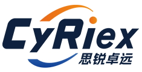 | 思锐卓远 | [logo-bilingual-official.png](../logo/cyriex/logo-bilingual-official.png) / logo | [许可未核实](https://www.cyriex.com/) |  |
|  | 思锐卓远 | [logo-wide-brand.png](../logo/cyriex/logo-wide-brand.png) / logo | [许可未核实](https://www.cyriex.com/) |  |
|  | 思锐卓远 | [logo-wide-white.png](../logo/cyriex/logo-wide-white.png) / logo | [许可未核实](https://www.cyriex.com/) |  |
|  | 大华 | [logo-bilingual-white.png](../logo/dahua/logo-bilingual-white.png) / logo | [许可未核实](https://www.dahuatech.com/law.html) | 法律声明要求使用商标事先取得书面许可，网站内容保留版权。 |
|  | 大华 | [logo-bilingual.png](../logo/dahua/logo-bilingual.png) / logo | [许可未核实](https://www.dahuatech.com/law.html) | 法律声明要求使用商标事先取得书面许可，网站内容保留版权。 |
| 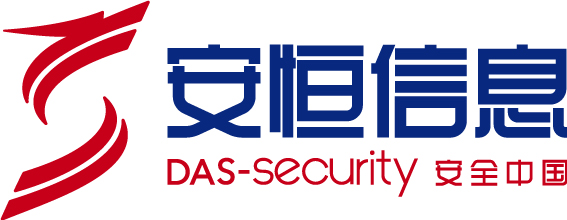 | 安恒信息 | [logo-bilingual.jpg](../logo/dbappsecurity/logo-bilingual.jpg) / logo | [许可未核实](https://www.dbappsecurity.com.cn/) |  |
|  | 安恒信息 | [symbol-red.png](../logo/dbappsecurity/symbol-red.png) / icon | [许可未核实](https://www.dbappsecurity.com.cn/) |  |
|  | 元戎启行 | [logo.png](../logo/deeproute/logo.png) / logo | [许可未核实](https://www.deeproute.ai/) |  |
|  | 深度求索 | [logo-brand.svg](../logo/deepseek/logo-brand.svg) / logo | [许可未核实](https://github.com/deepseek-ai/DeepSeek-LLM/blob/main/images/logo.svg) |  |
|  | 深度求索 | [symbol-brand.svg](../logo/deepseek/symbol-brand.svg) / icon | [许可未核实](https://github.com/deepseek-ai/DeepSeek-LLM/blob/main/images/logo.svg) |  |
| 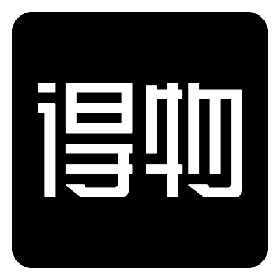 | 得物 | [wordmark-square-official.png](../logo/dewu/wordmark-square-official.png) / wordmark | [许可未核实](https://poizon.jobs.feishu.cn/index) |  |
|  | 原力灵机 | [logo-en-horizontal-white.png](../logo/dexmal/logo-en-horizontal-white.png) / logo | [许可未核实](https://www.dexmal.com/about/brand) | 品牌规范要求标识保持完整及既定比例，并遵循安全空间、黑白反白和联合标识规范。 |
| 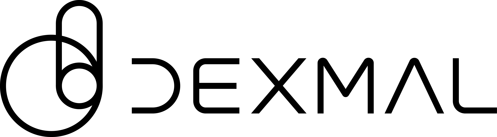 | 原力灵机 | [logo-en-horizontal.png](../logo/dexmal/logo-en-horizontal.png) / logo | [许可未核实](https://www.dexmal.com/about/brand) | 品牌规范要求标识保持完整及既定比例，并遵循安全空间、黑白反白和联合标识规范。 |
|  | 原力灵机 | [logo-en-vertical-white.png](../logo/dexmal/logo-en-vertical-white.png) / logo | [许可未核实](https://www.dexmal.com/about/brand) | 品牌规范要求标识保持完整及既定比例，并遵循安全空间、黑白反白和联合标识规范。 |
| 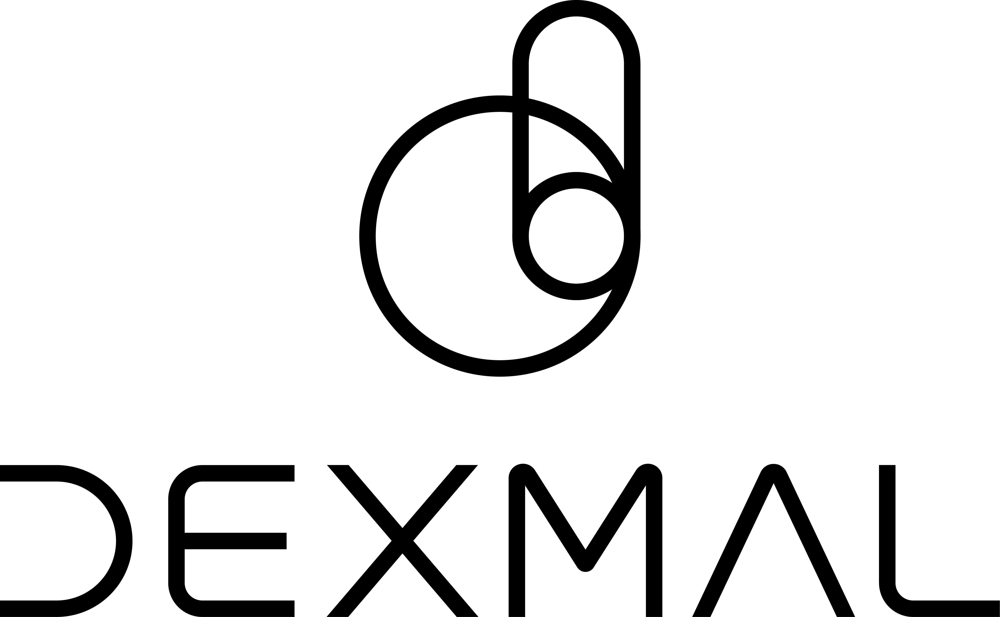 | 原力灵机 | [logo-en-vertical.png](../logo/dexmal/logo-en-vertical.png) / logo | [许可未核实](https://www.dexmal.com/about/brand) | 品牌规范要求标识保持完整及既定比例，并遵循安全空间、黑白反白和联合标识规范。 |
|  | 原力灵机 | [logo-white.svg](../logo/dexmal/logo-white.svg) / logo | [许可未核实](https://www.dexmal.com/) | 品牌规范要求标识保持完整及既定比例，并遵循安全空间、黑白反白和联合标识规范。 |
|  | 原力灵机 | [logo-zh-vertical-white.png](../logo/dexmal/logo-zh-vertical-white.png) / logo | [许可未核实](https://www.dexmal.com/about/brand) | 品牌规范要求标识保持完整及既定比例，并遵循安全空间、黑白反白和联合标识规范。 |
| 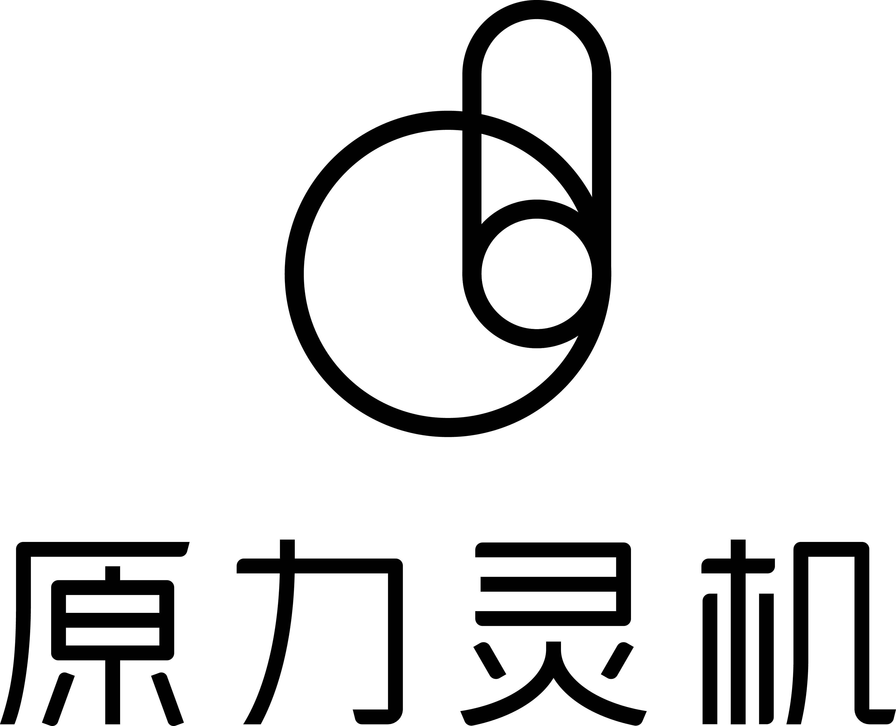 | 原力灵机 | [logo-zh-vertical.png](../logo/dexmal/logo-zh-vertical.png) / logo | [许可未核实](https://www.dexmal.com/about/brand) | 品牌规范要求标识保持完整及既定比例，并遵循安全空间、黑白反白和联合标识规范。 |
|  | 原力灵机 | [logo.svg](../logo/dexmal/logo.svg) / logo | [许可未核实](https://www.dexmal.com/) | 品牌规范要求标识保持完整及既定比例，并遵循安全空间、黑白反白和联合标识规范。 |
|  | 原力灵机 | [symbol-white.png](../logo/dexmal/symbol-white.png) / icon | [许可未核实](https://www.dexmal.com/about/brand) | 品牌规范要求标识保持完整及既定比例，并遵循安全空间、黑白反白和联合标识规范。 |
| 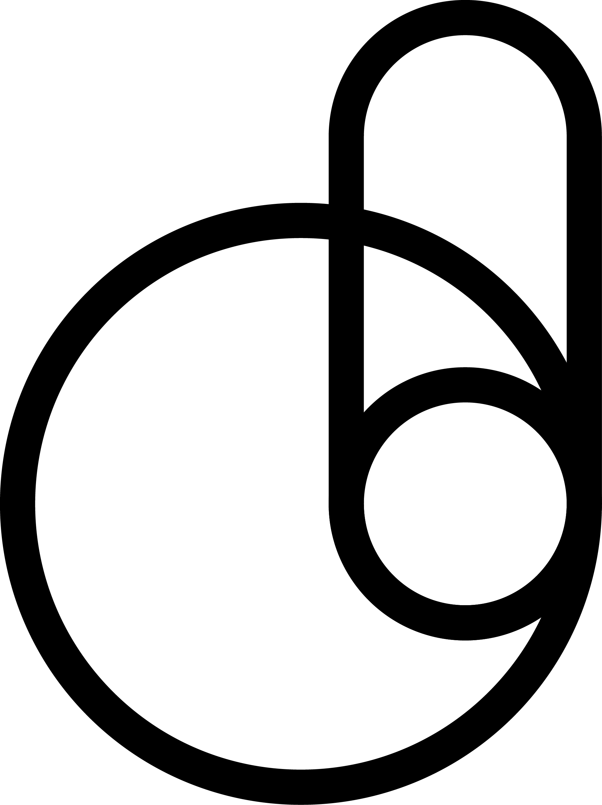 | 原力灵机 | [symbol.png](../logo/dexmal/symbol.png) / icon | [许可未核实](https://www.dexmal.com/about/brand) | 品牌规范要求标识保持完整及既定比例，并遵循安全空间、黑白反白和联合标识规范。 |
|  | 原力灵机 | [wordmark-bilingual-white.png](../logo/dexmal/wordmark-bilingual-white.png) / wordmark | [许可未核实](https://www.dexmal.com/about/brand) | 品牌规范要求标识保持完整及既定比例，并遵循安全空间、黑白反白和联合标识规范。 |
| 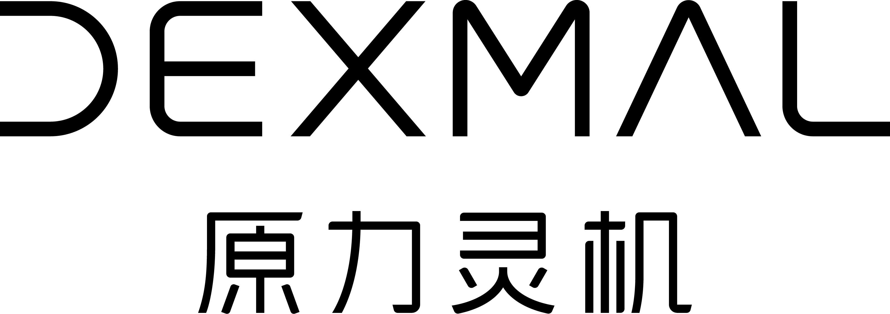 | 原力灵机 | [wordmark-bilingual.png](../logo/dexmal/wordmark-bilingual.png) / wordmark | [许可未核实](https://www.dexmal.com/about/brand) | 品牌规范要求标识保持完整及既定比例，并遵循安全空间、黑白反白和联合标识规范。 |
|  | 滴滴 | [icon-gray-official.svg](../logo/didi/icon-gray-official.svg) / icon | [Public domain &#40;textlogo; third-party assessment&#41;](https://commons.wikimedia.org/w/index.php?title=File:DiDi_Logo.svg&oldid=1219426260) | 版权依据采用所引 Wikimedia Commons 具体文件页的 PD-textlogo 第三方公共领域判定，图库分发依据限于该判定。商标权及其他使用限制保留，使用不得暗示官方背书。不同法域的原创性门槛可能不同。判定范围限于 DiDi 组合标中的相同 D 形图形。 |
|  | 滴滴 | [icon-gray-square-extracted.svg](../logo/didi/icon-gray-square-extracted.svg) / icon | [Public domain &#40;textlogo; third-party assessment&#41;](https://commons.wikimedia.org/w/index.php?title=File:DiDi_Logo.svg&oldid=1219426260) | 版权依据采用所引 Wikimedia Commons 具体文件页的 PD-textlogo 第三方公共领域判定，图库分发依据限于该判定。商标权及其他使用限制保留，使用不得暗示官方背书。不同法域的原创性门槛可能不同。判定范围限于 DiDi 组合标中的相同 D 形图形。 |
|  | 滴滴 | [icon-orange-extracted.svg](../logo/didi/icon-orange-extracted.svg) / icon | [Public domain &#40;textlogo&#41;](https://commons.wikimedia.org/w/index.php?title=File%3ADiDi_Logo.svg&oldid=1219426260) | 版权依据采用所引 Wikimedia Commons 具体文件页的 PD-textlogo 第三方公共领域判定，图库分发依据限于该判定。商标权及其他使用限制保留，使用不得暗示官方背书。不同法域的原创性门槛可能不同。判定范围为相同 D 形图形及 DiDi 英文组合。 |
|  | 滴滴 | [logo-chinese-official.svg](../logo/didi/logo-chinese-official.svg) / logo | [许可未核实](https://www.didiglobal.com/) |  |
|  | 滴滴 | [logo-chinese-white-official.svg](../logo/didi/logo-chinese-white-official.svg) / logo | [许可未核实](https://www.didiglobal.com/) |  |
|  | 滴滴 | [logo-english-white-official.svg](../logo/didi/logo-english-white-official.svg) / logo | [许可未核实](https://www.didiglobal.com/) |  |
|  | 滴滴 | [logo-english.svg](../logo/didi/logo-english.svg) / logo | [Public domain &#40;textlogo&#41;](https://commons.wikimedia.org/w/index.php?title=File%3ADiDi_Logo.svg&oldid=1219426260) | 版权依据采用所引 Wikimedia Commons 具体文件页的 PD-textlogo 第三方公共领域判定，图库分发依据限于该判定。商标权及其他使用限制保留，使用不得暗示官方背书。不同法域的原创性门槛可能不同。判定范围为相同 D 形图形及 DiDi 英文组合。 |
|  | 鼎捷数智 | [logo-zh.png](../logo/digiwin/logo-zh.png) / logo | [许可未核实](https://www.digiwin.com/) |  |
| 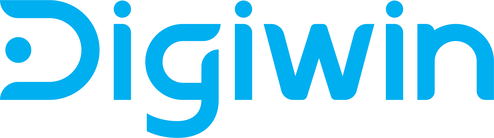 | 鼎捷数智 | [wordmark-en-commons.png](../logo/digiwin/wordmark-en-commons.png) / wordmark | [Public domain &#40;PD-textlogo&#41;](https://commons.wikimedia.org/wiki/File:Digiwin.png) | 商标权仍由相应权利人保留。 |
|  | 多点数智 | [logo-bilingual.png](../logo/dmall/logo-bilingual.png) / logo | [许可未核实](https://www.dmall.com/) |  |
| 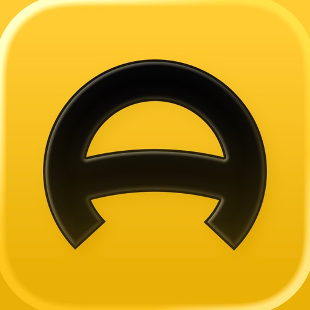 | 懂车帝 | [icon-appstore.jpg](../logo/dongchedi/icon-appstore.jpg) / icon | [许可未核实](https://apps.apple.com/cn/app/%E6%87%82%E8%BD%A6%E5%B8%9D-%E9%80%89%E4%B9%B0%E6%96%B0%E8%BD%A6%E4%BA%8C%E6%89%8B%E8%BD%A6/id1232131998?uo=4) |  |
|  | 懂车帝 | [icon-yellow-extracted.svg](../logo/dongchedi/icon-yellow-extracted.svg) / icon | [许可未核实](https://www.dongchedi.com/) | 官方协议列有书面同意要求，相应许可及署名条件待核实。 |
|  | 懂车帝 | [logo-chinese-official.svg](../logo/dongchedi/logo-chinese-official.svg) / logo | [许可未核实](https://www.dongchedi.com/) | 官方协议列有书面同意要求，相应许可及署名条件待核实。 |
|  | 都学网 | [logo-bilingual.png](../logo/doxue/logo-bilingual.png) / logo | [许可未核实](https://www.doxue.com/index) |  |
|  | 深势科技 | [wordmark-bilingual-black.webp](../logo/dp-tech/wordmark-bilingual-black.webp) / wordmark | [许可未核实](https://www.dp.tech/) |  |
|  | 深势科技 | [wordmark-bilingual-white-official.webp](../logo/dp-tech/wordmark-bilingual-white-official.webp) / wordmark | [许可未核实](https://www.dp.tech/) |  |
| 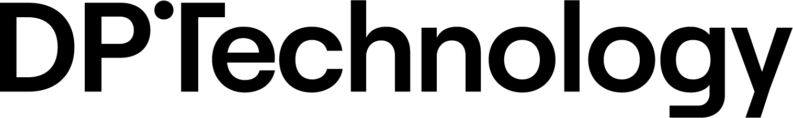 | 深势科技 | [wordmark-english-black.webp](../logo/dp-tech/wordmark-english-black.webp) / wordmark | [许可未核实](https://www.dp.tech/en/) |  |
|  | 深势科技 | [wordmark-english-white.webp](../logo/dp-tech/wordmark-english-white.webp) / wordmark | [许可未核实](https://www.dp.tech/en/) |  |
|  | 袋鼠云 | [logo-bilingual-white.svg](../logo/dtstack/logo-bilingual-white.svg) / logo | [许可未核实](https://www.dtstack.com/) |  |
| 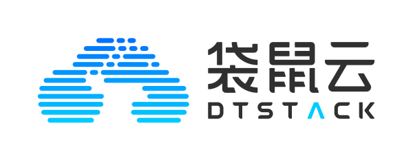 | 袋鼠云 | [logo-bilingual.svg](../logo/dtstack/logo-bilingual.svg) / logo | [许可未核实](https://www.dtstack.com/) |  |
|  | 袋鼠云 | [symbol-brand.svg](../logo/dtstack/symbol-brand.svg) / icon | [许可未核实](https://www.dtstack.com/) |  |
|  | 多益网络 | [logo-chinese-small-official.png](../logo/duoyi/logo-chinese-small-official.png) / logo | [许可未核实](https://www.duoyigroup.cn/dycommerce/ch/business.shtm) |  |
|  | 度小满 | [logo-white.png](../logo/duxiaoman/logo-white.png) / logo | [许可未核实](https://www.duxiaoman.com/) |  |
|  | 度小满 | [logo-zh.png](../logo/duxiaoman/logo-zh.png) / logo | [许可未核实](https://www.duxiaoman.com/) |  |
|  | 东方财富 | [logo-bilingual.png](../logo/eastmoney/logo-bilingual.png) / logo | [许可未核实](https://about.eastmoney.com/) |  |
|  | 东方财富 | [logo-portal-url.png](../logo/eastmoney/logo-portal-url.png) / logo | [许可未核实](https://www.eastmoney.com/) |  |
|  | 伊顿 | [logo-slogan-blue.png](../logo/eaton/logo-slogan-blue.png) / logo | [许可未核实](https://origin-login.eaton.com/in/en-us/company/news-insights/media-resources.html) | Eaton 标志为注册商标。官方媒体页要求使用 Logo 及取得可复制图稿前联系 media@eaton.com。遵守官方规范的留白、最小尺寸及配色要求。 |
|  | 伊顿 | [logo-slogan-white.png](../logo/eaton/logo-slogan-white.png) / logo | [许可未核实](https://origin-login.eaton.com/in/en-us/company/news-insights/media-resources.html) | Eaton 标志为注册商标。官方媒体页要求使用 Logo 及取得可复制图稿前联系 media@eaton.com。遵守官方规范的留白、最小尺寸及配色要求。 |
|  | 伊顿 | [wordmark-blue.png](../logo/eaton/wordmark-blue.png) / wordmark | [许可未核实](https://origin-login.eaton.com/in/en-us/company/news-insights/media-resources.html) | Eaton 标志为注册商标。官方媒体页要求使用 Logo 及取得可复制图稿前联系 media@eaton.com。遵守官方规范的留白、最小尺寸及配色要求。 |
|  | 科沃斯 | [logo.png](../logo/ecovacs/logo.png) / logo | [许可未核实](https://www.ecovacsgroup.com/about-us) |  |
|  | 英迈软件 | [logo-bilingual.png](../logo/emsoft/logo-bilingual.png) / logo | [许可未核实](https://www.emsoft.com.cn/#/) |  |
|  | 英迈软件 | [logo-white.png](../logo/emsoft/logo-white.png) / logo | [许可未核实](https://www.emsoft.com.cn/#/) |  |
|  | 网新软件 | [logo-bilingual-official.png](../logo/epsoft/logo-bilingual-official.png) / logo | [许可未核实](https://www.epsoft.com.cn/) |  |
| 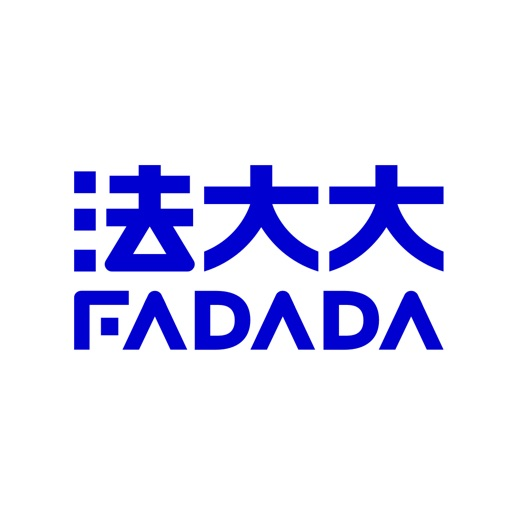 | 法大大 | [icon-appstore.jpg](../logo/fadada/icon-appstore.jpg) / wordmark | [许可未核实](https://apps.apple.com/cn/app/%E6%B3%95%E5%A4%A7%E5%A4%A7-%E7%AD%BE%E5%90%88%E5%90%8C-%E5%B0%B1%E4%B8%8A%E6%B3%95%E5%A4%A7%E5%A4%A7/id1103204022?uo=4) |  |
|  | 帆软 | [icon-blue-extracted.svg](../logo/fanruan/icon-blue-extracted.svg) / icon | [许可未核实](https://www.fanruan.com/en/) | 许可及署名条件待核实。 |
|  | 帆软 | [logo-chinese-small-official.png](../logo/fanruan/logo-chinese-small-official.png) / logo | [许可未核实](https://www.fanruan.com/download/) |  |
|  | 帆软 | [logo-english-official.svg](../logo/fanruan/logo-english-official.svg) / logo | [许可未核实](https://www.fanruan.com/en/) |  |
|  | 饭团外卖 | [icon-appstore.jpg](../logo/fantuan/icon-appstore.jpg) / icon | [许可未核实](https://apps.apple.com/ca/app/fantuan-delivery-%E9%A5%AD%E5%9B%A2%E5%A4%96%E5%8D%96/id1218697769?uo=4) |  |
| 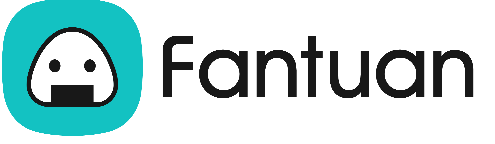 | 饭团外卖 | [logo-english-horizontal.png](../logo/fantuan/logo-english-horizontal.png) / logo | [许可未核实](https://www.fantuan.ca/en-US/about) |  |
|  | 法本信息 | [wordmark-blue.svg](../logo/farben/wordmark-blue.svg) / wordmark | [许可未核实](https://farben.com.cn/) |  |
|  | 法本信息 | [wordmark-white.svg](../logo/farben/wordmark-white.svg) / wordmark | [许可未核实](https://farben.com.cn/) |  |
|  | 趣加 | [logo.svg](../logo/funplus/logo.svg) / logo | [许可未核实](https://funplus.com/) |  |
|  | 趣加 | [symbol.svg](../logo/funplus/symbol.svg) / icon | [许可未核实](https://funplus.com/) |  |
|  | 纷享销客 | [logo-zh-tagline.png](../logo/fxiaoke/logo-zh-tagline.png) / logo | [许可未核实](https://www.fxiaoke.com/) |  |
|  | 吉比特 | [logo-bilingual.svg](../logo/g-bits/logo-bilingual.svg) / logo | [许可未核实](https://www.g-bits.com/zh/) |  |
|  | 极智嘉 | [wordmark.png](../logo/geekplus/wordmark.png) / wordmark | [许可未核实](https://www.geekplus.com/en) |  |
|  | 吉利 | [logo-black-horizontal.svg](../logo/geely/logo-black-horizontal.svg) / logo | [许可未核实](https://www.geely.com/) |  |
|  | 吉利 | [logo-black-vertical.svg](../logo/geely/logo-black-vertical.svg) / logo | [许可未核实](https://www.geely.com/) |  |
|  | 吉利 | [logo-white-horizontal.svg](../logo/geely/logo-white-horizontal.svg) / logo | [许可未核实](https://www.geely.com/) |  |
|  | 巨人网络 | [logo.png](../logo/giant-network/logo.png) / logo | [许可未核实](https://www.ztgame.com/) |  |
|  | Git | [icon-black.svg](../logo/git/icon-black.svg) / icon | [CC-BY-3.0](https://git-scm.com/community/logos) | 官方 Logo 下载页采用 CC BY 3.0，分发须保留作者署名和许可链接。Git 名称与 Logo 商标权由 Software Freedom Conservancy 代表 Git 项目持有。使用须遵循商标政策，商品销售等用途须另行取得许可，使用不得暗示官方背书。商标政策见 https://git-scm.com/about/trademark 。 |
|  | Git | [icon-orange.svg](../logo/git/icon-orange.svg) / icon | [CC-BY-3.0](https://github.com/git/git-scm.com/blob/f8a81a6dffa8f80450f8688769f9a2a57de1f545/content/community/logos.html) | 官方 Logo 下载页采用 CC BY 3.0，分发须保留作者署名和许可链接。Git 名称与 Logo 商标权由 Software Freedom Conservancy 代表 Git 项目持有。使用须遵循商标政策，商品销售等用途须另行取得许可，使用不得暗示官方背书。商标政策见 https://git-scm.com/about/trademark 。 |
|  | Git | [icon-white-extracted.svg](../logo/git/icon-white-extracted.svg) / icon | [CC-BY-3.0](https://github.com/git/git-scm.com/blob/f8a81a6dffa8f80450f8688769f9a2a57de1f545/content/community/logos.html) | 官方 Logo 下载页采用 CC BY 3.0，分发须保留作者署名和许可链接。Git 名称与 Logo 商标权由 Software Freedom Conservancy 代表 Git 项目持有。使用须遵循商标政策，商品销售等用途须另行取得许可，使用不得暗示官方背书。商标政策见 https://git-scm.com/about/trademark 。 |
|  | Git | [logo-black.svg](../logo/git/logo-black.svg) / logo | [CC-BY-3.0](https://git-scm.com/community/logos) | 官方 Logo 下载页采用 CC BY 3.0，分发须保留作者署名和许可链接。Git 名称与 Logo 商标权由 Software Freedom Conservancy 代表 Git 项目持有。使用须遵循商标政策，商品销售等用途须另行取得许可，使用不得暗示官方背书。商标政策见 https://git-scm.com/about/trademark 。 |
|  | Git | [logo-color.svg](../logo/git/logo-color.svg) / logo | [CC-BY-3.0](https://github.com/git/git-scm.com/blob/f8a81a6dffa8f80450f8688769f9a2a57de1f545/content/community/logos.html) | 官方 Logo 下载页采用 CC BY 3.0，分发须保留作者署名和许可链接。Git 名称与 Logo 商标权由 Software Freedom Conservancy 代表 Git 项目持有。使用须遵循商标政策，商品销售等用途须另行取得许可，使用不得暗示官方背书。商标政策见 https://git-scm.com/about/trademark 。 |
|  | Git | [logo-orange.svg](../logo/git/logo-orange.svg) / logo | [CC-BY-3.0](https://git-scm.com/community/logos) | 官方 Logo 下载页采用 CC BY 3.0，分发须保留作者署名和许可链接。Git 名称与 Logo 商标权由 Software Freedom Conservancy 代表 Git 项目持有。使用须遵循商标政策，商品销售等用途须另行取得许可，使用不得暗示官方背书。商标政策见 https://git-scm.com/about/trademark 。 |
|  | Git | [logo-white.svg](../logo/git/logo-white.svg) / logo | [CC-BY-3.0](https://github.com/git/git-scm.com/blob/f8a81a6dffa8f80450f8688769f9a2a57de1f545/content/community/logos.html) | 官方 Logo 下载页采用 CC BY 3.0，分发须保留作者署名和许可链接。Git 名称与 Logo 商标权由 Software Freedom Conservancy 代表 Git 项目持有。使用须遵循商标政策，商品销售等用途须另行取得许可，使用不得暗示官方背书。商标政策见 https://git-scm.com/about/trademark 。 |
|  | GitLab | [icon-black-official.svg](../logo/gitlab/icon-black-official.svg) / icon | [许可未核实](https://about.gitlab.com/press/press-kit/) |  |
|  | GitLab | [icon-color-official.svg](../logo/gitlab/icon-color-official.svg) / icon | [许可未核实](https://about.gitlab.com/press/press-kit/) |  |
|  | GitLab | [icon-color-square-extracted.svg](../logo/gitlab/icon-color-square-extracted.svg) / icon | [许可未核实](https://about.gitlab.com/press/press-kit/) | 许可及署名条件待核实。 |
|  | GitLab | [icon-legacy.png](../logo/gitlab/icon-legacy.png) / icon | [CC-BY-NC-SA-4.0](https://gitlab.com/gitlab-com/gitlab-artwork/-/raw/9b07772f44a9fa51f395a95928a6e41c61a5b1cb/README.md) | 旧版 Artwork 图标适用 CC BY-NC-SA 4.0，仅限非商业用途，需保留署名及许可链接，改编须按相同方式共享。商标权保留，此许可适用范围限于本历史文件。当前商标要求见 https://handbook.gitlab.com/handbook/marketing/brand-experience/trademark-guidelines/ 。 |
|  | GitLab | [icon-white-official.svg](../logo/gitlab/icon-white-official.svg) / icon | [许可未核实](https://about.gitlab.com/press/press-kit/) |  |
|  | GitLab | [icon-white-square-extracted.svg](../logo/gitlab/icon-white-square-extracted.svg) / icon | [许可未核实](https://about.gitlab.com/press/press-kit/) | 许可及署名条件待核实。 |
|  | GitLab | [logo-black-official.svg](../logo/gitlab/logo-black-official.svg) / logo | [许可未核实](https://about.gitlab.com/press/press-kit/) |  |
| 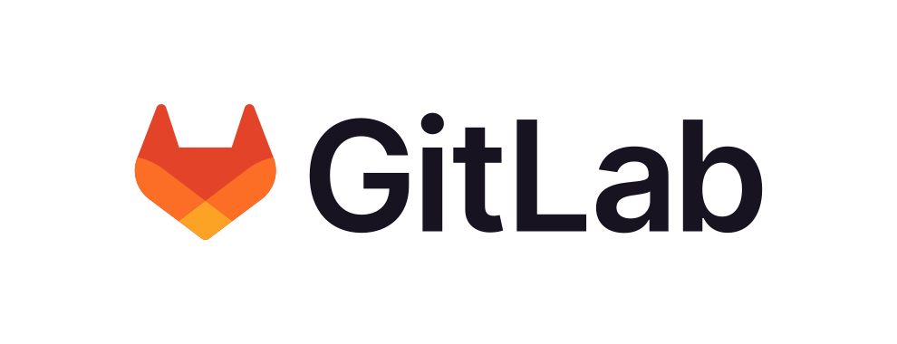 | GitLab | [logo-color-official.svg](../logo/gitlab/logo-color-official.svg) / logo | [许可未核实](https://about.gitlab.com/press/press-kit/) |  |
| 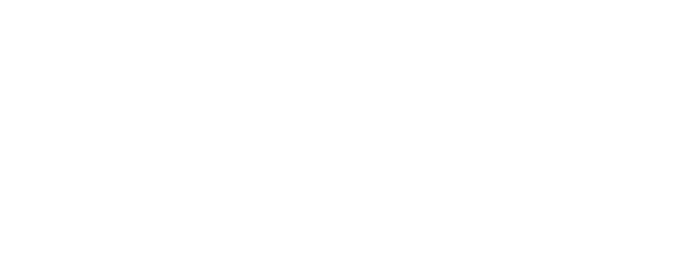 | GitLab | [logo-monochrome-white-official.svg](../logo/gitlab/logo-monochrome-white-official.svg) / logo | [许可未核实](https://about.gitlab.com/press/press-kit/) |  |
| 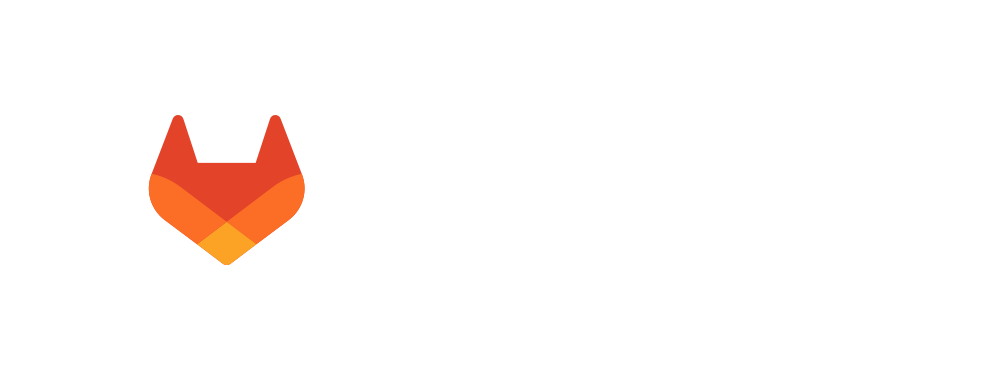 | GitLab | [logo-white-official.svg](../logo/gitlab/logo-white-official.svg) / logo | [许可未核实](https://about.gitlab.com/press/press-kit/) |  |
|  | 汇顶科技 | [wordmark-brand.svg](../logo/goodix/wordmark-brand.svg) / wordmark | [许可未核实](https://www.goodix.com/zh/) |  |
|  | 汇顶科技 | [wordmark-white.svg](../logo/goodix/wordmark-white.svg) / wordmark | [许可未核实](https://www.goodix.com/zh/) |  |
|  | 海底捞 | [logo-bilingual.svg](../logo/haidilao/logo-bilingual.svg) / logo | [许可未核实](https://www.haidilao.com/) |  |
|  | 海尔 | [wordmark-black.png](../logo/haier/wordmark-black.png) / wordmark | [许可未核实](https://www.haier.com/my/media-kit/haier-logos/20250324_258125.shtml) |  |
| 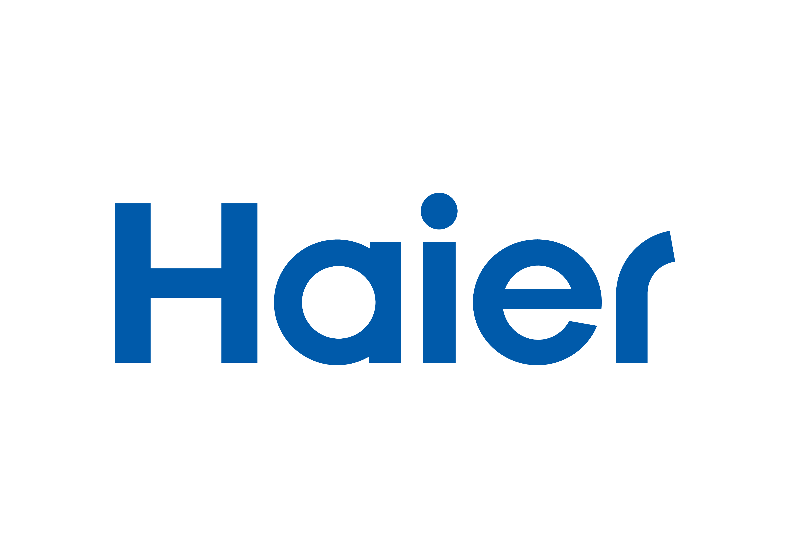 | 海尔 | [wordmark-blue.png](../logo/haier/wordmark-blue.png) / wordmark | [许可未核实](https://www.haier.com/my/media-kit/haier-logos/20250324_258124.shtml) |  |
| 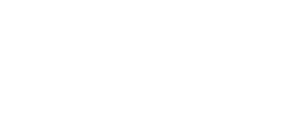 | 海尔 | [wordmark-tagline-white.png](../logo/haier/wordmark-tagline-white.png) / wordmark | [许可未核实](https://www.haier.com/careers/) |  |
|  | 海尔 | [wordmark-tagline.png](../logo/haier/wordmark-tagline.png) / wordmark | [许可未核实](https://www.haier.com/careers/) |  |
| 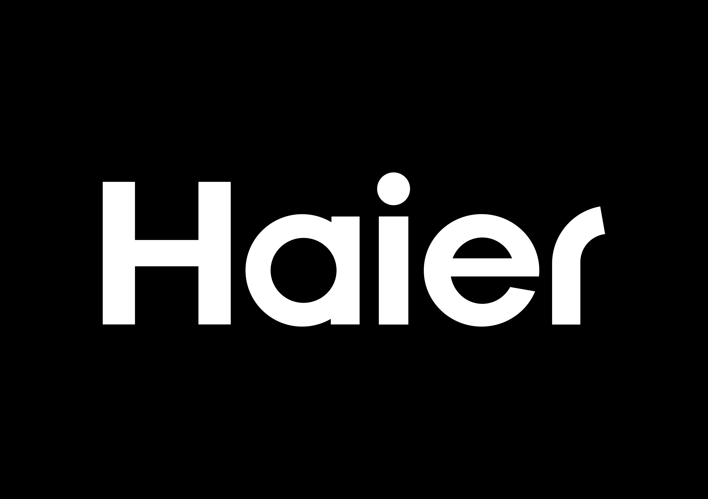 | 海尔 | [wordmark-white-black-bg.png](../logo/haier/wordmark-white-black-bg.png) / wordmark | [许可未核实](https://www.haier.com/my/media-kit/haier-logos/20250324_258127.shtml) |  |
| 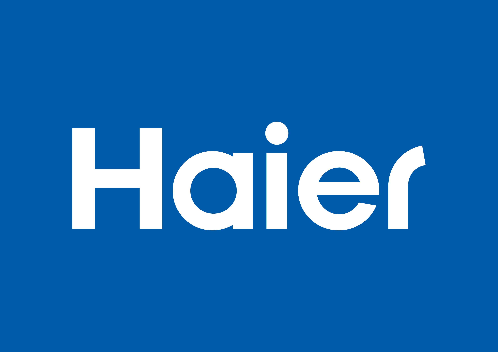 | 海尔 | [wordmark-white-blue-bg.png](../logo/haier/wordmark-white-blue-bg.png) / wordmark | [许可未核实](https://www.haier.com/my/media-kit/haier-logos/20250324_258126.shtml) |  |
| 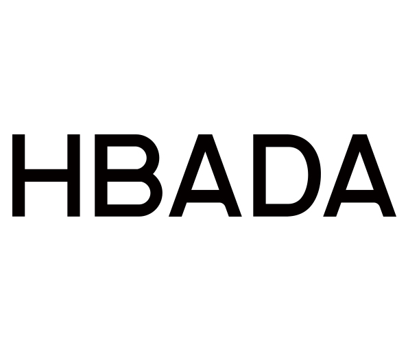 | 黑白调 | [wordmark.png](../logo/hbada/wordmark.png) / wordmark | [许可未核实](https://hbada.com/) |  |
| 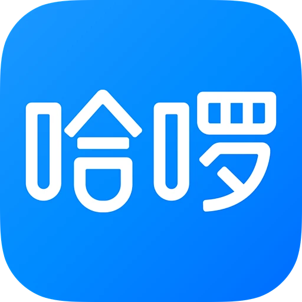 | 哈啰 | [icon-app.webp](../logo/hello/icon-app.webp) / icon | [许可未核实](https://www.hello-inc.com/) |  |
|  | 哈啰 | [wordmark-zh.png](../logo/hello/wordmark-zh.png) / wordmark | [许可未核实](https://www.hello-inc.com/) |  |
|  | 挚文集团 | [brand-logo.png](../logo/hello-group/brand-logo.png) / logo | [许可未核实](https://www.hellogroup.com/) |  |
|  | 挚文集团 | [logo-zh-white-header.svg](../logo/hello-group/logo-zh-white-header.svg) / logo | [许可未核实](https://www.hellogroup.com/) |  |
|  | 挚文集团 | [symbol.png](../logo/hello-group/symbol.png) / icon | [许可未核实](https://www.hellogroup.com/) |  |
|  | 海康威视 | [wordmark.png](../logo/hikvision/wordmark.png) / wordmark | [许可未核实](https://iberia.hikvision.com/es/hikcentral) |  |
|  | 经纬恒润 | [logo-bilingual-small-official.png](../logo/hirain/logo-bilingual-small-official.png) / logo | [许可未核实](https://www.hirain.com/) |  |
|  | 荣耀 | [logo-black-horizontal-2026.svg](../logo/honor/logo-black-horizontal-2026.svg) / logo | [许可未核实](https://www.honor.com/cn/brand-guideline/basics/logo/) | 工具包声明适用于个人、编辑及非商业用途；品牌规范要求经合同或协议授权使用。遵守官方标志完整性和安全空间要求。 |
|  | 荣耀 | [logo-black-vertical-2026.svg](../logo/honor/logo-black-vertical-2026.svg) / logo | [许可未核实](https://www.honor.com/cn/brand-guideline/basics/logo/) | 工具包声明适用于个人、编辑及非商业用途；品牌规范要求经合同或协议授权使用。遵守官方标志完整性和安全空间要求。 |
|  | 荣耀 | [logo-color-black-horizontal-2026.svg](../logo/honor/logo-color-black-horizontal-2026.svg) / logo | [许可未核实](https://www.honor.com/cn/brand-guideline/basics/logo/) | 工具包声明适用于个人、编辑及非商业用途；品牌规范要求经合同或协议授权使用。遵守官方标志完整性和安全空间要求。 |
|  | 荣耀 | [logo-color-black-vertical-2026.svg](../logo/honor/logo-color-black-vertical-2026.svg) / logo | [许可未核实](https://www.honor.com/cn/brand-guideline/basics/logo/) | 工具包声明适用于个人、编辑及非商业用途；品牌规范要求经合同或协议授权使用。遵守官方标志完整性和安全空间要求。 |
| 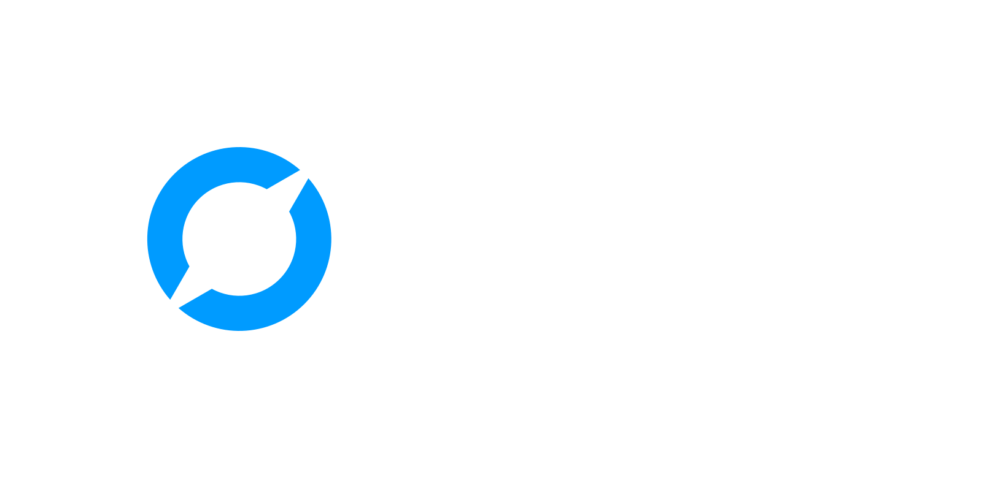 | 荣耀 | [logo-color-white-horizontal-2026.svg](../logo/honor/logo-color-white-horizontal-2026.svg) / logo | [许可未核实](https://www.honor.com/cn/brand-guideline/basics/logo/) | 工具包声明适用于个人、编辑及非商业用途；品牌规范要求经合同或协议授权使用。遵守官方标志完整性和安全空间要求。 |
| 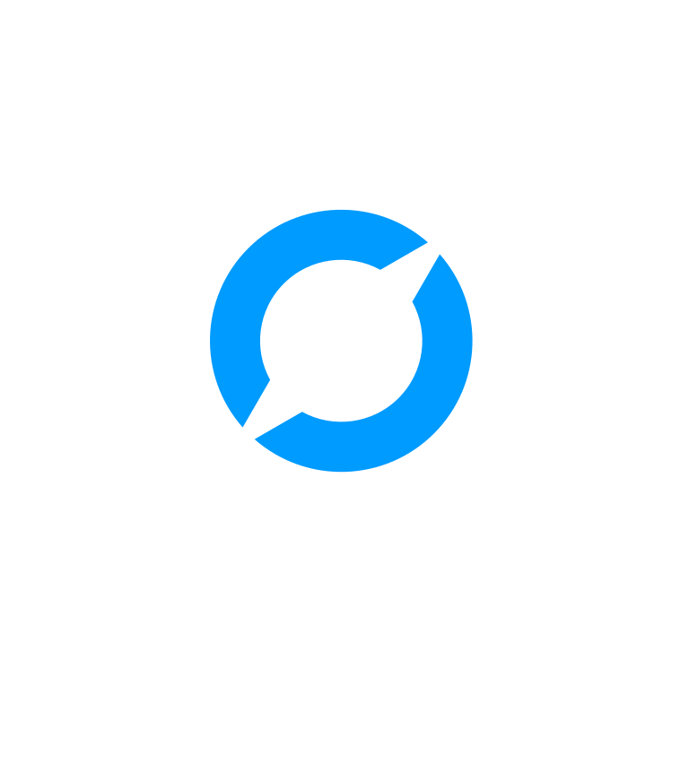 | 荣耀 | [logo-color-white-vertical-2026.svg](../logo/honor/logo-color-white-vertical-2026.svg) / logo | [许可未核实](https://www.honor.com/cn/brand-guideline/basics/logo/) | 工具包声明适用于个人、编辑及非商业用途；品牌规范要求经合同或协议授权使用。遵守官方标志完整性和安全空间要求。 |
| 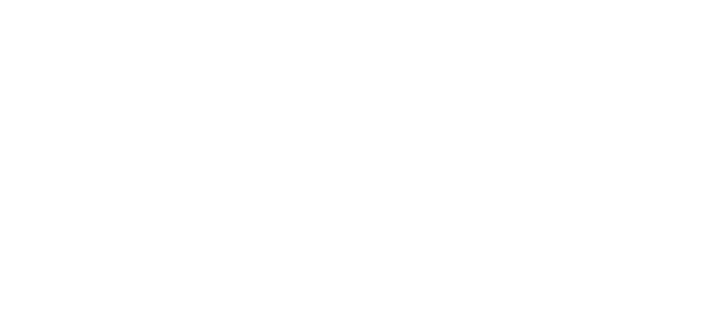 | 荣耀 | [logo-white-horizontal-2026.svg](../logo/honor/logo-white-horizontal-2026.svg) / logo | [许可未核实](https://www.honor.com/cn/brand-guideline/basics/logo/) | 工具包声明适用于个人、编辑及非商业用途；品牌规范要求经合同或协议授权使用。遵守官方标志完整性和安全空间要求。 |
| 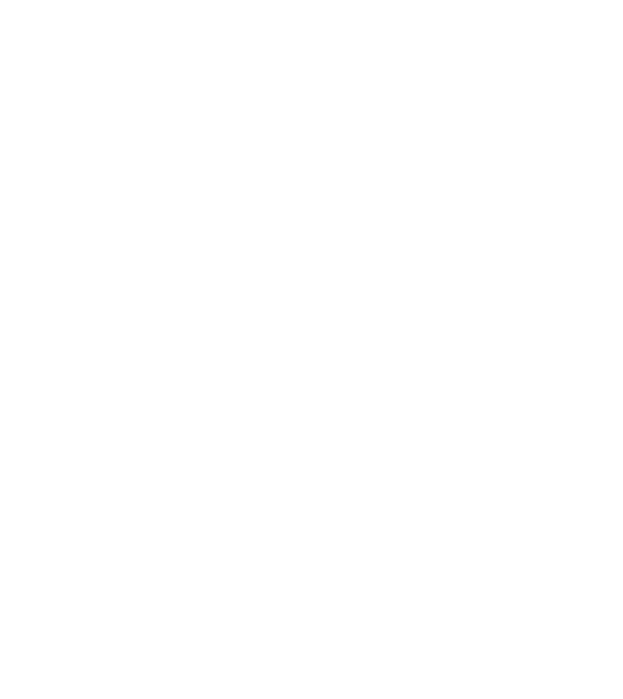 | 荣耀 | [logo-white-vertical-2026.svg](../logo/honor/logo-white-vertical-2026.svg) / logo | [许可未核实](https://www.honor.com/cn/brand-guideline/basics/logo/) | 工具包声明适用于个人、编辑及非商业用途；品牌规范要求经合同或协议授权使用。遵守官方标志完整性和安全空间要求。 |
|  | 荣耀 | [wordmark-black-2020.svg](../logo/honor/wordmark-black-2020.svg) / wordmark | [Public domain &#40;textlogo&#41;](https://commons.wikimedia.org/w/index.php?title=File%3AHonor_Logo_%282020%29.svg&oldid=1107928605) | 版权依据采用所引 Wikimedia Commons 具体文件页的 PD-textlogo 第三方公共领域判定，图库分发依据限于该判定。商标权及其他使用限制保留，使用不得暗示官方背书。不同法域的原创性门槛可能不同。官方品牌规范要求通过合同或协议取得标志使用授权。使用要求见 https://www.honor.com/cn/brand-guideline/basics/logo/ 和 https://www.honor.com/cn/company-trademark-policy/ 。 |
|  | 华盛通 | [logo-zh.png](../logo/hstong/logo-zh.png) / logo | [许可未核实](https://www.hstong.com/about/recruit) |  |
| 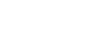 | 华盛通 | [wordmark-white.png](../logo/hstong/wordmark-white.png) / wordmark | [许可未核实](https://www.hstong.com/about/recruit) |  |
|  | 华勤 | [logo-white.svg](../logo/huaqin/logo-white.svg) / logo | [许可未核实](https://www.huaqin.com/) |  |
|  | 华勤 | [logo-zh.png](../logo/huaqin/logo-zh.png) / logo | [许可未核实](https://www.huaqin.com/) |  |
|  | 华顺信安 | [logo-bilingual.svg](../logo/huashunxinan/logo-bilingual.svg) / logo | [许可未核实](https://huashunxinan.net/) |  |
| 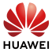 | 华为 | [logo-color-vertical-official.svg](../logo/huawei/logo-color-vertical-official.svg) / logo | [许可未核实](https://www.huawei.com/en/media-center/multimedia) |  |
| 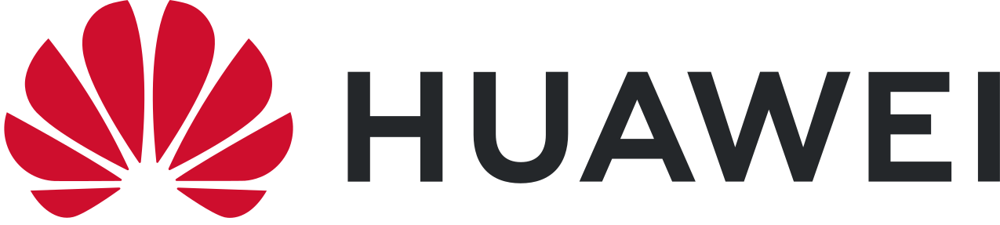 | 华为 | [logo-flat-horizontal-official.svg](../logo/huawei/logo-flat-horizontal-official.svg) / logo | [许可未核实](https://consumer.huawei.com/cn/) |  |
| 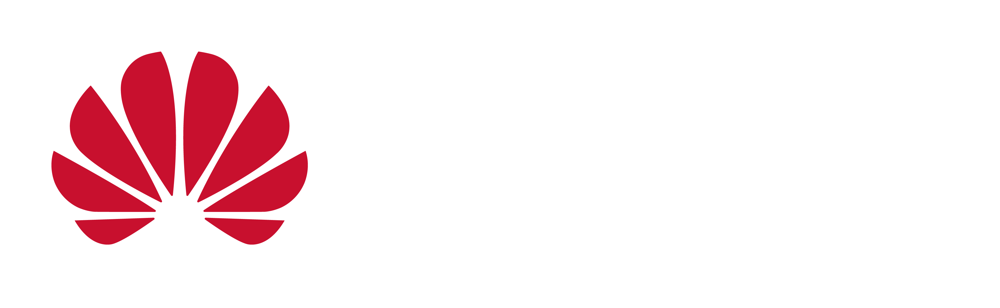 | 华为 | [logo-flat-white-horizontal-official.png](../logo/huawei/logo-flat-white-horizontal-official.png) / logo | [许可未核实](https://consumer.huawei.com/cn/) |  |
|  | 华为 | [logo-horizontal-header.png](../logo/huawei/logo-horizontal-header.png) / logo | [许可未核实](https://www.huawei.com/en/media-center/multimedia) |  |
|  | 华为 | [wordmark-dark-2018.png](../logo/huawei/wordmark-dark-2018.png) / wordmark | [Public domain &#40;textlogo&#41;](https://commons.wikimedia.org/w/index.php?title=File%3AHuawei_wordmark_2019.svg&oldid=1123513783) | 版权依据采用所引 Wikimedia Commons 具体文件页的 PD-textlogo 第三方公共领域判定，图库分发依据限于该判定。商标权及其他使用限制保留，使用不得暗示官方背书。不同法域的原创性门槛可能不同。适用作品为 2018 年起使用的 HUAWEI 文字标识。 |
|  | 花小小新疆炒米粉 | [icon.png](../logo/huaxiaoxiao/icon.png) / icon | [许可未核实](https://huaxx.cn/) |  |
|  | 花小小新疆炒米粉 | [logo-zh.png](../logo/huaxiaoxiao/logo-zh.png) / logo | [许可未核实](https://huaxx.cn/) |  |
|  | 恒生电子 | [wordmark-color-official.png](../logo/hundsun/wordmark-color-official.png) / wordmark | [许可未核实](https://campus.hundsun.com/campus) |  |
|  | 恒生电子 | [wordmark-header-original.png](../logo/hundsun/wordmark-header-original.png) / wordmark | [许可未核实](https://www.hundsun.com/) |  |
|  | 腾讯混元 | [logo-chinese-color-official.png](../logo/hunyuan/logo-chinese-color-official.png) / logo | [许可未核实](https://hunyuan.tencent.com/) |  |
|  | 腾讯混元 | [symbol-color-official.svg](../logo/hunyuan/symbol-color-official.svg) / icon | [许可未核实](https://hunyuan.tencent.com/) |  |
|  | 腾讯混元 | [symbol-color-square-extracted.svg](../logo/hunyuan/symbol-color-square-extracted.svg) / icon | [许可未核实](https://hunyuan.tencent.com/) |  |
|  | 货拉拉 | [wordmark-zh.png](../logo/huolala/wordmark-zh.png) / wordmark | [许可未核实](https://www.huolala.cn/) |  |
| 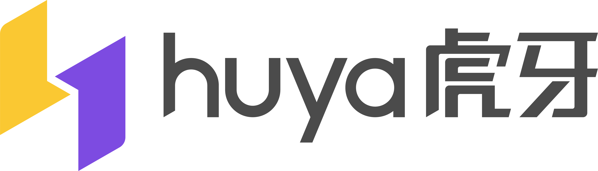 | 虎牙 | [logo-corporate.png](../logo/huya/logo-corporate.png) / logo | [许可未核实](https://hd.huya.com/pc/contactUs/) | 官方标志下载页注明本公司 Logo 禁止授权之外的使用。 |
|  | 中国工商银行 | [logo.png](../logo/icbc/logo.png) / logo | [许可未核实](https://www.icbc.com.cn/ICBCLtd/%E5%85%B3%E4%BA%8E%E6%88%91%E8%A1%8C/%E9%9B%86%E5%9B%A2%E5%93%81%E7%89%8C/jcgf.htm) | 集团标识基础规范声明，未经许可不得修改、复制或以其它方式使用工商银行商业标识。 |
|  | 科大讯飞 | [icon-blue-extracted.svg](../logo/iflytek/icon-blue-extracted.svg) / icon | [Public domain &#40;textlogo; third-party assessment&#41;](https://commons.wikimedia.org/wiki/File:IFlytek_logo.png) | 版权依据采用所引 Wikimedia Commons 具体文件页的 PD-textlogo 第三方公共领域判定，图库分发依据限于该判定。商标权及其他使用限制保留，使用不得暗示官方背书。不同法域的原创性门槛可能不同。适用范围限于相同 X 图形和 iFLYTEK 字标。 |
|  | 科大讯飞 | [logo-black-bilingual.png](../logo/iflytek/logo-black-bilingual.png) / logo | [Public domain &#40;textlogo&#41;](https://commons.wikimedia.org/w/index.php?title=File:IFlytek_logo.png&oldid=1015993493) | 版权依据采用所引 Wikimedia Commons 具体文件页的 PD-textlogo 第三方公共领域判定，图库分发依据限于该判定。商标权及其他使用限制保留，使用不得暗示官方背书。不同法域的原创性门槛可能不同。适用范围为科大讯飞 X 图形、中文名和 iFLYTEK 字标的相应组合及单色版本。 |
|  | 科大讯飞 | [logo-blue-bilingual.png](../logo/iflytek/logo-blue-bilingual.png) / logo | [Public domain &#40;textlogo&#41;](https://commons.wikimedia.org/w/index.php?title=File:IFlytek_logo.png&oldid=1015993493) | 版权依据采用所引 Wikimedia Commons 具体文件页的 PD-textlogo 第三方公共领域判定，图库分发依据限于该判定。商标权及其他使用限制保留，使用不得暗示官方背书。不同法域的原创性门槛可能不同。适用范围为科大讯飞 X 图形、中文名和 iFLYTEK 字标的相应组合及单色版本。 |
|  | 科大讯飞 | [logo-english-official.svg](../logo/iflytek/logo-english-official.svg) / logo | [Public domain &#40;textlogo; third-party assessment&#41;](https://commons.wikimedia.org/wiki/File:IFlytek_logo.png) | 版权依据采用所引 Wikimedia Commons 具体文件页的 PD-textlogo 第三方公共领域判定，图库分发依据限于该判定。商标权及其他使用限制保留，使用不得暗示官方背书。不同法域的原创性门槛可能不同。适用范围限于相同 X 图形和 iFLYTEK 字标。 |
|  | 科大讯飞 | [logo-white-bilingual.png](../logo/iflytek/logo-white-bilingual.png) / logo | [Public domain &#40;textlogo&#41;](https://commons.wikimedia.org/w/index.php?title=File:IFlytek_logo.png&oldid=1015993493) | 版权依据采用所引 Wikimedia Commons 具体文件页的 PD-textlogo 第三方公共领域判定，图库分发依据限于该判定。商标权及其他使用限制保留，使用不得暗示官方背书。不同法域的原创性门槛可能不同。适用范围为科大讯飞 X 图形、中文名和 iFLYTEK 字标的相应组合及单色版本。 |
|  | 科大讯飞 | [logo-white-english-official.svg](../logo/iflytek/logo-white-english-official.svg) / logo | [许可未核实](https://www.iflytek.com/en/) |  |
|  | 华橙 | [wordmark-imou-orange.png](../logo/imou/wordmark-imou-orange.png) / wordmark | [许可未核实](https://www.imou.com/cn/) |  |
|  | 华橙 | [wordmark-imou-white.png](../logo/imou/wordmark-imou-white.png) / wordmark | [许可未核实](https://www.imou.com/cn/) |  |
|  | 汇川技术 | [wordmark-blue-official.png](../logo/inovance/wordmark-blue-official.png) / wordmark | [Public domain &#40;textlogo; third-party assessment&#41;](https://commons.wikimedia.org/w/index.php?title=File:Shenzhen_Inovance_Technology.svg&oldid=1117280283) | 版权依据采用所引 Wikimedia Commons 具体文件页的 PD-textlogo 第三方公共领域判定，图库分发依据限于该判定。商标权及其他使用限制保留，使用不得暗示官方背书。不同法域的原创性门槛可能不同。适用范围限于相同 INOVANCE 英文字形。 |
| 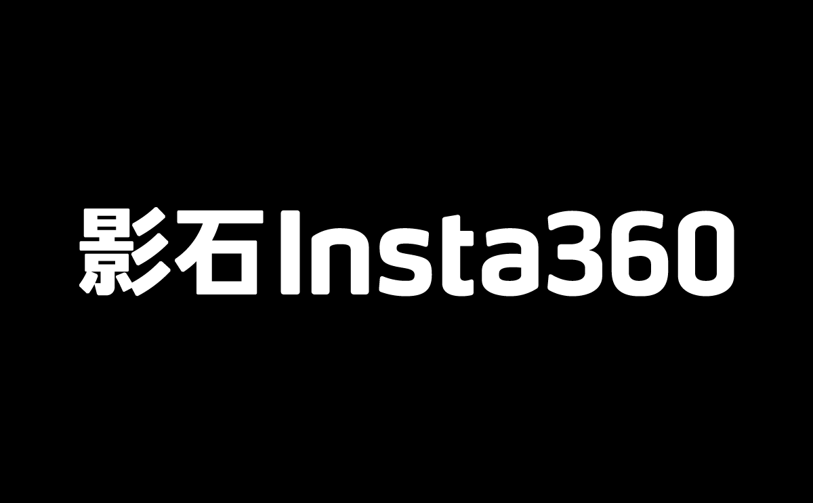 | 影石 | [wordmark-black-horizontal.png](../logo/insta360/wordmark-black-horizontal.png) / wordmark | [许可未核实](https://www.insta360.com/cn/press/logo) | 品牌销售方向直接使用 Logo；品牌传播方向酌情使用 Logo 与 Slogan 组合。 |
| 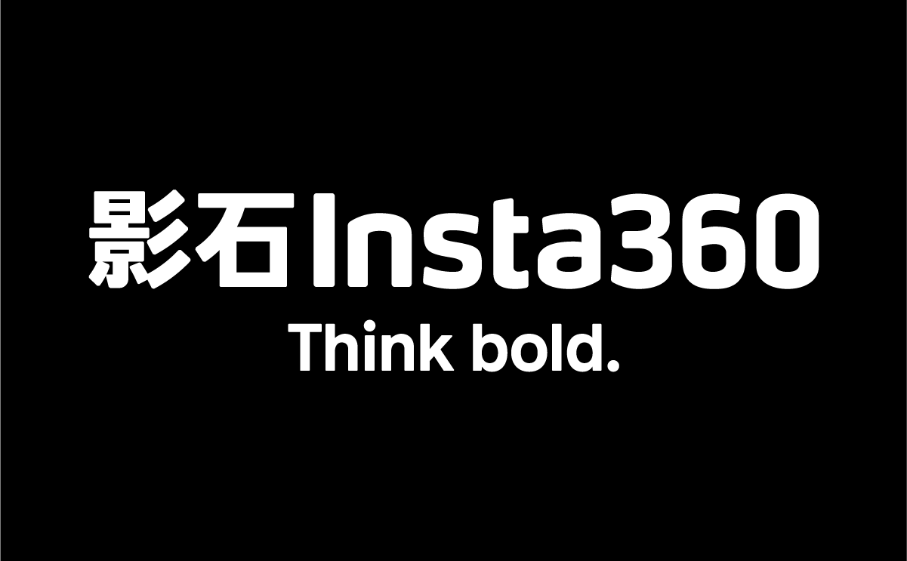 | 影石 | [wordmark-black-slogan-en-center.png](../logo/insta360/wordmark-black-slogan-en-center.png) / wordmark | [许可未核实](https://www.insta360.com/cn/press/logo) | 品牌销售方向直接使用 Logo；品牌传播方向酌情使用 Logo 与 Slogan 组合。 |
| 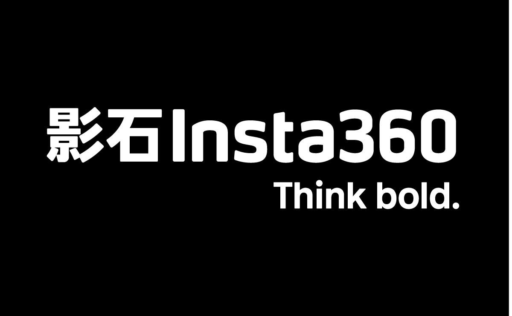 | 影石 | [wordmark-black-slogan-en-right.png](../logo/insta360/wordmark-black-slogan-en-right.png) / wordmark | [许可未核实](https://www.insta360.com/cn/press/logo) | 品牌销售方向直接使用 Logo；品牌传播方向酌情使用 Logo 与 Slogan 组合。 |
| 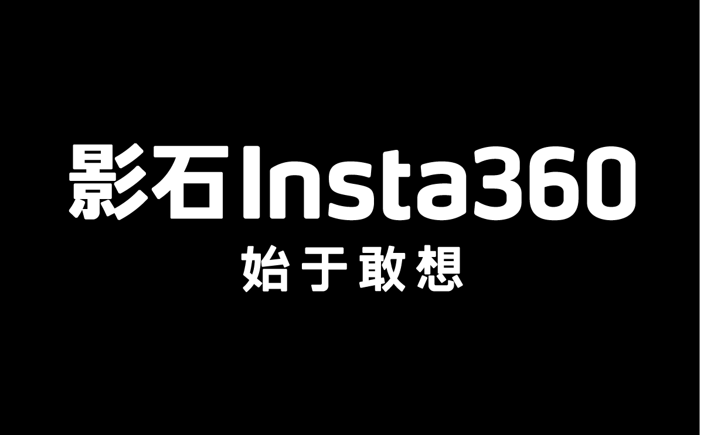 | 影石 | [wordmark-black-slogan-zh-center.png](../logo/insta360/wordmark-black-slogan-zh-center.png) / wordmark | [许可未核实](https://www.insta360.com/cn/press/logo) | 品牌销售方向直接使用 Logo；品牌传播方向酌情使用 Logo 与 Slogan 组合。 |
|  | 影石 | [wordmark-black-slogan-zh-right.png](../logo/insta360/wordmark-black-slogan-zh-right.png) / wordmark | [许可未核实](https://www.insta360.com/cn/press/logo) | 品牌销售方向直接使用 Logo；品牌传播方向酌情使用 Logo 与 Slogan 组合。 |
|  | 影石 | [wordmark-black-vertical.png](../logo/insta360/wordmark-black-vertical.png) / wordmark | [许可未核实](https://www.insta360.com/cn/press/logo) | 品牌销售方向直接使用 Logo；品牌传播方向酌情使用 Logo 与 Slogan 组合。 |
|  | 影石 | [wordmark-black.svg](../logo/insta360/wordmark-black.svg) / wordmark | [许可未核实](https://www.insta360.com/cn/press/logo) | 品牌销售方向直接使用 Logo；品牌传播方向酌情使用 Logo 与 Slogan 组合。 |
|  | 影石 | [wordmark-transparent-black-slogan-en-center.png](../logo/insta360/wordmark-transparent-black-slogan-en-center.png) / wordmark | [许可未核实](https://www.insta360.com/cn/press/logo) | 品牌销售方向直接使用 Logo；品牌传播方向酌情使用 Logo 与 Slogan 组合。 |
|  | 影石 | [wordmark-transparent-black-slogan-en-right.png](../logo/insta360/wordmark-transparent-black-slogan-en-right.png) / wordmark | [许可未核实](https://www.insta360.com/cn/press/logo) | 品牌销售方向直接使用 Logo；品牌传播方向酌情使用 Logo 与 Slogan 组合。 |
|  | 影石 | [wordmark-transparent-black-slogan-zh-center.png](../logo/insta360/wordmark-transparent-black-slogan-zh-center.png) / wordmark | [许可未核实](https://www.insta360.com/cn/press/logo) | 品牌销售方向直接使用 Logo；品牌传播方向酌情使用 Logo 与 Slogan 组合。 |
|  | 影石 | [wordmark-transparent-black-slogan-zh-right.png](../logo/insta360/wordmark-transparent-black-slogan-zh-right.png) / wordmark | [许可未核实](https://www.insta360.com/cn/press/logo) | 品牌销售方向直接使用 Logo；品牌传播方向酌情使用 Logo 与 Slogan 组合。 |
|  | 影石 | [wordmark-transparent-black-vertical.png](../logo/insta360/wordmark-transparent-black-vertical.png) / wordmark | [许可未核实](https://www.insta360.com/cn/press/logo) | 品牌销售方向直接使用 Logo；品牌传播方向酌情使用 Logo 与 Slogan 组合。 |
|  | 影石 | [wordmark-transparent-white-slogan-en-center.png](../logo/insta360/wordmark-transparent-white-slogan-en-center.png) / wordmark | [许可未核实](https://www.insta360.com/cn/press/logo) | 品牌销售方向直接使用 Logo；品牌传播方向酌情使用 Logo 与 Slogan 组合。 |
|  | 影石 | [wordmark-transparent-white-slogan-en-right.png](../logo/insta360/wordmark-transparent-white-slogan-en-right.png) / wordmark | [许可未核实](https://www.insta360.com/cn/press/logo) | 品牌销售方向直接使用 Logo；品牌传播方向酌情使用 Logo 与 Slogan 组合。 |
|  | 影石 | [wordmark-transparent-white-slogan-zh-center.png](../logo/insta360/wordmark-transparent-white-slogan-zh-center.png) / wordmark | [许可未核实](https://www.insta360.com/cn/press/logo) | 品牌销售方向直接使用 Logo；品牌传播方向酌情使用 Logo 与 Slogan 组合。 |
|  | 影石 | [wordmark-transparent-white-slogan-zh-right.png](../logo/insta360/wordmark-transparent-white-slogan-zh-right.png) / wordmark | [许可未核实](https://www.insta360.com/cn/press/logo) | 品牌销售方向直接使用 Logo；品牌传播方向酌情使用 Logo 与 Slogan 组合。 |
|  | 影石 | [wordmark-transparent-white-vertical.png](../logo/insta360/wordmark-transparent-white-vertical.png) / wordmark | [许可未核实](https://www.insta360.com/cn/press/logo) | 品牌销售方向直接使用 Logo；品牌传播方向酌情使用 Logo 与 Slogan 组合。 |
|  | 影石 | [wordmark-white.svg](../logo/insta360/wordmark-white.svg) / wordmark | [许可未核实](https://www.insta360.com/cn/press/logo) | 品牌销售方向直接使用 Logo；品牌传播方向酌情使用 Logo 与 Slogan 组合。 |
|  | 影石 | [wordmark-yellow-horizontal.png](../logo/insta360/wordmark-yellow-horizontal.png) / wordmark | [许可未核实](https://www.insta360.com/cn/press/logo) | 品牌销售方向直接使用 Logo；品牌传播方向酌情使用 Logo 与 Slogan 组合。 |
|  | 影石 | [wordmark-yellow-slogan-en-center.png](../logo/insta360/wordmark-yellow-slogan-en-center.png) / wordmark | [许可未核实](https://www.insta360.com/cn/press/logo) | 品牌销售方向直接使用 Logo；品牌传播方向酌情使用 Logo 与 Slogan 组合。 |
|  | 影石 | [wordmark-yellow-slogan-en-right.png](../logo/insta360/wordmark-yellow-slogan-en-right.png) / wordmark | [许可未核实](https://www.insta360.com/cn/press/logo) | 品牌销售方向直接使用 Logo；品牌传播方向酌情使用 Logo 与 Slogan 组合。 |
|  | 影石 | [wordmark-yellow-slogan-zh-center.jpg](../logo/insta360/wordmark-yellow-slogan-zh-center.jpg) / wordmark | [许可未核实](https://www.insta360.com/cn/press/logo) | 品牌销售方向直接使用 Logo；品牌传播方向酌情使用 Logo 与 Slogan 组合。 |
|  | 影石 | [wordmark-yellow-slogan-zh-right.png](../logo/insta360/wordmark-yellow-slogan-zh-right.png) / wordmark | [许可未核实](https://www.insta360.com/cn/press/logo) | 品牌销售方向直接使用 Logo；品牌传播方向酌情使用 Logo 与 Slogan 组合。 |
|  | 影石 | [wordmark-yellow-vertical.jpg](../logo/insta360/wordmark-yellow-vertical.jpg) / wordmark | [许可未核实](https://www.insta360.com/cn/press/logo) | 品牌销售方向直接使用 Logo；品牌传播方向酌情使用 Logo 与 Slogan 组合。 |
|  | 爱奇艺 | [wordmark-black-print-official.png](../logo/iqiyi/wordmark-black-print-official.png) / wordmark | [许可未核实](https://www.iqiyi.com/common/biaozhiguifan.html) |  |
|  | 爱奇艺 | [wordmark-green.svg](../logo/iqiyi/wordmark-green.svg) / wordmark | [Public domain &#40;textlogo&#41;](https://commons.wikimedia.org/w/index.php?title=File%3AIQIYI_logo_%282022%29.svg&oldid=1277926211) | 版权依据采用所引 Wikimedia Commons 具体文件页的 PD-textlogo 第三方公共领域判定，图库分发依据限于该判定。商标权及其他使用限制保留，使用不得暗示官方背书。不同法域的原创性门槛可能不同。 |
|  | 爱奇艺 | [wordmark-white-official.png](../logo/iqiyi/wordmark-white-official.png) / wordmark | [许可未核实](https://www.iqiyi.com/common/biaozhiguifan.html) |  |
|  | 树根科技 | [logo-bilingual-black-official.png](../logo/irootech/logo-bilingual-black-official.png) / logo | [许可未核实](https://www.irootech.com/) |  |
|  | 树根科技 | [wordmark-en-header-original.png](../logo/irootech/wordmark-en-header-original.png) / wordmark | [许可未核实](https://en.irootech.com/) |  |
|  | 易思维 | [logo-bilingual.png](../logo/isvision/logo-bilingual.png) / logo | [许可未核实](https://www.isv-tech.com/) |  |
|  | 易思维 | [logo-white.png](../logo/isvision/logo-white.png) / logo | [许可未核实](https://www.isv-tech.com/) |  |
|  | 江淮汽车 | [wordmark-bilingual.png](../logo/jac/wordmark-bilingual.png) / wordmark | [许可未核实](https://www.jac.com.cn/rczp/) |  |
|  | 京东 | [icon-google-play-official.png](../logo/jd/icon-google-play-official.png) / icon | [许可未核实](https://play.google.com/store/apps/details?id=com.jingdong.app.mall&hl=zh) |  |
|  | 京东 | [logo-en-ir-official.png](../logo/jd/logo-en-ir-official.png) / logo | [许可未核实](https://ir.jd.com/) |  |
|  | 京东 | [logo-header-official.png](../logo/jd/logo-header-official.png) / logo | [许可未核实](https://about.jd.com/) |  |
|  | 九方智投 | [logo-with-tagline.png](../logo/jfzt/logo-with-tagline.png) / logo | [许可未核实](https://www.9fzt.com/) |  |
|  | 靖安科技 | [logo-bilingual.png](../logo/jingan-tech/logo-bilingual.png) / logo | [许可未核实](https://career.sustech.edu.cn/detail/online?id=3625479) |  |
|  | 乐堡互娱 | [logo-light.svg](../logo/joycastle/logo-light.svg) / logo | [许可未核实](https://www.joycastle.mobi/) |  |
|  | 乐堡互娱 | [logo.svg](../logo/joycastle/logo.svg) / logo | [许可未核实](https://www.joycastle.mobi/) |  |
|  | 乐堡互娱 | [symbol.svg](../logo/joycastle/symbol.svg) / icon | [许可未核实](https://www.joycastle.mobi/) |  |
|  | 极兔 | [logo-brand.png](../logo/jt-express/logo-brand.png) / logo | [许可未核实](https://www.jtexpress.com.cn/) |  |
|  | 极兔 | [logo-white.png](../logo/jt-express/logo-white.png) / logo | [许可未核实](https://www.jtexpress.com.cn/) |  |
|  | 金蝶 | [logo-color-chinese-header.png](../logo/kingdee/logo-color-chinese-header.png) / logo | [许可未核实](https://www.kingdee.com/) |  |
|  | 金蝶 | [logo-color-english-official.svg](../logo/kingdee/logo-color-english-official.svg) / logo | [许可未核实](https://www.kingdee.com/global/company-information/) |  |
|  | 金山软件 | [logo-bilingual.png](../logo/kingsoft/logo-bilingual.png) / logo | [许可未核实](https://www.kingsoft.com/) |  |
|  | 金山办公 | [logo-bilingual.svg](../logo/kingsoft-office/logo-bilingual.svg) / logo | [许可未核实](https://www.wps.cn/KINGSOFT) |  |
|  | 金山办公 | [symbol-brand.svg](../logo/kingsoft-office/symbol-brand.svg) / icon | [许可未核实](https://www.wps.cn/KINGSOFT) |  |
|  | 客路 | [logo-rgb-official.png](../logo/klook/logo-rgb-official.png) / logo | [许可未核实](https://www.prnewswire.com/news-releases/klook-rebrands-signaling-the-transformation-of-its-business-to-power-a-new-future-of-travel-301492309.html) | Klook 官方新闻稿所链接的品牌重塑媒体素材包。官方公开提供下载，仓库再分发授权及具体使用条件尚未核实。 |
|  | 康冠科技 | [logo.png](../logo/ktc/logo.png) / logo | [许可未核实](https://www.ktc.cn/) |  |
|  | 快商通 | [logo.png](../logo/kuaishang/logo.png) / logo | [许可未核实](https://www.kuaishang.cn/) |  |
|  | 快手 | [icon-orange-official.png](../logo/kuaishou/icon-orange-official.png) / icon | [Public domain &#40;textlogo; third-party assessment&#41;](https://commons.wikimedia.org/w/index.php?title=File:Kuaishou_logo.png&oldid=686719154) | 版权依据采用所引 Wikimedia Commons 具体文件页的 PD-textlogo 第三方公共领域判定，图库分发依据限于该判定。商标权及其他使用限制保留，使用不得暗示官方背书。不同法域的原创性门槛可能不同。适用范围为相同摄影机图形及 KUAISHOU 英文组合。官方素材页另要求用于宣传推广快手产品、署名及保持标识完整性。 |
|  | 快手 | [icon-rounded-official.png](../logo/kuaishou/icon-rounded-official.png) / icon | [Public domain &#40;textlogo; third-party assessment&#41;](https://commons.wikimedia.org/w/index.php?title=File:Kuaishou_logo.png&oldid=686719154) | 版权依据采用所引 Wikimedia Commons 具体文件页的 PD-textlogo 第三方公共领域判定，图库分发依据限于该判定。商标权及其他使用限制保留，使用不得暗示官方背书。不同法域的原创性门槛可能不同。适用范围为相同摄影机图形及 KUAISHOU 英文组合。官方素材页另要求用于宣传推广快手产品、署名及保持标识完整性。 |
|  | 快手 | [logo-chinese-horizontal-color.png](../logo/kuaishou/logo-chinese-horizontal-color.png) / logo | [许可未核实](https://www.kuaishou.com/official/material-lib) | 素材页面允许宣传推广快手产品时下载使用，需标明来源为快手网站并保持完整比例；许可及再次分发条件待核实。 |
|  | 快手 | [logo-chinese-horizontal-dark-background.png](../logo/kuaishou/logo-chinese-horizontal-dark-background.png) / logo | [许可未核实](https://www.kuaishou.com/official/material-lib) | 素材页面允许宣传推广快手产品时下载使用，需标明来源为快手网站并保持完整比例；许可及再次分发条件待核实。 |
|  | 快手 | [logo-chinese-horizontal-orange-background.png](../logo/kuaishou/logo-chinese-horizontal-orange-background.png) / logo | [许可未核实](https://www.kuaishou.com/official/material-lib) | 素材页面允许宣传推广快手产品时下载使用，需标明来源为快手网站并保持完整比例；许可及再次分发条件待核实。 |
|  | 快手 | [logo-chinese-slogan-color.png](../logo/kuaishou/logo-chinese-slogan-color.png) / logo | [许可未核实](https://www.kuaishou.com/official/material-lib) | 素材页面允许宣传推广快手产品时下载使用，需标明来源为快手网站并保持完整比例；许可及再次分发条件待核实。 |
|  | 快手 | [logo-chinese-slogan-dark-background.png](../logo/kuaishou/logo-chinese-slogan-dark-background.png) / logo | [许可未核实](https://www.kuaishou.com/official/material-lib) | 素材页面允许宣传推广快手产品时下载使用，需标明来源为快手网站并保持完整比例；许可及再次分发条件待核实。 |
|  | 快手 | [logo-chinese-slogan-orange-background.png](../logo/kuaishou/logo-chinese-slogan-orange-background.png) / logo | [许可未核实](https://www.kuaishou.com/official/material-lib) | 素材页面允许宣传推广快手产品时下载使用，需标明来源为快手网站并保持完整比例；许可及再次分发条件待核实。 |
|  | 快手 | [logo-chinese-vertical-color.png](../logo/kuaishou/logo-chinese-vertical-color.png) / logo | [许可未核实](https://www.kuaishou.com/official/material-lib) | 素材页面允许宣传推广快手产品时下载使用，需标明来源为快手网站并保持完整比例；许可及再次分发条件待核实。 |
|  | 快手 | [logo-chinese-vertical-dark-background.png](../logo/kuaishou/logo-chinese-vertical-dark-background.png) / logo | [许可未核实](https://www.kuaishou.com/official/material-lib) | 素材页面允许宣传推广快手产品时下载使用，需标明来源为快手网站并保持完整比例；许可及再次分发条件待核实。 |
|  | 快手 | [logo-chinese-vertical-orange-background.png](../logo/kuaishou/logo-chinese-vertical-orange-background.png) / logo | [许可未核实](https://www.kuaishou.com/official/material-lib) | 素材页面允许宣传推广快手产品时下载使用，需标明来源为快手网站并保持完整比例；许可及再次分发条件待核实。 |
|  | 快手 | [logo-english-dark-background.jpg](../logo/kuaishou/logo-english-dark-background.jpg) / logo | [许可未核实](https://www.kuaishou.com/official/material-lib) | 素材页面允许宣传推广快手产品时下载使用，需标明来源为快手网站并保持完整比例；许可及再次分发条件待核实。 |
|  | 快手 | [logo-english-official.jpg](../logo/kuaishou/logo-english-official.jpg) / logo | [Public domain &#40;textlogo; third-party assessment&#41;](https://commons.wikimedia.org/w/index.php?title=File:Kuaishou_logo.png&oldid=686719154) | 版权依据采用所引 Wikimedia Commons 具体文件页的 PD-textlogo 第三方公共领域判定，图库分发依据限于该判定。商标权及其他使用限制保留，使用不得暗示官方背书。不同法域的原创性门槛可能不同。适用范围为相同摄影机图形及 KUAISHOU 英文组合。官方素材页另要求用于宣传推广快手产品、署名及保持标识完整性。 |
|  | 快手 | [logo-english-orange-background.jpg](../logo/kuaishou/logo-english-orange-background.jpg) / logo | [许可未核实](https://www.kuaishou.com/official/material-lib) | 素材页面允许宣传推广快手产品时下载使用，需标明来源为快手网站并保持完整比例；许可及再次分发条件待核实。 |
|  | 麒麟软件 | [logo.png](../logo/kylinsoft/logo.png) / logo | [许可未核实](https://www.kylinos.cn/) |  |
|  | 联友科技 | [logo-footer.png](../logo/lanyou-tech/logo-footer.png) / logo | [许可未核实](https://www.szlanyou.com/) |  |
|  | 联宝科技 | [logo.png](../logo/lcfc/logo.png) / logo | [许可未核实](https://www.lcfc.com.cn/index.aspx) |  |
|  | 零跑汽车 | [logo-black.png](../logo/leapmotor/logo-black.png) / logo | [许可未核实](https://leapmotor.cn/) |  |
|  | 零跑汽车 | [logo-white.png](../logo/leapmotor/logo-white.png) / logo | [许可未核实](https://leapmotor.cn/) |  |
|  | 联想 | [logo-red-official.svg](../logo/lenovo/logo-red-official.svg) / logo | [Public domain &#40;textlogo; third-party assessment&#41;](https://commons.wikimedia.org/w/index.php?title=File%3ALenovo_%282015%29.svg&oldid=1251613811) | 版权依据采用所引 Wikimedia Commons 具体文件页的 PD-textlogo 第三方公共领域判定，图库分发依据限于该判定。商标权及其他使用限制保留，使用不得暗示官方背书。不同法域的原创性门槛可能不同。适用范围为 Lenovo 字样与纯色矩形标识。官方要求其他公司使用 Logo 时取得书面许可或品牌授权，品牌资源禁止用于训练 AI 模型。相关条款见 https://www.lenovo.com/us/en/legal/copytrade/ 和 https://brandworld.lenovo.com/visual-identity/logo/ 。 |
|  | 理想 | [symbol-white.svg](../logo/li-auto/symbol-white.svg) / icon | [许可未核实](https://www.lixiang.com/) |  |
|  | 理想 | [symbol.svg](../logo/li-auto/symbol.svg) / icon | [许可未核实](https://www.lixiang.com/) |  |
|  | 理想 | [wordmark-en.svg](../logo/li-auto/wordmark-en.svg) / logo | [许可未核实](https://www.lixiang.com/) |  |
|  | 理想 | [wordmark-zh.svg](../logo/li-auto/wordmark-zh.svg) / logo | [许可未核实](https://www.lixiang.com/) |  |
|  | 联蔚数科 | [logo-anniversary-red-official.png](../logo/lianwei/logo-anniversary-red-official.png) / logo | [许可未核实](https://www.lianwei.com.cn/) | 25周年纪念构图，使用时须结合对应纪念场景。 |
|  | 联蔚数科 | [logo-anniversary-white-official.png](../logo/lianwei/logo-anniversary-white-official.png) / logo | [许可未核实](https://www.lianwei.com.cn/) | 25周年纪念构图，使用时须结合对应纪念场景。 |
|  | 猎聘 | [logo.png](../logo/liepin/logo.png) / logo | [许可未核实](https://www.liepin.com/) |  |
|  | 灵犀互娱 | [logo.png](../logo/lingxi-games/logo.png) / logo | [许可未核实](https://www.lingxigames.com/) |  |
|  | 美图 | [logo-zh.png](../logo/meitu/logo-zh.png) / wordmark | [许可未核实](https://www.meitu.com/zh) |  |
|  | 美团 | [logo-bilingual-commons.png](../logo/meituan/logo-bilingual-commons.png) / logo | [Public domain &#40;textlogo&#41;](https://commons.wikimedia.org/w/index.php?title=File:Meituan_English_Logo.png&oldid=1252441203) | Commons 文件页许可区列出 PD-textlogo，结构化数据另列 CC BY-SA 4.0，故同时保留上传者、来源及该协议链接。适用范围为本文件的“美团”图标及 Meituan 英文字样。商标权及其他使用限制保留，使用不得暗示官方背书。 |
|  | 美团 | [logo-chinese-official.png](../logo/meituan/logo-chinese-official.png) / logo | [Public domain &#40;textlogo&#41;](https://commons.wikimedia.org/wiki/File:Meituan_Logo.png) | 版权依据采用所引 Wikimedia Commons 具体文件页的 PD-textlogo 第三方公共领域判定，图库分发依据限于该判定。商标权及其他使用限制保留，使用不得暗示官方背书。不同法域的原创性门槛可能不同。官方媒体素材页限定图像仅供个人或编辑使用。 |
|  | 美团 | [wordmark-rounded-google-play.png](../logo/meituan/wordmark-rounded-google-play.png) / wordmark | [Public domain &#40;textlogo; third-party assessment&#41;](https://commons.wikimedia.org/w/index.php?title=File:Meituan_Logo.png&oldid=999835944) | 版权依据采用所引 Wikimedia Commons 具体文件页的 PD-textlogo 第三方公共领域判定，图库分发依据限于该判定。商标权及其他使用限制保留，使用不得暗示官方背书。不同法域的原创性门槛可能不同。适用范围限于相同美团字形及简单黄色底形。 |
|  | 沐曦 | [logo-white.svg](../logo/metax/logo-white.svg) / logo | [许可未核实](https://www.metax-tech.com/) |  |
|  | 沐曦 | [logo.svg](../logo/metax/logo.svg) / logo | [许可未核实](https://www.metax-tech.com/) |  |
|  | 美的 | [logo.png](../logo/midea/logo.png) / wordmark | [许可未核实](https://www.midea.com.cn/zh) |  |
|  | 米哈游 | [wordmark-white-header.png](../logo/mihoyo/wordmark-white-header.png) / wordmark | [许可未核实](https://www.mihoyo.com/) |  |
|  | 米哈游 | [wordmark.png](../logo/mihoyo/wordmark.png) / wordmark | [许可未核实](https://www.mihoyo.com/) |  |
|  | MiniMax | [logo-black-horizontal.png](../logo/minimax/logo-black-horizontal.png) / logo | [Public domain &#40;textlogo&#41;](https://commons.wikimedia.org/w/index.php?title=File:MiniMax.png&oldid=1051737129) | 版权依据采用所引 Wikimedia Commons 具体文件页的 PD-textlogo 第三方公共领域判定，图库分发依据限于该判定。商标权及其他使用限制保留，使用不得暗示官方背书。不同法域的原创性门槛可能不同。适用范围为相同简单波形和 MINIMAX 字形。官方品牌条款要求遵守比例、颜色、间距和组合规范，禁止歪曲、拆分、重新设计及转授权。官方使用许可为有限、非独占且不可转让，未涵盖的用途须另行申请批准。条款见 https://www.minimax.io/brand-vi 。 |
|  | MiniMax | [logo-gradient-horizontal-white.png](../logo/minimax/logo-gradient-horizontal-white.png) / logo | [Public domain &#40;textlogo&#41;](https://commons.wikimedia.org/w/index.php?title=File:MiniMax.png&oldid=1051737129) | 版权依据采用所引 Wikimedia Commons 具体文件页的 PD-textlogo 第三方公共领域判定，图库分发依据限于该判定。商标权及其他使用限制保留，使用不得暗示官方背书。不同法域的原创性门槛可能不同。适用范围为相同简单波形和 MINIMAX 字形。官方品牌条款要求遵守比例、颜色、间距和组合规范，禁止歪曲、拆分、重新设计及转授权。官方使用许可为有限、非独占且不可转让，未涵盖的用途须另行申请批准。条款见 https://www.minimax.io/brand-vi 。 |
|  | MiniMax | [logo-gradient-horizontal.png](../logo/minimax/logo-gradient-horizontal.png) / logo | [Public domain &#40;textlogo&#41;](https://commons.wikimedia.org/w/index.php?title=File:MiniMax.png&oldid=1051737129) | 版权依据采用所引 Wikimedia Commons 具体文件页的 PD-textlogo 第三方公共领域判定，图库分发依据限于该判定。商标权及其他使用限制保留，使用不得暗示官方背书。不同法域的原创性门槛可能不同。适用范围为相同简单波形和 MINIMAX 字形。官方品牌条款要求遵守比例、颜色、间距和组合规范，禁止歪曲、拆分、重新设计及转授权。官方使用许可为有限、非独占且不可转让，未涵盖的用途须另行申请批准。条款见 https://www.minimax.io/brand-vi 。 |
|  | MiniMax | [logo-gradient-vertical-official.png](../logo/minimax/logo-gradient-vertical-official.png) / logo | [Public domain &#40;textlogo&#41;](https://commons.wikimedia.org/w/index.php?title=File:MiniMax.png&oldid=1051737129) | 版权依据采用所引 Wikimedia Commons 具体文件页的 PD-textlogo 第三方公共领域判定，图库分发依据限于该判定。商标权及其他使用限制保留，使用不得暗示官方背书。不同法域的原创性门槛可能不同。适用范围为相同简单波形和 MINIMAX 字形。官方品牌条款要求遵守比例、颜色、间距和组合规范，禁止歪曲、拆分、重新设计及转授权。官方使用许可为有限、非独占且不可转让，未涵盖的用途须另行申请批准。条款见 https://www.minimax.io/brand-vi 。 |
|  | MiniMax | [logo-slogan-dark-1.png](../logo/minimax/logo-slogan-dark-1.png) / logo | [许可未核实](https://www.minimax.io/brand-vi) | 遵守官方比例、颜色、间距和完整组合要求。官方使用许可为有限、非独占且不可转让，未涵盖的用途须另行申请批准。 |
|  | MiniMax | [logo-slogan-dark-2.png](../logo/minimax/logo-slogan-dark-2.png) / logo | [许可未核实](https://www.minimax.io/brand-vi) | 遵守官方比例、颜色、间距和完整组合要求。官方使用许可为有限、非独占且不可转让，未涵盖的用途须另行申请批准。 |
|  | MiniMax | [logo-slogan-dark-3.png](../logo/minimax/logo-slogan-dark-3.png) / logo | [许可未核实](https://www.minimax.io/brand-vi) | 遵守官方比例、颜色、间距和完整组合要求。官方使用许可为有限、非独占且不可转让，未涵盖的用途须另行申请批准。 |
|  | MiniMax | [logo-slogan-dark-4.png](../logo/minimax/logo-slogan-dark-4.png) / logo | [许可未核实](https://www.minimax.io/brand-vi) | 遵守官方比例、颜色、间距和完整组合要求。官方使用许可为有限、非独占且不可转让，未涵盖的用途须另行申请批准。 |
|  | MiniMax | [logo-slogan-light-1.png](../logo/minimax/logo-slogan-light-1.png) / logo | [许可未核实](https://www.minimax.io/brand-vi) | 遵守官方比例、颜色、间距和完整组合要求。官方使用许可为有限、非独占且不可转让，未涵盖的用途须另行申请批准。 |
|  | MiniMax | [logo-slogan-light-2.png](../logo/minimax/logo-slogan-light-2.png) / logo | [许可未核实](https://www.minimax.io/brand-vi) | 遵守官方比例、颜色、间距和完整组合要求。官方使用许可为有限、非独占且不可转让，未涵盖的用途须另行申请批准。 |
|  | MiniMax | [logo-slogan-light-3.png](../logo/minimax/logo-slogan-light-3.png) / logo | [许可未核实](https://www.minimax.io/brand-vi) | 遵守官方比例、颜色、间距和完整组合要求。官方使用许可为有限、非独占且不可转让，未涵盖的用途须另行申请批准。 |
|  | MiniMax | [logo-slogan-light-4.png](../logo/minimax/logo-slogan-light-4.png) / logo | [许可未核实](https://www.minimax.io/brand-vi) | 遵守官方比例、颜色、间距和完整组合要求。官方使用许可为有限、非独占且不可转让，未涵盖的用途须另行申请批准。 |
|  | 名创优品 | [icon-mobile-assistant.jpg](../logo/miniso/icon-mobile-assistant.jpg) / icon | [许可未核实](https://apps.apple.com/cn/app/miniso%E7%A7%BB%E5%8A%A8%E5%8A%A9%E6%89%8B/id6468981157?uo=4) |  |
|  | 名创优品 | [logo-horizontal-us-official.svg](../logo/miniso/logo-horizontal-us-official.svg) / logo | [许可未核实](https://www.miniso-us.com/) |  |
|  | 名创优品 | [logo.png](../logo/miniso/logo.png) / logo | [许可未核实](https://www.miniso.com/brand/) |  |
|  | 名创优品 | [wink.png](../logo/miniso/wink.png) / icon | [许可未核实](https://www.miniso.com/) |  |
|  | Moka | [logo-brand.png](../logo/moka/logo-brand.png) / logo | [许可未核实](https://www.mokahr.com/) |  |
|  | Momenta | [logo-brand.png](../logo/momenta/logo-brand.png) / logo | [许可未核实](https://www.momenta.cn/) |  |
|  | Momenta | [logo-white.svg](../logo/momenta/logo-white.svg) / logo | [许可未核实](https://www.momenta.cn/) |  |
|  | Momenta | [symbol-white.svg](../logo/momenta/symbol-white.svg) / icon | [许可未核实](https://www.momenta.cn/) |  |
|  | 沐瞳科技 | [logo-black.svg](../logo/moonton/logo-black.svg) / logo | [许可未核实](https://cn.moonton.com/) |  |
|  | 沐瞳科技 | [logo-footer.svg](../logo/moonton/logo-footer.svg) / logo | [许可未核实](https://cn.moonton.com/) |  |
|  | 沐瞳科技 | [logo.svg](../logo/moonton/logo.svg) / logo | [许可未核实](https://cn.moonton.com/) |  |
|  | 沐瞳科技 | [symbol.svg](../logo/moonton/symbol.svg) / icon | [许可未核实](https://cn.moonton.com/) |  |
|  | 凯越集团 | [logo.webp](../logo/mu-group/logo.webp) / logo | [许可未核实](https://www.mugroup.com/) |  |
|  | 招联 | [logo-footer.png](../logo/mucfc/logo-footer.png) / logo | [许可未核实](https://www.mucfc.com/) | 官网声明商标、LOGO等未经书面授权不得展示、使用或作其他处理。 |
|  | 招联 | [logo.png](../logo/mucfc/logo.png) / logo | [许可未核实](https://www.mucfc.com/) | 官网声明商标、LOGO等未经书面授权不得展示、使用或作其他处理。 |
|  | 四维图新 | [logo-bilingual-gradient-official.png](../logo/navinfo/logo-bilingual-gradient-official.png) / logo | [许可未核实](https://www.seewayai.com/) |  |
|  | 四维图新 | [logo-bilingual-white-official.png](../logo/navinfo/logo-bilingual-white-official.png) / logo | [许可未核实](https://www.seewayai.com/) |  |
|  | 四维图新 | [symbol-blue-official.png](../logo/navinfo/symbol-blue-official.png) / icon | [许可未核实](https://www.seewayai.com/) |  |
|  | 网易 | [wordmark-red-official.svg](../logo/netease/wordmark-red-official.svg) / wordmark | [许可未核实](https://campus.163.com/app/index) |  |
|  | 网易云音乐 | [logo-en-white.svg](../logo/netease-cloud-music/logo-en-white.svg) / logo | [许可未核实](https://ir.music.163.com/en/index.php) |  |
|  | 网易云音乐 | [logo-zh-ir.svg](../logo/netease-cloud-music/logo-zh-ir.svg) / logo | [许可未核实](https://ir.music.163.com/sc/index.php) |  |
|  | 网易云音乐 | [symbol-red.svg](../logo/netease-cloud-music/symbol-red.svg) / icon | [许可未核实](https://ir.music.163.com/en/index.php) |  |
|  | 网易雷火 | [logo-brand-image.png](../logo/netease-leihuo/logo-brand-image.png) / logo | [许可未核实](https://leihuo.163.com/) |  |
|  | 智驾新程 | [logo-dark-text.png](../logo/neuehct/logo-dark-text.png) / wordmark | [许可未核实](https://www.neuehct.auto/) |  |
|  | 智驾新程 | [logo-light-text.png](../logo/neuehct/logo-light-text.png) / wordmark | [许可未核实](https://www.neuehct.auto/) |  |
|  | 新东方 | [wordmark-green-official.png](../logo/new-oriental/wordmark-green-official.png) / wordmark | [许可未核实](https://nc.xdf.cn/fuwu/202103/158614096.html) | 官方品牌声明要求在经营活动中使用“新东方”中英文商标及品牌前取得授权。 |
|  | 新东方 | [wordmark-white-official.png](../logo/new-oriental/wordmark-white-official.png) / wordmark | [许可未核实](https://nc.xdf.cn/fuwu/202103/158614096.html) | 官方品牌声明要求在经营活动中使用“新东方”中英文商标及品牌前取得授权。 |
|  | 九号公司 | [symbol-black.svg](../logo/ninebot/symbol-black.svg) / icon | [许可未核实](https://ninebot.com/explore/about-us.html) |  |
|  | 九号公司 | [symbol-white.svg](../logo/ninebot/symbol-white.svg) / icon | [许可未核实](https://ninebot.com/explore/about-us.html) |  |
|  | 九号公司 | [wordmark-ninebot-header.png](../logo/ninebot/wordmark-ninebot-header.png) / wordmark | [许可未核实](https://ninebot.com/) |  |
|  | 蔚来 | [icon-black-extracted.svg](../logo/nio/icon-black-extracted.svg) / icon | [Public domain &#40;textlogo; third-party assessment&#41;](https://commons.wikimedia.org/w/index.php?title=File:NIO_logo.svg&oldid=1114774938) | 版权依据采用所引 Wikimedia Commons 具体文件页的 PD-textlogo 第三方公共领域判定，图库分发依据限于该判定。商标权及其他使用限制保留，使用不得暗示官方背书。不同法域的原创性门槛可能不同。适用范围为相同 NIO 图形及对应英文组合。官方媒体 Kit 的使用范围限于媒体报道。 |
|  | 蔚来 | [icon-turquoise-app.png](../logo/nio/icon-turquoise-app.png) / icon | [Public domain &#40;textlogo; third-party assessment&#41;](https://commons.wikimedia.org/w/index.php?title=File:NIO_logo_emblem.svg&oldid=1124487383) | 版权依据采用所引 Wikimedia Commons 具体文件页的 PD-textlogo 第三方公共领域判定，图库分发依据限于该判定。商标权及其他使用限制保留，使用不得暗示官方背书。不同法域的原创性门槛可能不同。适用范围限于相同 NIO 图形及简单青绿底形，本文件用于识别 NIO 官方应用。 |
|  | 蔚来 | [icon-white-official.svg](../logo/nio/icon-white-official.svg) / icon | [Public domain &#40;textlogo; third-party assessment&#41;](https://commons.wikimedia.org/w/index.php?title=File:NIO_logo_emblem.svg&oldid=1124487383) | 版权依据采用所引 Wikimedia Commons 具体文件页的 PD-textlogo 第三方公共领域判定，图库分发依据限于该判定。商标权及其他使用限制保留，使用不得暗示官方背书。不同法域的原创性门槛可能不同。适用范围限于相同 NIO 独立图形。 |
|  | 蔚来 | [icon-white-square-extracted.svg](../logo/nio/icon-white-square-extracted.svg) / icon | [Public domain &#40;textlogo; third-party assessment&#41;](https://commons.wikimedia.org/w/index.php?title=File:NIO_logo_emblem.svg&oldid=1124487383) | 版权依据采用所引 Wikimedia Commons 具体文件页的 PD-textlogo 第三方公共领域判定，图库分发依据限于该判定。商标权及其他使用限制保留，使用不得暗示官方背书。不同法域的原创性门槛可能不同。适用范围限于相同 NIO 独立图形。 |
|  | 蔚来 | [logo-black-english-official.svg](../logo/nio/logo-black-english-official.svg) / logo | [Public domain &#40;textlogo; third-party assessment&#41;](https://commons.wikimedia.org/w/index.php?title=File:NIO_logo.svg&oldid=1114774938) | 版权依据采用所引 Wikimedia Commons 具体文件页的 PD-textlogo 第三方公共领域判定，图库分发依据限于该判定。商标权及其他使用限制保留，使用不得暗示官方背书。不同法域的原创性门槛可能不同。适用范围为相同 NIO 图形及对应英文组合。官方媒体 Kit 的使用范围限于媒体报道。 |
|  | 绿盟科技 | [logo.png](../logo/nsfocus/logo.png) / logo | [许可未核实](https://www.nsfocus.com.cn/html/7/11/) |  |
|  | OPPO | [wordmark-black-official.svg](../logo/oppo/wordmark-black-official.svg) / wordmark | [Public domain &#40;textlogo; third-party assessment&#41;](https://commons.wikimedia.org/w/index.php?title=File:OPPO_LOGO_2019.svg&oldid=1291432638) | 版权依据采用所引 Wikimedia Commons 具体文件页的 PD-textlogo 第三方公共领域判定，图库分发依据限于该判定。商标权及其他使用限制保留，使用不得暗示官方背书。不同法域的原创性门槛可能不同。适用范围为相同 OPPO 英文字标。 |
|  | OPPO | [wordmark-green-2019.svg](../logo/oppo/wordmark-green-2019.svg) / wordmark | [Public domain &#40;textlogo&#41;](https://commons.wikimedia.org/w/index.php?title=File%3AOPPO_LOGO_2019.svg&oldid=1291432638) | 版权依据采用所引 Wikimedia Commons 具体文件页的 PD-textlogo 第三方公共领域判定，图库分发依据限于该判定。商标权及其他使用限制保留，使用不得暗示官方背书。不同法域的原创性门槛可能不同。适用范围为相同 OPPO 英文字标。 |
|  | 欧达光电 | [logo.svg](../logo/osda/logo.svg) / logo | [许可未核实](https://osdasol.com.cn/) |  |
|  | 超参数科技 | [logo-white.png](../logo/parametrix/logo-white.png) / logo | [许可未核实](https://www.parametrix.ai/) |  |
|  | 太平洋网络 | [logo-bilingual.png](../logo/pcgroup/logo-bilingual.png) / logo | [许可未核实](https://corp.pconline.com.cn/) |  |
|  | 拼多多 | [logo-english-slogan-official.png](../logo/pinduoduo/logo-english-slogan-official.png) / logo | [许可未核实](https://en.pinduoduo.com/) |  |
|  | 拼多多 | [logo-slogan-official.png](../logo/pinduoduo/logo-slogan-official.png) / logo | [许可未核实](https://www.pinduoduo.com/) |  |
|  | 中国平安 | [logo-en-orange-bg.png](../logo/ping-an/logo-en-orange-bg.png) / wordmark | [许可未核实](https://finserve.pingan.com/media-library) | 集团官网声明，未经许可不得复制、转载或摘编。 |
|  | 中国平安 | [logo-en-white.png](../logo/ping-an/logo-en-white.png) / wordmark | [许可未核实](https://finserve.pingan.com/media-library) | 集团官网声明，未经许可不得复制、转载或摘编。 |
|  | 中国平安 | [logo-en.png](../logo/ping-an/logo-en.png) / wordmark | [许可未核实](https://finserve.pingan.com/media-library) | 集团官网声明，未经许可不得复制、转载或摘编。 |
|  | 中国平安 | [logo-horizontal.svg](../logo/ping-an/logo-horizontal.svg) / logo | [许可未核实](https://www.pingan.com/) | 集团官网声明，未经许可不得复制、转载或摘编。 |
|  | 中国平安 | [logo-orange-bg.png](../logo/ping-an/logo-orange-bg.png) / logo | [许可未核实](https://finserve.pingan.com/media-library) | 集团官网声明，未经许可不得复制、转载或摘编。 |
|  | 中国平安 | [logo-tagline-horizontal-orange-bg.png](../logo/ping-an/logo-tagline-horizontal-orange-bg.png) / logo | [许可未核实](https://finserve.pingan.com/media-library) | 集团官网声明，未经许可不得复制、转载或摘编。 |
|  | 中国平安 | [logo-tagline-horizontal-white.png](../logo/ping-an/logo-tagline-horizontal-white.png) / logo | [许可未核实](https://finserve.pingan.com/media-library) | 集团官网声明，未经许可不得复制、转载或摘编。 |
|  | 中国平安 | [logo-tagline-horizontal.png](../logo/ping-an/logo-tagline-horizontal.png) / logo | [许可未核实](https://finserve.pingan.com/media-library) | 集团官网声明，未经许可不得复制、转载或摘编。 |
|  | 中国平安 | [logo-tagline-vertical-orange-bg.png](../logo/ping-an/logo-tagline-vertical-orange-bg.png) / logo | [许可未核实](https://finserve.pingan.com/media-library) | 集团官网声明，未经许可不得复制、转载或摘编。 |
|  | 中国平安 | [logo-tagline-vertical-white.png](../logo/ping-an/logo-tagline-vertical-white.png) / logo | [许可未核实](https://finserve.pingan.com/media-library) | 集团官网声明，未经许可不得复制、转载或摘编。 |
|  | 中国平安 | [logo-tagline-vertical.png](../logo/ping-an/logo-tagline-vertical.png) / logo | [许可未核实](https://finserve.pingan.com/media-library) | 集团官网声明，未经许可不得复制、转载或摘编。 |
|  | 中国平安 | [logo-vertical-orange-bg.png](../logo/ping-an/logo-vertical-orange-bg.png) / logo | [许可未核实](https://finserve.pingan.com/media-library) | 集团官网声明，未经许可不得复制、转载或摘编。 |
|  | 中国平安 | [logo-vertical-white.png](../logo/ping-an/logo-vertical-white.png) / logo | [许可未核实](https://finserve.pingan.com/media-library) | 集团官网声明，未经许可不得复制、转载或摘编。 |
|  | 中国平安 | [logo-vertical.png](../logo/ping-an/logo-vertical.png) / logo | [许可未核实](https://finserve.pingan.com/media-library) | 集团官网声明，未经许可不得复制、转载或摘编。 |
|  | 中国平安 | [logo-white.png](../logo/ping-an/logo-white.png) / logo | [许可未核实](https://finserve.pingan.com/media-library) | 集团官网声明，未经许可不得复制、转载或摘编。 |
|  | 中国平安 | [logo-zh-orange-bg.png](../logo/ping-an/logo-zh-orange-bg.png) / wordmark | [许可未核实](https://finserve.pingan.com/media-library) | 集团官网声明，未经许可不得复制、转载或摘编。 |
|  | 中国平安 | [logo-zh-white.png](../logo/ping-an/logo-zh-white.png) / wordmark | [许可未核实](https://finserve.pingan.com/media-library) | 集团官网声明，未经许可不得复制、转载或摘编。 |
|  | 中国平安 | [logo-zh.png](../logo/ping-an/logo-zh.png) / wordmark | [许可未核实](https://finserve.pingan.com/media-library) | 集团官网声明，未经许可不得复制、转载或摘编。 |
|  | 中国平安 | [logo.svg](../logo/ping-an/logo.svg) / logo | [许可未核实](https://www.pingan.cn/about/material-lib.shtml) | 集团官网声明，未经许可不得复制、转载或摘编。 |
|  | 平安健康保险 | [logo-white-header.png](../logo/pingan-health-insurance/logo-white-header.png) / logo | [许可未核实](https://health.pingan.com/) |  |
|  | 平安健康保险 | [logo.png](../logo/pingan-health-insurance/logo.png) / logo | [许可未核实](https://health.pingan.com/) |  |
|  | 平安科技 | [logo.png](../logo/pingan-tech/logo.png) / logo | [许可未核实](https://tech.pingan.com/) |  |
|  | 轻舟智航 | [logo.png](../logo/qcraft/logo.png) / wordmark | [许可未核实](https://www.qcraft.ai/cn) |  |
|  | 智书企飞 | [brand-logo.png](../logo/qfei/brand-logo.png) / logo | [许可未核实](https://www.qfei.cn/) |  |
|  | 360 | [icon-monochrome-small-official.png](../logo/qihoo-360/icon-monochrome-small-official.png) / icon | [许可未核实](https://www.360.cn/about/contactus.html?page=logo) |  |
|  | 360 | [icon-small-official.png](../logo/qihoo-360/icon-small-official.png) / icon | [许可未核实](https://www.360.cn/about/contactus.html?page=logo) |  |
|  | 360 | [logo-color-vertical-official.png](../logo/qihoo-360/logo-color-vertical-official.png) / logo | [许可未核实](https://www.360.cn/about/contactus.html?page=logo) |  |
|  | 360 | [logo-horizontal-official.png](../logo/qihoo-360/logo-horizontal-official.png) / logo | [许可未核实](https://www.360.cn/about/contactus.html?page=logo) |  |
|  | 360 | [logo-monochrome-horizontal-official.png](../logo/qihoo-360/logo-monochrome-horizontal-official.png) / logo | [许可未核实](https://www.360.cn/about/contactus.html?page=logo) |  |
|  | 360 | [logo-monochrome-vertical-official.png](../logo/qihoo-360/logo-monochrome-vertical-official.png) / logo | [许可未核实](https://www.360.cn/about/contactus.html?page=logo) |  |
|  | 启云方 | [logo.png](../logo/qiyunfang/logo.png) / logo | [许可未核实](https://www.qiyunfang.com/) |  |
|  | 去哪儿 | [icon-cyan-extracted.svg](../logo/qunar/icon-cyan-extracted.svg) / icon | [许可未核实](https://careers.trip.com/) | 许可及署名条件待核实。 |
|  | 去哪儿 | [logo-chinese-official.svg](../logo/qunar/logo-chinese-official.svg) / logo | [许可未核实](https://job.ctrip.com/) |  |
|  | 去哪儿 | [logo-english-official.svg](../logo/qunar/logo-english-official.svg) / logo | [许可未核实](https://careers.trip.com/) |  |
|  | 睿联 | [icon-blue-background-official.png](../logo/reolink/icon-blue-background-official.png) / icon | [许可未核实](https://reolink.com/gb/press/) |  |
|  | 睿联 | [symbol-white-extracted.svg](../logo/reolink/symbol-white-extracted.svg) / icon | [许可未核实](https://reolink.com/gb/press/) |  |
|  | 睿联 | [wordmark-black-official.png](../logo/reolink/wordmark-black-official.png) / wordmark | [许可未核实](https://reolink.com/gb/press/) |  |
|  | 睿联 | [wordmark-blue-official.png](../logo/reolink/wordmark-blue-official.png) / wordmark | [许可未核实](https://reolink.com/gb/press/) |  |
|  | 睿联 | [wordmark-white-official.svg](../logo/reolink/wordmark-white-official.svg) / wordmark | [许可未核实](https://reolink.com/gb/press/) |  |
|  | 深信服 | [icon-color-extracted.svg](../logo/sangfor/icon-color-extracted.svg) / icon | [许可未核实](https://www.sangfor.com.cn/) | 许可及署名条件待核实。 |
|  | 深信服 | [logo-bilingual-official.svg](../logo/sangfor/logo-bilingual-official.svg) / logo | [许可未核实](https://www.sangfor.com.cn/) |  |
|  | 三一重工 | [logo-bilingual-official.png](../logo/sany/logo-bilingual-official.png) / logo | [许可未核实](https://www.sany.com.cn/) |  |
|  | 三一重工 | [logo-english-square-official.png](../logo/sany/logo-english-square-official.png) / logo | [许可未核实](https://www.sany.com.cn/) |  |
|  | 飞轮科技 | [logo-selectdb.png](../logo/selectdb/logo-selectdb.png) / logo | [许可未核实](https://www.selectdb.com/about) |  |
|  | 商汤科技 | [logo-color.png](../logo/sensetime/logo-color.png) / logo | [CC-BY-SA-4.0](https://commons.wikimedia.org/w/index.php?title=File:SenseTime_logo.png&oldid=1255679577) | 本文件按 Commons 文件页所列 CC BY-SA 4.0 分发，需保留作者署名、文件来源、许可链接及修改说明，改编须按相同或兼容许可分享。商标权保留，使用不得暗示品牌背书。 |
|  | 顺丰速运 | [icon-appstore.jpg](../logo/sf-express/icon-appstore.jpg) / icon | [许可未核实](https://apps.apple.com/cn/app/%E9%A1%BA%E4%B8%B0%E9%80%9F%E8%BF%90-%E5%BF%AB%E9%80%92%E6%9F%A5%E5%AF%84%E6%94%B6-%E4%B8%8D%E6%AD%A2%E6%98%AF%E5%BF%AB/id899529698?uo=4) |  |
|  | 顺丰速运 | [icon-black-official.png](../logo/sf-express/icon-black-official.png) / icon | [许可未核实](https://www.sf-express.com/chn/sc/use) | 官网使用条款限制站外使用。 |
|  | 顺丰速运 | [icon-white-official.png](../logo/sf-express/icon-white-official.png) / icon | [许可未核实](https://www.sf-express.com/chn/sc/use) | 官网使用条款限制站外使用。 |
|  | 顺丰科技 | [logo-bilingual-white-official.svg](../logo/sf-tech/logo-bilingual-white-official.svg) / logo | [许可未核实](https://www.sf-tech.com.cn/join/) |  |
|  | 盛大 | [icon-color-official.png](../logo/shanda/icon-color-official.png) / icon | [许可未核实](https://shanda.com/) |  |
|  | 盛大 | [logo-english-horizontal-color-official.svg](../logo/shanda/logo-english-horizontal-color-official.svg) / logo | [许可未核实](https://brand.shanda.com/) | 官方品牌页要求不编辑、变形、改色或重组标志，避免造成品牌混淆。许可及署名条件仍待核实。 |
|  | 盛大 | [logo-english-horizontal-white-official.svg](../logo/shanda/logo-english-horizontal-white-official.svg) / logo | [许可未核实](https://brand.shanda.com/) | 官方品牌页要求不编辑、变形、改色或重组标志，避免造成品牌混淆。许可及署名条件仍待核实。 |
|  | 虾皮 | [icon-orange-extracted.svg](../logo/shopee/icon-orange-extracted.svg) / icon | [Public domain &#40;textlogo; third-party assessment&#41;](https://commons.wikimedia.org/w/index.php?title=File:Shopee.svg&oldid=1284381307) | 版权依据采用所引 Wikimedia Commons 具体文件页的 PD-textlogo 第三方公共领域判定，图库分发依据限于该判定。商标权及其他使用限制保留，使用不得暗示官方背书。不同法域的原创性门槛可能不同。适用范围为相同购物袋图形、S 字形及 Shopee 字标。Sea 官方媒体库要求事先书面批准使用其标识。 |
|  | 虾皮 | [logo-horizontal-official.svg](../logo/shopee/logo-horizontal-official.svg) / logo | [Public domain &#40;textlogo; third-party assessment&#41;](https://commons.wikimedia.org/w/index.php?title=File:Shopee.svg&oldid=1284381307) | 版权依据采用所引 Wikimedia Commons 具体文件页的 PD-textlogo 第三方公共领域判定，图库分发依据限于该判定。商标权及其他使用限制保留，使用不得暗示官方背书。不同法域的原创性门槛可能不同。适用范围为相同购物袋图形、S 字形及 Shopee 字标。Sea 官方媒体库要求事先书面批准使用其标识。 |
|  | 虾皮 | [logo-vertical-commons.png](../logo/shopee/logo-vertical-commons.png) / logo | [Public domain &#40;textlogo&#41;](https://commons.wikimedia.org/w/index.php?title=File:Shopee_logo.svg&oldid=1191573910) | 版权依据采用所引 Wikimedia Commons 具体文件页的 PD-textlogo 第三方公共领域判定，图库分发依据限于该判定。商标权及其他使用限制保留，使用不得暗示官方背书。不同法域的原创性门槛可能不同。适用范围为相同购物袋图形、S 字形及 Shopee 字标。Sea 官方媒体库要求事先书面批准使用其标识。 |
|  | 国金证券 | [logo-bilingual-tagline.png](../logo/sinolink-securities/logo-bilingual-tagline.png) / logo | [许可未核实](https://www.gjzq.com.cn/main/index.html) |  |
|  | Soul | [logo-brand.png](../logo/soul/logo-brand.png) / logo | [许可未核实](https://www.soulapp.cn/) |  |
|  | Soul | [logo-white.png](../logo/soul/logo-white.png) / logo | [许可未核实](https://www.soulapp.cn/) |  |
|  | 南芯 | [logo-footer.png](../logo/southchip/logo-footer.png) / logo | [许可未核实](https://www.southchip.com/) |  |
|  | 南芯 | [logo-nav.png](../logo/southchip/logo-nav.png) / logo | [许可未核实](https://www.southchip.com/) |  |
|  | 浦发银行 | [logo.svg](../logo/spdb-bank/logo.svg) / logo | [许可未核实](https://www.spdb.com.cn/) |  |
|  | 刘文祥麻辣烫 | [logo.png](../logo/spicyliu/logo.png) / icon | [许可未核实](https://www.spicyliu.com/) |  |
|  | 千寻智能 | [logo-zh-white.png](../logo/spirit-ai/logo-zh-white.png) / logo | [许可未核实](https://docs.spirit-ai.com/zh) |  |
|  | 千寻智能 | [logo-zh.png](../logo/spirit-ai/logo-zh.png) / logo | [许可未核实](https://docs.spirit-ai.com/zh) |  |
|  | 石犀科技 | [logo-zh-brand.png](../logo/srhino/logo-zh-brand.png) / logo | [许可未核实](https://www.srhino.com/) |  |
|  | 阶跃星辰 | [logo-black.svg](../logo/stepfun/logo-black.svg) / logo | [许可未核实](https://www.stepfun.com/) |  |
|  | 阶跃星辰 | [symbol-black.svg](../logo/stepfun/symbol-black.svg) / icon | [许可未核实](https://www.stepfun.com/) |  |
|  | 信锐技术 | [logo-bilingual-color-official.png](../logo/sundray/logo-bilingual-color-official.png) / logo | [许可未核实](https://www.sundray.com.cn/) |  |
|  | 信锐技术 | [symbol-color-raster-official.svg](../logo/sundray/symbol-color-raster-official.svg) / icon | [许可未核实](https://www.sundray.com.cn/) |  |
|  | 阳光电源 | [wordmark-orange-official.svg](../logo/sungrow/wordmark-orange-official.svg) / wordmark | [许可未核实](https://www.sungrowpower.com/us/en) |  |
|  | 阳光保险 | [logo-bilingual.png](../logo/sunshine-insurance/logo-bilingual.png) / logo | [许可未核实](https://www.sinosig.com/) |  |
|  | 阳光保险 | [logo-white.png](../logo/sunshine-insurance/logo-white.png) / logo | [许可未核实](https://www.sinosig.com/) |  |
|  | 淘天集团 | [logo-recruitment-official.png](../logo/taotian/logo-recruitment-official.png) / logo | [许可未核实](https://talent.taotian.com/) |  |
|  | 鼎桥 | [logo-bilingual.svg](../logo/td-tech/logo-bilingual.svg) / logo | [许可未核实](https://www.td-tech.com/en/) |  |
|  | 腾讯 | [icon-t-black-official.png](../logo/tencent/icon-t-black-official.png) / icon | [许可未核实](https://www.tencent.com/zh-cn/newsroom/media-resources/logos/) | 官方媒体库限定素材供媒体报道使用，其他用途须核对品牌方要求。 |
|  | 腾讯 | [icon-t-blue-official.png](../logo/tencent/icon-t-blue-official.png) / icon | [许可未核实](https://www.tencent.com/zh-cn/newsroom/media-resources/logos/) | 官方媒体库限定素材供媒体报道使用，其他用途须核对品牌方要求。 |
|  | 腾讯 | [icon-t-white-official.png](../logo/tencent/icon-t-white-official.png) / icon | [许可未核实](https://www.tencent.com/zh-cn/newsroom/media-resources/logos/) | 官方媒体库限定素材供媒体报道使用，其他用途须核对品牌方要求。 |
|  | 腾讯 | [icon-tile-black-official.png](../logo/tencent/icon-tile-black-official.png) / icon | [许可未核实](https://www.tencent.com/zh-cn/newsroom/media-resources/logos/) | 官方媒体库限定素材供媒体报道使用，其他用途须核对品牌方要求。 |
|  | 腾讯 | [icon-tile-blue-official.png](../logo/tencent/icon-tile-blue-official.png) / icon | [许可未核实](https://www.tencent.com/zh-cn/newsroom/media-resources/logos/) | 官方媒体库限定素材供媒体报道使用，其他用途须核对品牌方要求。 |
|  | 腾讯 | [icon-tile-white-official.png](../logo/tencent/icon-tile-white-official.png) / icon | [许可未核实](https://www.tencent.com/zh-cn/newsroom/media-resources/logos/) | 官方媒体库限定素材供媒体报道使用，其他用途须核对品牌方要求。 |
|  | 腾讯 | [wordmark-black-official.png](../logo/tencent/wordmark-black-official.png) / wordmark | [Public domain &#40;textlogo; third-party assessment&#41;](https://commons.wikimedia.org/w/index.php?title=File%3ATencent_logo_2017.svg&oldid=1213564805) | 版权依据采用所引 Wikimedia Commons 具体文件页的 PD-textlogo 第三方公共领域判定，图库分发依据限于该判定。商标权及其他使用限制保留，使用不得暗示官方背书。不同法域的原创性门槛可能不同。适用范围为相同 Tencent 与腾讯中英文字标。官方媒体页限定素材供媒体报道使用，超出合理使用范围须取得书面许可，相关注册商标的使用须经许可。相关条款见 https://www.tencent.com/zh-cn/newsroom/media-resources/ 和 https://www.tencent.com/zh-cn/legal-statement/ 。 |
|  | 腾讯 | [wordmark-blue-official.png](../logo/tencent/wordmark-blue-official.png) / wordmark | [Public domain &#40;textlogo; third-party assessment&#41;](https://commons.wikimedia.org/w/index.php?title=File%3ATencent_logo_2017.svg&oldid=1213564805) | 版权依据采用所引 Wikimedia Commons 具体文件页的 PD-textlogo 第三方公共领域判定，图库分发依据限于该判定。商标权及其他使用限制保留，使用不得暗示官方背书。不同法域的原创性门槛可能不同。适用范围为相同 Tencent 与腾讯中英文字标。官方媒体页限定素材供媒体报道使用，超出合理使用范围须取得书面许可，相关注册商标的使用须经许可。相关条款见 https://www.tencent.com/zh-cn/newsroom/media-resources/ 和 https://www.tencent.com/zh-cn/legal-statement/ 。 |
|  | 腾讯 | [wordmark-english-black-official.png](../logo/tencent/wordmark-english-black-official.png) / wordmark | [许可未核实](https://www.tencent.com/zh-cn/newsroom/media-resources/logos/) | 官方媒体库限定素材供媒体报道使用，其他用途须核对品牌方要求。 |
|  | 腾讯 | [wordmark-english-blue-official.png](../logo/tencent/wordmark-english-blue-official.png) / wordmark | [许可未核实](https://www.tencent.com/zh-cn/newsroom/media-resources/logos/) | 官方媒体库限定素材供媒体报道使用，其他用途须核对品牌方要求。 |
|  | 腾讯 | [wordmark-english-white-official.png](../logo/tencent/wordmark-english-white-official.png) / wordmark | [许可未核实](https://www.tencent.com/zh-cn/newsroom/media-resources/logos/) | 官方媒体库限定素材供媒体报道使用，其他用途须核对品牌方要求。 |
|  | 腾讯 | [wordmark-white-official.png](../logo/tencent/wordmark-white-official.png) / wordmark | [Public domain &#40;textlogo; third-party assessment&#41;](https://commons.wikimedia.org/w/index.php?title=File%3ATencent_logo_2017.svg&oldid=1213564805) | 版权依据采用所引 Wikimedia Commons 具体文件页的 PD-textlogo 第三方公共领域判定，图库分发依据限于该判定。商标权及其他使用限制保留，使用不得暗示官方背书。不同法域的原创性门槛可能不同。适用范围为相同 Tencent 与腾讯中英文字标。官方媒体页限定素材供媒体报道使用，超出合理使用范围须取得书面许可，相关注册商标的使用须经许可。相关条款见 https://www.tencent.com/zh-cn/newsroom/media-resources/ 和 https://www.tencent.com/zh-cn/legal-statement/ 。 |
|  | 腾讯云 | [logo-brand.svg](../logo/tencent-cloud/logo-brand.svg) / logo | [许可未核实](https://cloud.tencent.com/) |  |
|  | 腾讯云 | [logo-white.svg](../logo/tencent-cloud/logo-white.svg) / logo | [许可未核实](https://cloud.tencent.com/) |  |
|  | 腾讯云 | [symbol-brand.svg](../logo/tencent-cloud/symbol-brand.svg) / icon | [许可未核实](https://cloud.tencent.com/) |  |
|  | 腾讯音乐娱乐集团 | [logo-chinese-official.png](../logo/tencent-music/logo-chinese-official.png) / logo | [许可未核实](https://www.tencentmusic.com/) |  |
|  | 腾讯音乐娱乐集团 | [wordmark-bilingual-white-official.png](../logo/tencent-music/wordmark-bilingual-white-official.png) / wordmark | [许可未核实](https://www.tencentmusic.com/) |  |
|  | 腾讯音乐娱乐集团 | [wordmark-tme-blue-official.png](../logo/tencent-music/wordmark-tme-blue-official.png) / wordmark | [Public domain &#40;textlogo; third-party assessment&#41;](https://commons.wikimedia.org/w/index.php?title=File:%E9%A8%B0%E8%A8%8A%E9%9F%B3%E6%A8%82%E5%A8%9B%E6%A8%82%E9%9B%86%E5%9C%98logo.jpg&oldid=1254296409) | 版权依据采用所引 Wikimedia Commons 具体文件页的 PD-textlogo 第三方公共领域判定，图库分发依据限于该判定。商标权及其他使用限制保留，使用不得暗示官方背书。不同法域的原创性门槛可能不同。适用范围限于相同 TME 简单字母图形。 |
|  | 腾娱互动 | [logo-recruitment-official.png](../logo/tenyu/logo-recruitment-official.png) / logo | [许可未核实](https://zhaotalent-tenyu.ihr.tencent-cloud.com/tenant/) | 招聘场景专用组合。 |
|  | 微步在线 | [logo-chinese-white-official.png](../logo/threatbook/logo-chinese-white-official.png) / logo | [许可未核实](https://threatbook.cn/) |  |
|  | 3K游戏 | [logo-brand.png](../logo/three-k-games/logo-brand.png) / logo | [许可未核实](https://www.3k.com/joinUs.html) |  |
|  | 3K游戏 | [logo-white.png](../logo/three-k-games/logo-white.png) / logo | [许可未核实](https://www.3k.com/joinUs.html) |  |
|  | 雷鸣比特 | [logo.svg](../logo/thunderbit/logo.svg) / icon | [许可未核实](https://thunderbit.com/) |  |
|  | 老虎国际 | [logo-chinese-color-official.svg](../logo/tiger-brokers/logo-chinese-color-official.svg) / logo | [许可未核实](https://www.itigerup.com/hans/job) |  |
|  | 老虎国际 | [logo-chinese-white-listed-official.svg](../logo/tiger-brokers/logo-chinese-white-listed-official.svg) / logo | [许可未核实](https://www.itigerup.com/hans/job) |  |
|  | 老虎国际 | [logo.png](../logo/tiger-brokers/logo.png) / icon | [许可未核实](https://www.itigerup.com/hans/job) |  |
|  | 同程旅行 | [logo-zh.png](../logo/tongcheng-travel/logo-zh.png) / logo | [许可未核实](https://www.tongchengir.com/) |  |
|  | 同花顺 | [logo-brand.png](../logo/tonghuashun/logo-brand.png) / logo | [许可未核实](https://www.10jqka.com.cn/) |  |
|  | 同花顺 | [logo-square.png](../logo/tonghuashun/logo-square.png) / logo | [许可未核实](https://www.10jqka.com.cn/) |  |
|  | 传音控股 | [wordmark-black-official.svg](../logo/transsion/wordmark-black-official.svg) / wordmark | [Public domain &#40;textlogo; third-party assessment&#41;](https://commons.wikimedia.org/w/index.php?title=File:Transsion_Logo.svg&oldid=1224445862) | 版权依据采用所引 Wikimedia Commons 具体文件页的 PD-textlogo 第三方公共领域判定，图库分发依据限于该判定。商标权及其他使用限制保留，使用不得暗示官方背书。不同法域的原创性门槛可能不同。适用范围为相同 Transsion 英文字标。 |
|  | 携程集团 | [wordmark-blue-small-official.png](../logo/trip-com/wordmark-blue-small-official.png) / wordmark | [Public domain &#40;textlogo; third-party assessment&#41;](https://commons.wikimedia.org/w/index.php?title=File:Trip.com_Group_logo.svg&oldid=1245285677) | 版权依据采用所引 Wikimedia Commons 具体文件页的 PD-textlogo 第三方公共领域判定，图库分发依据限于该判定。商标权及其他使用限制保留，使用不得暗示官方背书。不同法域的原创性门槛可能不同。适用范围限于相同 Trip.com Group 简单英文字标。 |
|  | 携程集团 | [wordmark-white-official.png](../logo/trip-com/wordmark-white-official.png) / wordmark | [许可未核实](https://group.trip.com/media) |  |
|  | 清微智能 | [icon-official.svg](../logo/tsingmicro/icon-official.svg) / icon | [许可未核实](https://www.tsingmicro.com/) |  |
|  | 清微智能 | [logo-color-official.svg](../logo/tsingmicro/logo-color-official.svg) / logo | [许可未核实](https://www.tsingmicro.com/) |  |
|  | 清微智能 | [logo-white-official.svg](../logo/tsingmicro/logo-white-official.svg) / logo | [许可未核实](https://www.tsingmicro.com/) |  |
|  | 联影 | [logo-en.png](../logo/united-imaging/logo-en.png) / logo | [许可未核实](https://www.united-imaging.com/) |  |
|  | 联影 | [logo-zh.png](../logo/united-imaging/logo-zh.png) / logo | [许可未核实](https://www.united-imaging.com/) |  |
|  | 联影 | [symbol.png](../logo/united-imaging/symbol.png) / icon | [许可未核实](https://www.united-imaging.com/) |  |
|  | 宇树科技 | [logo-white.svg](../logo/unitree/logo-white.svg) / wordmark | [许可未核实](https://www.unitree.com/cn) |  |
|  | 宇树科技 | [logo.svg](../logo/unitree/logo.svg) / wordmark | [许可未核实](https://www.unitree.com/cn) |  |
|  | 宇视科技 | [logo.png](../logo/uniview/logo.png) / logo | [许可未核实](https://cn.uniview.com/) |  |
|  | 优博讯 | [logo-bilingual-blue-official.png](../logo/urovo/logo-bilingual-blue-official.png) / logo | [许可未核实](https://www.urovo.com/) |  |
|  | 优博讯 | [logo-bilingual-white-official.png](../logo/urovo/logo-bilingual-white-official.png) / logo | [许可未核实](https://www.urovo.com/) |  |
|  | 优博讯 | [wordmark-english-blue.png](../logo/urovo/wordmark-english-blue.png) / wordmark | [许可未核实](https://en.urovo.com/) |  |
|  | 优博讯 | [wordmark-english-white.png](../logo/urovo/wordmark-english-white.png) / wordmark | [许可未核实](https://en.urovo.com/) |  |
|  | 唯品会 | [wordmark-slogan-official.png](../logo/vipshop/wordmark-slogan-official.png) / wordmark | [许可未核实](https://www.vip.com/) |  |
|  | 杭州可见信号科技 | [icon.svg](../logo/vis-signal/icon.svg) / icon | [许可未核实](https://vis-signal.com/) |  |
|  | 维他奶 | [logo-bilingual.png](../logo/vitasoy/logo-bilingual.png) / logo | [许可未核实](https://www.vitasoy.com/contact-us/) |  |
|  | 维他奶 | [logo-white.png](../logo/vitasoy/logo-white.png) / logo | [许可未核实](https://www.vitasoy.com/contact-us/) |  |
|  | 远见聚众 | [logo-vertical.png](../logo/vitco/logo-vertical.png) / logo | [许可未核实](https://www.vitco.cn/web/contact.html) |  |
|  | 远见聚众 | [wordmark-english-footer-official.png](../logo/vitco/wordmark-english-footer-official.png) / wordmark | [许可未核实](https://www.vitco.cn/web/contact.html) |  |
|  | vivo | [wordmark-blue-2019.svg](../logo/vivo/wordmark-blue-2019.svg) / wordmark | [Public domain &#40;textlogo&#41;](https://commons.wikimedia.org/w/index.php?title=File%3AVivo_%28China%29_logo.svg&oldid=1276362702) | 版权依据采用所引 Wikimedia Commons 具体文件页的 PD-textlogo 第三方公共领域判定，图库分发依据限于该判定。商标权及其他使用限制保留，使用不得暗示官方背书。不同法域的原创性门槛可能不同。 |
|  | 岚图 | [icon-appstore.jpg](../logo/voyah/icon-appstore.jpg) / icon | [许可未核实](https://apps.apple.com/cn/app/%E5%B2%9A%E5%9B%BE%E6%B1%BD%E8%BD%A6-%E4%B8%AD%E5%9B%BD%E9%AB%98%E7%AB%AF%E6%96%B0%E8%83%BD%E6%BA%90%E6%B1%BD%E8%BD%A6%E9%A2%86%E5%AF%BC%E8%80%85/id1550056350?uo=4) |  |
|  | 岚图 | [logo-chinese-black.png](../logo/voyah/logo-chinese-black.png) / logo | [许可未核实](https://www.voyah.com.cn/) |  |
|  | 岚图 | [logo-chinese-white.png](../logo/voyah/logo-chinese-white.png) / logo | [许可未核实](https://www.voyah.com.cn/) |  |
|  | 岚图 | [logo-english-black.png](../logo/voyah/logo-english-black.png) / logo | [许可未核实](https://www.voyah-auto.com/about/brand) |  |
|  | 岚图 | [logo.png](../logo/voyah/logo.png) / logo | [许可未核实](https://www.voyah.com.cn/) |  |
|  | 岚图 | [wordmark-english-white.png](../logo/voyah/wordmark-english-white.png) / wordmark | [许可未核实](https://www.voyah-auto.com/about/brand) |  |
|  | 水滴 | [logo-bilingual-small-official.png](../logo/waterdrop/logo-bilingual-small-official.png) / logo | [许可未核实](https://www.waterdrop-inc.com/downloads) |  |
|  | 水滴 | [logo-bilingual-white-background-official.png](../logo/waterdrop/logo-bilingual-white-background-official.png) / logo | [许可未核实](https://www.waterdrop-inc.com/downloads) |  |
|  | 微博 | [icon-appstore.jpg](../logo/weibo/icon-appstore.jpg) / icon | [许可未核实](https://apps.apple.com/cn/app/%E5%BE%AE%E5%8D%9A/id350962117?uo=4) |  |
|  | 微博 | [logo-chinese-horizontal-official.svg](../logo/weibo/logo-chinese-horizontal-official.svg) / logo | [许可未核实](https://c.weibo.cn/) |  |
|  | 微店 | [wordmark-white.png](../logo/weidian/wordmark-white.png) / wordmark | [许可未核实](https://www.weidian.com/) |  |
|  | 微店 | [wordmark-zh.png](../logo/weidian/wordmark-zh.png) / wordmark | [许可未核实](https://www.weidian.com/) |  |
|  | 文远知行 | [logo-bilingual.png](../logo/weride/logo-bilingual.png) / logo | [许可未核实](https://www.weride.ai/zh) |  |
|  | 文远知行 | [logo-en.png](../logo/weride/logo-en.png) / logo | [许可未核实](https://www.weride.ai/) |  |
|  | 浩鲸 | [logo-zh.png](../logo/whalecloud/logo-zh.png) / logo | [许可未核实](https://www.iwhalecloud.com/) |  |
|  | 万兴科技 | [logo-bilingual-horizontal-stock-official.svg](../logo/wondershare/logo-bilingual-horizontal-stock-official.svg) / logo | [许可未核实](https://www.wondershare.cn/) |  |
|  | 万兴科技 | [logo-bilingual-slogan-white-official.svg](../logo/wondershare/logo-bilingual-slogan-white-official.svg) / logo | [许可未核实](https://www.wondershare.cn/) |  |
|  | 万兴科技 | [logo-english-black-official.svg](../logo/wondershare/logo-english-black-official.svg) / logo | [许可未核实](https://www.wondershare.de/news/media-assets.html) |  |
|  | 万兴科技 | [logo-english-white-official.svg](../logo/wondershare/logo-english-white-official.svg) / logo | [许可未核实](https://www.wondershare.de/news/media-assets.html) |  |
|  | 万兴科技 | [symbol-black-official.svg](../logo/wondershare/symbol-black-official.svg) / icon | [许可未核实](https://www.wondershare.de/news/media-assets.html) |  |
|  | 万兴科技 | [symbol-black-square-extracted.svg](../logo/wondershare/symbol-black-square-extracted.svg) / icon | [许可未核实](https://www.wondershare.de/news/media-assets.html) |  |
|  | 万兴科技 | [symbol-white-official.svg](../logo/wondershare/symbol-white-official.svg) / icon | [许可未核实](https://www.wondershare.de/news/media-assets.html) |  |
|  | 万兴科技 | [symbol-white-square-extracted.svg](../logo/wondershare/symbol-white-square-extracted.svg) / icon | [许可未核实](https://www.wondershare.de/news/media-assets.html) |  |
|  | 药明康德 | [logo-english-white-official.svg](../logo/wuxiapptec/logo-english-white-official.svg) / logo | [许可未核实](https://www.wuxiapptec.com/) |  |
|  | 超聚变 | [logo-slogan-en-2022.png](../logo/xfusion/logo-slogan-en-2022.png) / logo | [许可未核实](https://www.xfusion.com/static/cn/resource/xfusion-logo) |  |
|  | 超聚变 | [logo-slogan-zh-2022.png](../logo/xfusion/logo-slogan-zh-2022.png) / logo | [许可未核实](https://www.xfusion.com/static/cn/resource/xfusion-logo) |  |
|  | 超聚变 | [wordmark-black.jpg](../logo/xfusion/wordmark-black.jpg) / wordmark | [许可未核实](https://www.xfusion.com/static/cn/resource/xfusion-logo) |  |
|  | 超聚变 | [wordmark-brand.png](../logo/xfusion/wordmark-brand.png) / wordmark | [许可未核实](https://www.xfusion.com/static/cn/resource/xfusion-logo) |  |
|  | 超聚变 | [wordmark-red-white.png](../logo/xfusion/wordmark-red-white.png) / wordmark | [许可未核实](https://www.xfusion.com/static/cn/resource/xfusion-logo) |  |
|  | 超聚变 | [wordmark-white.png](../logo/xfusion/wordmark-white.png) / wordmark | [许可未核实](https://www.xfusion.com/static/cn/resource/xfusion-logo) |  |
|  | 晓多科技 | [logo-chinese-ai-official.png](../logo/xiaoduo/logo-chinese-ai-official.png) / logo | [许可未核实](https://www.xiaoduoai.com/) |  |
|  | 晓多科技 | [logo-white.png](../logo/xiaoduo/logo-white.png) / logo | [许可未核实](https://www.xiaoduoai.com/) |  |
|  | 小红书 | [wordmark-capsule-official.svg](../logo/xiaohongshu/wordmark-capsule-official.svg) / wordmark | [Public domain &#40;textlogo; third-party assessment&#41;](https://commons.wikimedia.org/w/index.php?title=File:XiaohongshuLOGO.png&oldid=1059366505) | 版权依据采用所引 Wikimedia Commons 具体文件页的 PD-textlogo 第三方公共领域判定，图库分发依据限于该判定。商标权及其他使用限制保留，使用不得暗示官方背书。不同法域的原创性门槛可能不同。适用范围限于相同“小红书”三字及简单几何底形。 |
|  | 小红书 | [wordmark-rounded-google-play.png](../logo/xiaohongshu/wordmark-rounded-google-play.png) / wordmark | [Public domain &#40;textlogo; third-party assessment&#41;](https://commons.wikimedia.org/w/index.php?title=File:XiaohongshuLOGO.png&oldid=1059366505) | 版权依据采用所引 Wikimedia Commons 具体文件页的 PD-textlogo 第三方公共领域判定，图库分发依据限于该判定。商标权及其他使用限制保留，使用不得暗示官方背书。不同法域的原创性门槛可能不同。适用范围限于相同“小红书”三字及简单几何底形。 |
|  | 小满科技 | [icon-appstore.jpg](../logo/xiaoman/icon-appstore.jpg) / icon | [许可未核实](https://apps.apple.com/cn/app/okki/id1092357844?uo=4) |  |
|  | 小满科技 | [wordmark-black-official.png](../logo/xiaoman/wordmark-black-official.png) / wordmark | [许可未核实](https://www.xiaoman.cn/join.html) |  |
|  | 小满科技 | [wordmark-white-official.png](../logo/xiaoman/wordmark-white-official.png) / wordmark | [许可未核实](https://www.xiaoman.cn/join.html) |  |
|  | 小米 | [icon-orange-extracted.svg](../logo/xiaomi/icon-orange-extracted.svg) / icon | [Public domain &#40;textlogo; third-party assessment&#41;](https://commons.wikimedia.org/wiki/File:Xiaomi_logo_horizontal_%282021-%29.svg) | 版权依据采用所引 Wikimedia Commons 具体文件页的 PD-textlogo 第三方公共领域判定，图库分发依据限于该判定。商标权及其他使用限制保留，使用不得暗示官方背书。不同法域的原创性门槛可能不同。适用范围为相同小米横版组合标识。 |
|  | 小米 | [logo-horizontal-official.svg](../logo/xiaomi/logo-horizontal-official.svg) / logo | [Public domain &#40;textlogo; third-party assessment&#41;](https://commons.wikimedia.org/wiki/File:Xiaomi_logo_horizontal_%282021-%29.svg) | 版权依据采用所引 Wikimedia Commons 具体文件页的 PD-textlogo 第三方公共领域判定，图库分发依据限于该判定。商标权及其他使用限制保留，使用不得暗示官方背书。不同法域的原创性门槛可能不同。适用范围为相同小米横版组合标识。 |
|  | 小天才 | [wordmark-orange.png](../logo/xiaotiancai/wordmark-orange.png) / wordmark | [许可未核实](https://www.okii.com/html/mobile/brand/brand.html?tab=ad) |  |
|  | 小天才 | [wordmark-white.png](../logo/xiaotiancai/wordmark-white.png) / wordmark | [许可未核实](https://www.okii.com/html/mobile/brand/brand.html?tab=ad) |  |
|  | 小鹏 | [icon-black-official.svg](../logo/xpeng/icon-black-official.svg) / icon | [Public domain &#40;textlogo; third-party assessment&#41;](https://commons.wikimedia.org/w/index.php?title=File:XPeng_logo.svg&oldid=1115665137) | 版权依据采用所引 Wikimedia Commons 具体文件页的 PD-textlogo 第三方公共领域判定，图库分发依据限于该判定。商标权及其他使用限制保留，使用不得暗示官方背书。不同法域的原创性门槛可能不同。适用范围为相同 X 形图形及 XPENG 英文组合。 |
|  | 小鹏 | [icon-black-square-extracted.svg](../logo/xpeng/icon-black-square-extracted.svg) / icon | [Public domain &#40;textlogo; third-party assessment&#41;](https://commons.wikimedia.org/w/index.php?title=File:XPeng_logo.svg&oldid=1115665137) | 版权依据采用所引 Wikimedia Commons 具体文件页的 PD-textlogo 第三方公共领域判定，图库分发依据限于该判定。商标权及其他使用限制保留，使用不得暗示官方背书。不同法域的原创性门槛可能不同。适用范围为相同 X 形图形及 XPENG 英文组合。 |
|  | 小鹏 | [icon-white-official.svg](../logo/xpeng/icon-white-official.svg) / icon | [Public domain &#40;textlogo; third-party assessment&#41;](https://commons.wikimedia.org/w/index.php?title=File:XPeng_logo.svg&oldid=1115665137) | 版权依据采用所引 Wikimedia Commons 具体文件页的 PD-textlogo 第三方公共领域判定，图库分发依据限于该判定。商标权及其他使用限制保留，使用不得暗示官方背书。不同法域的原创性门槛可能不同。适用范围为相同 X 形图形及 XPENG 英文组合。 |
|  | 小鹏 | [icon-white-square-extracted.svg](../logo/xpeng/icon-white-square-extracted.svg) / icon | [Public domain &#40;textlogo; third-party assessment&#41;](https://commons.wikimedia.org/w/index.php?title=File:XPeng_logo.svg&oldid=1115665137) | 版权依据采用所引 Wikimedia Commons 具体文件页的 PD-textlogo 第三方公共领域判定，图库分发依据限于该判定。商标权及其他使用限制保留，使用不得暗示官方背书。不同法域的原创性门槛可能不同。适用范围为相同 X 形图形及 XPENG 英文组合。 |
|  | 小鹏 | [logo-black-commons.svg](../logo/xpeng/logo-black-commons.svg) / logo | [Public domain &#40;textlogo&#41;](https://commons.wikimedia.org/w/index.php?title=File:XPeng_logo.svg&oldid=1115665137) | 版权依据采用所引 Wikimedia Commons 具体文件页的 PD-textlogo 第三方公共领域判定，图库分发依据限于该判定。商标权及其他使用限制保留，使用不得暗示官方背书。不同法域的原创性门槛可能不同。适用范围为相同 X 形图形及 XPENG 英文组合。 |
|  | 小鹏 | [logo-english-white-horizontal-official.svg](../logo/xpeng/logo-english-white-horizontal-official.svg) / logo | [许可未核实](https://www.xpeng.com/) |  |
|  | 迅雷 | [logo-brand.svg](../logo/xunlei/logo-brand.svg) / logo | [许可未核实](https://www.xunlei.com/) |  |
|  | 迅雷 | [symbol-brand.svg](../logo/xunlei/symbol-brand.svg) / icon | [许可未核实](https://www.xunlei.com/) |  |
|  | 要务科技 | [icon-small-official.png](../logo/yaowu-tech/icon-small-official.png) / icon | [许可未核实](https://www.yaowutech.com/) |  |
|  | 要务科技 | [logo-bilingual-official.png](../logo/yaowu-tech/logo-bilingual-official.png) / logo | [许可未核实](https://www.yaowutech.com/) |  |
|  | 影刀 | [logo-white.svg](../logo/yingdao/logo-white.svg) / logo | [许可未核实](https://www.yingdao.com/html/user_license.html) | 用户协议要求使用相关图形、标识取得分叉智能明确授权。 |
|  | 影刀 | [logo-zh.svg](../logo/yingdao/logo-zh.svg) / logo | [许可未核实](https://www.yingdao.com/html/user_license.html) | 用户协议要求使用相关图形、标识取得分叉智能明确授权。 |
|  | 用友 | [wordmark-bilingual-red-gray-official.png](../logo/yonyou/wordmark-bilingual-red-gray-official.png) / wordmark | [许可未核实](https://www.yonyou.com/) |  |
|  | 用友 | [wordmark-red-transparent.png](../logo/yonyou/wordmark-red-transparent.png) / wordmark | [Public domain &#40;textlogo&#41;](https://commons.wikimedia.org/w/index.php?title=File:Yonyou_logo.jpg&oldid=1279365656) | 版权依据采用所引 Wikimedia Commons 具体文件页的 PD-textlogo 第三方公共领域判定，图库分发依据限于该判定。商标权及其他使用限制保留，使用不得暗示官方背书。不同法域的原创性门槛可能不同。适用范围限于相同 yonyou 英文字标。 |
|  | 用友 | [wordmark-white.svg](../logo/yonyou/wordmark-white.svg) / wordmark | [Public domain &#40;textlogo&#41;](https://commons.wikimedia.org/w/index.php?title=File:Yonyou_logo.jpg&oldid=1279365656) | 版权依据采用所引 Wikimedia Commons 具体文件页的 PD-textlogo 第三方公共领域判定，图库分发依据限于该判定。商标权及其他使用限制保留，使用不得暗示官方背书。不同法域的原创性门槛可能不同。适用范围限于相同 yonyou 英文字标。 |
|  | 有赞 | [logo-en-brand.png](../logo/youzan/logo-en-brand.png) / logo | [许可未核实](https://www.youzan.com/cms/article/15806.html) | 使用前需向有赞申请书面授权，并遵守授权期限、范围及品牌规范，禁止变形。 |
|  | 有赞 | [logo-en-red-white.png](../logo/youzan/logo-en-red-white.png) / logo | [许可未核实](https://www.youzan.com/cms/article/15806.html) | 使用前需向有赞申请书面授权，并遵守授权期限、范围及品牌规范，禁止变形。 |
|  | 有赞 | [logo-en-white.png](../logo/youzan/logo-en-white.png) / logo | [许可未核实](https://www.youzan.com/cms/article/15806.html) | 使用前需向有赞申请书面授权，并遵守授权期限、范围及品牌规范，禁止变形。 |
|  | 有赞 | [logo-zh-brand.png](../logo/youzan/logo-zh-brand.png) / logo | [许可未核实](https://www.youzan.com/cms/article/15806.html) | 使用前需向有赞申请书面授权，并遵守授权期限、范围及品牌规范，禁止变形。 |
|  | 有赞 | [logo-zh-red-white.png](../logo/youzan/logo-zh-red-white.png) / logo | [许可未核实](https://www.youzan.com/cms/article/15806.html) | 使用前需向有赞申请书面授权，并遵守授权期限、范围及品牌规范，禁止变形。 |
|  | 有赞 | [logo-zh-white.png](../logo/youzan/logo-zh-white.png) / logo | [许可未核实](https://www.youzan.com/cms/article/15806.html) | 使用前需向有赞申请书面授权，并遵守授权期限、范围及品牌规范，禁止变形。 |
|  | 有赞 | [symbol-red.png](../logo/youzan/symbol-red.png) / icon | [许可未核实](https://www.youzan.com/cms/article/15806.html) | 使用前需向有赞申请书面授权，并遵守授权期限、范围及品牌规范，禁止变形。 |
|  | 有赞 | [symbol-white.png](../logo/youzan/symbol-white.png) / icon | [许可未核实](https://www.youzan.com/cms/article/15806.html) | 使用前需向有赞申请书面授权，并遵守授权期限、范围及品牌规范，禁止变形。 |
|  | 腾讯元宝 | [app-icon-dimensional.jpg](../logo/yuanbao/app-icon-dimensional.jpg) / icon | [许可未核实](https://apps.apple.com/cn/app/id6480446430) |  |
|  | 腾讯元宝 | [app-icon-flat.png](../logo/yuanbao/app-icon-flat.png) / icon | [许可未核实](https://play.google.com/store/apps/details?id=com.tencent.hunyuan.app.chat) |  |
|  | 元气森林 | [logo.png](../logo/yuanqi-forest/logo.png) / wordmark | [许可未核实](https://www.yuanqisenlin.com/) |  |
|  | 乐享元游 | [logo.png](../logo/yuanyou-games/logo.png) / logo | [许可未核实](https://www.yyxxgames.com/) |  |
|  | 禅游科技 | [logo-white.png](../logo/zengame/logo-white.png) / logo | [许可未核实](https://www.zen-game.com/) |  |
|  | 知乎 | [wordmark-rounded-google-play.png](../logo/zhihu/wordmark-rounded-google-play.png) / wordmark | [Public domain &#40;textlogo; third-party assessment&#41;](https://commons.wikimedia.org/w/index.php?title=File:Zhihu_logo.svg&oldid=1117280600) | 版权依据采用所引 Wikimedia Commons 具体文件页的 PD-textlogo 第三方公共领域判定，图库分发依据限于该判定。商标权及其他使用限制保留，使用不得暗示官方背书。不同法域的原创性门槛可能不同。适用范围为相同知乎字形及简单几何底形。 |
|  | 知乎 | [wordmark-slogan-official.svg](../logo/zhihu/wordmark-slogan-official.svg) / wordmark | [许可未核实](https://ir.zhihu.com/) |  |
|  | 智谱 | [icon-black-extracted.svg](../logo/zhipu/icon-black-extracted.svg) / icon | [Public domain &#40;textlogo&#41;](https://commons.wikimedia.org/w/index.php?title=File:Z.ai_%28formerly_Zhipu_AI%29%282025_logo%29.jpg&oldid=1266754117) | 版权依据采用所引 Wikimedia Commons 具体文件页的 PD-textlogo 第三方公共领域判定，图库分发依据限于该判定。商标权及其他使用限制保留，使用不得暗示官方背书。不同法域的原创性门槛可能不同。适用范围限于所引 JPG 文件页中的“Z + 智谱”中文组合设计。 |
|  | 智谱 | [icon-monochrome-commons.png](../logo/zhipu/icon-monochrome-commons.png) / icon | [Public domain &#40;textlogo&#41;](https://commons.wikimedia.org/w/index.php?title=File:Z.ai_%28company_logo%29.svg&oldid=1192313548) | 版权依据采用所引 Wikimedia Commons 具体文件页的 PD-textlogo 第三方公共领域判定，图库分发依据限于该判定。商标权及其他使用限制保留，使用不得暗示官方背书。不同法域的原创性门槛可能不同。本图为 chat.z.ai 方形图标，使用时须与智谱公司横版组合标识区分。 |
|  | 智谱 | [icon-white-extracted.svg](../logo/zhipu/icon-white-extracted.svg) / icon | [Public domain &#40;textlogo&#41;](https://commons.wikimedia.org/w/index.php?title=File:Z.ai_%28formerly_Zhipu_AI%29%282025_logo%29.jpg&oldid=1266754117) | 版权依据采用所引 Wikimedia Commons 具体文件页的 PD-textlogo 第三方公共领域判定，图库分发依据限于该判定。商标权及其他使用限制保留，使用不得暗示官方背书。不同法域的原创性门槛可能不同。适用范围限于所引 JPG 文件页中的“Z + 智谱”中文组合设计。 |
|  | 智谱 | [logo-black-chinese.svg](../logo/zhipu/logo-black-chinese.svg) / logo | [Public domain &#40;textlogo&#41;](https://commons.wikimedia.org/w/index.php?title=File:Z.ai_%28formerly_Zhipu_AI%29%282025_logo%29.jpg&oldid=1266754117) | 版权依据采用所引 Wikimedia Commons 具体文件页的 PD-textlogo 第三方公共领域判定，图库分发依据限于该判定。商标权及其他使用限制保留，使用不得暗示官方背书。不同法域的原创性门槛可能不同。适用范围限于所引 JPG 文件页中的“Z + 智谱”中文组合设计。 |
|  | 智谱 | [logo-white-chinese.svg](../logo/zhipu/logo-white-chinese.svg) / logo | [Public domain &#40;textlogo&#41;](https://commons.wikimedia.org/w/index.php?title=File:Z.ai_%28formerly_Zhipu_AI%29%282025_logo%29.jpg&oldid=1266754117) | 版权依据采用所引 Wikimedia Commons 具体文件页的 PD-textlogo 第三方公共领域判定，图库分发依据限于该判定。商标权及其他使用限制保留，使用不得暗示官方背书。不同法域的原创性门槛可能不同。适用范围限于所引 JPG 文件页中的“Z + 智谱”中文组合设计。 |
|  | 转转 | [logo-zh.png](../logo/zhuanzhuan/logo-zh.png) / logo | [许可未核实](https://www.zhuanzhuan.com/) |  |
|  | 中兴通讯 | [wordmark-blue-header-official.png](../logo/zte/wordmark-blue-header-official.png) / wordmark | [Public domain &#40;textlogo; third-party assessment&#41;](https://commons.wikimedia.org/w/index.php?title=File%3AZTE-logo.svg&oldid=1281655836) | 版权依据采用所引 Wikimedia Commons 具体文件页的 PD-textlogo 第三方公共领域判定，图库分发依据限于该判定。商标权及其他使用限制保留，使用不得暗示官方背书。不同法域的原创性门槛可能不同。适用范围限于相同 ZTE 三字母字标，Commons 同时列出 PD-shape 判定。官网条款允许个人非商业目的拷贝、传播并保留版权声明，商标和标识使用须经明确许可。条款见 https://www.zte.com.cn/global/article/acknowledge.html 。 |
|  | 中兴通讯 | [wordmark-blue-official.png](../logo/zte/wordmark-blue-official.png) / wordmark | [Public domain &#40;textlogo; third-party assessment&#41;](https://commons.wikimedia.org/w/index.php?title=File%3AZTE-logo.svg&oldid=1281655836) | 版权依据采用所引 Wikimedia Commons 具体文件页的 PD-textlogo 第三方公共领域判定，图库分发依据限于该判定。商标权及其他使用限制保留，使用不得暗示官方背书。不同法域的原创性门槛可能不同。适用范围限于相同 ZTE 三字母字标，Commons 同时列出 PD-shape 判定。官网条款允许个人非商业目的拷贝、传播并保留版权声明，商标和标识使用须经明确许可。条款见 https://www.zte.com.cn/global/article/acknowledge.html 。 |
|  | 中兴通讯 | [wordmark-white-official.png](../logo/zte/wordmark-white-official.png) / wordmark | [Public domain &#40;textlogo; third-party assessment&#41;](https://commons.wikimedia.org/w/index.php?title=File%3AZTE-logo.svg&oldid=1281655836) | 版权依据采用所引 Wikimedia Commons 具体文件页的 PD-textlogo 第三方公共领域判定，图库分发依据限于该判定。商标权及其他使用限制保留，使用不得暗示官方背书。不同法域的原创性门槛可能不同。适用范围限于相同 ZTE 三字母字标，Commons 同时列出 PD-shape 判定。官网条款允许个人非商业目的拷贝、传播并保留版权声明，商标和标识使用须经明确许可。条款见 https://www.zte.com.cn/global/article/acknowledge.html 。 |
|  | 作业帮 | [icon-appstore.jpg](../logo/zuoyebang/icon-appstore.jpg) / icon | [许可未核实](https://apps.apple.com/cn/app/%E4%BD%9C%E4%B8%9A%E5%B8%AE-%E4%B8%AD%E5%B0%8F%E5%AD%A6%E5%AE%B6%E9%95%BF%E4%BD%9C%E4%B8%9A%E6%A3%80%E6%9F%A5%E5%92%8Cai%E4%BC%B4%E5%AD%A6%E8%BE%85%E5%AF%BC%E5%B7%A5%E5%85%B7/id803781859?uo=4) |  |
|  | 作业帮 | [logo-compact-official.png](../logo/zuoyebang/logo-compact-official.png) / logo | [许可未核实](https://www.zuoyebang.com/) |  |
|  | 作业帮 | [logo-slogan-official.png](../logo/zuoyebang/logo-slogan-official.png) / logo | [许可未核实](https://smart.zuoyebang.com/) |  |
